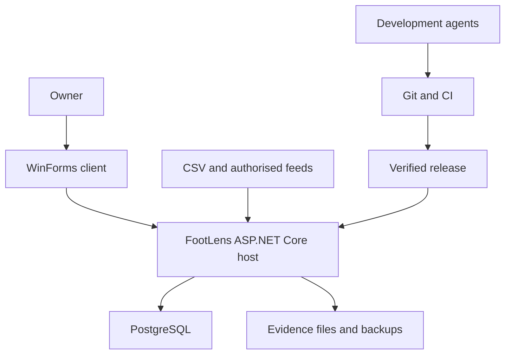
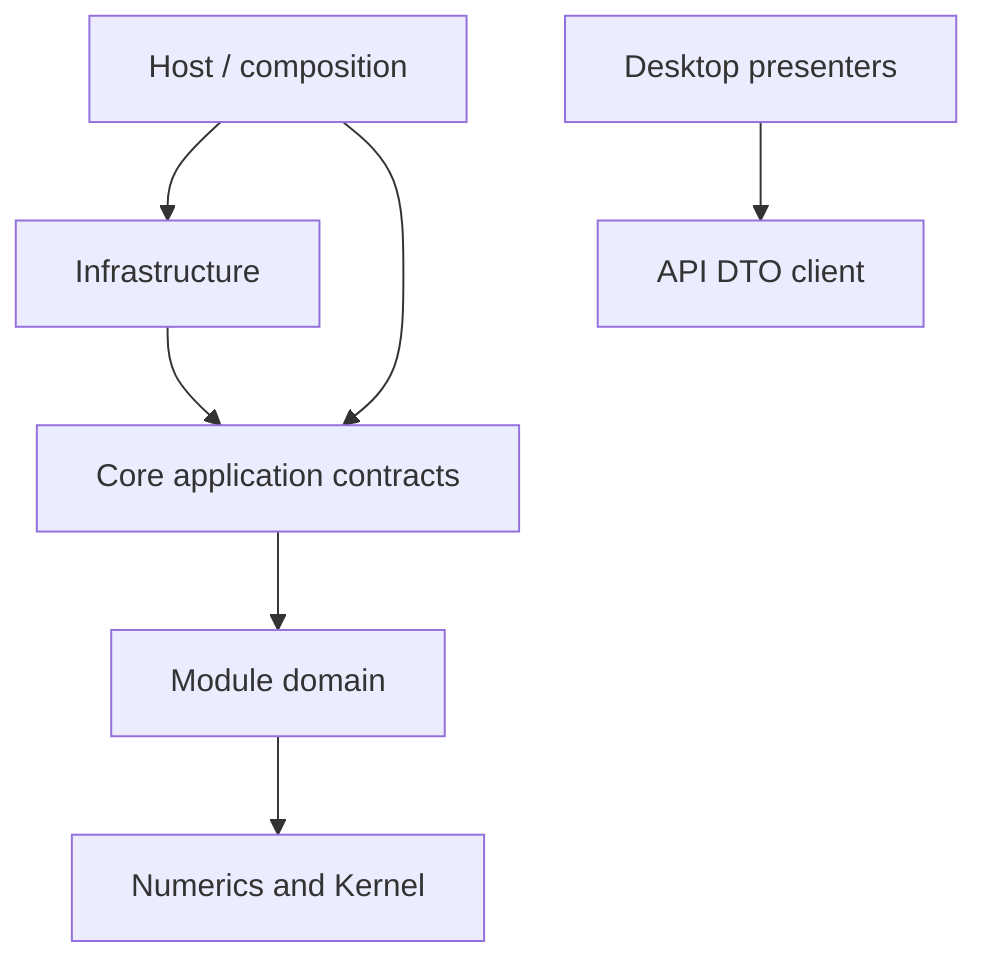
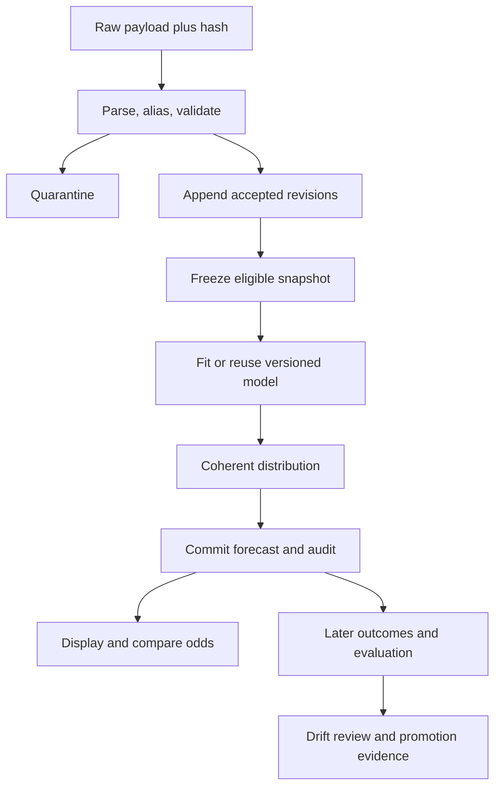
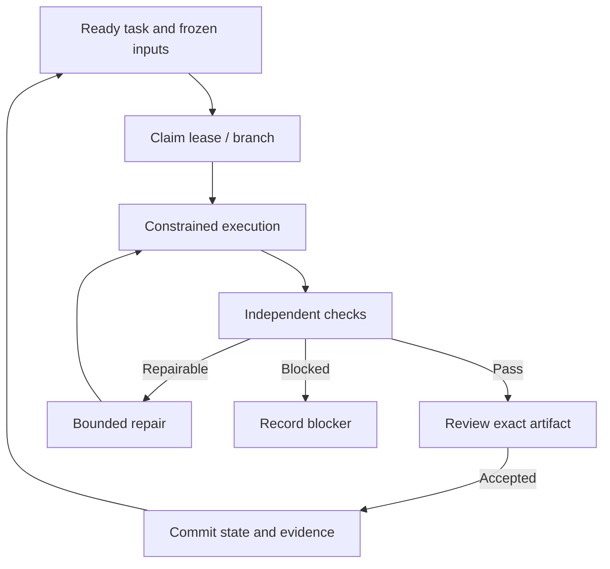

# FootLens architecture

## System context

Personal pre-match analytics, one owner and one modular-monolith deployment. WinForms calls a private API. Source adapters obtain authorised data; the monolith owns modelling, immutable predictions, replay, operations and PostgreSQL. AI agents operate on the repository and isolated test systems during development, not inside the production prediction algorithm.

Bind API and database to loopback by default. A same-machine service can remain running for schedules while the client closes. Homelab-hosted PostgreSQL is an optional private configuration requiring TLS, firewall rules and secret provisioning. No dependency on a public internet tunnel.

## Modular monolith and Clean Architecture

One deployable service, one database, one transaction where appropriate. Modules own schemas and application entry points. Internal synchronous calls use interfaces/immutable DTOs; long work uses durable PostgreSQL jobs. No message broker or service mesh. Avoid generic repository/unit-of-work wrappers over EF: define only business-specific ports needed by pure code. Commands and queries are simple C# handlers; no mandatory mediator or CQRS framework.

Solution projects:

- FootLens.Kernel: small value objects (IDs, UTC instant policy, result/reason types), no module entities.
- FootLens.Numerics: pure numerical functions, no I/O and no extra production packages.
- FootLens.Core: module folders containing Domain, Application and Contracts; BCL-only, no EF/WinForms/HTTP dependencies.
- FootLens.Infrastructure: module-specific EF mappings/stores, connectors, filesystem, clocks and jobs.
- FootLens.Host: ASP.NET endpoints, authentication, composition and hosted workers.
- FootLens.Desktop: WinForms views/presenters and typed HTTP client; no database access.
- FootLens.Tools: CLI for migrations, offline export/verification and operator tasks.
- Tests.Unit, Tests.Integration, Tests.Architecture, Tests.Desktop, Tests.Acceptance and Tests.NumericalOracle.

Folders enforce module boundaries initially. Architecture tests prohibit namespace-level access to another module's Domain/implementation. If this becomes difficult, split that module into assemblies without changing contracts. Shared contracts are deliberately small; do not build one universal entity graph.

Arrows represent compile-time references, not request flow. Desktop uses API DTOs, not Core entity implementations. Infrastructure registration is the only deliberate outward dependency of Host. DB roles enforce immutability; code tests enforce module ownership.

## Major modules

| Module / schema | Owns | Public entry points | Forbidden shortcut |
|---|---|---|---|
| Catalog / catalog | leagues, seasons, teams, fixtures, aliases, market/rules registries | ResolveIdentity, GetFixture, GetMarketContract | Guess ambiguous aliases |
| Ingestion / ingest | batches, raw evidence, DQ, fact revisions, membership snapshots | Import, Validate, CreateAsOfSnapshot | Overwrite an old observation |
| Statistics / stats logical module | team/referee summaries, feature preparation | BuildFeatures, QuerySummary | Read future/current rows for historical replay |
| Modeling / model | fit artifacts, parameter estimates, calibration, model cards | Fit, PredictDistribution, ValidateModel | Promote from training scores |
| Forecasts / forecast | distribution snapshots, derived markets, immutable journal | CreateForecast, Explain, CompareLegacy | Display unsaved output |
| Markets / markets | odds snapshots, value comparison, consistency graph | ImportOdds, Normalize, EvaluateValue | Mix book/time/rules to calculate overround |
| Backtesting / backtest | split plans, replay runs, metrics, paper ledger | RunReplay, SettlePaperPosition, Report | Use final outcomes in bet selection |
| Governance / governance | approvals, readiness, config profiles, audit | ApproveVersion, SetReadiness, QueryAudit | Maker self-approval without recorded owner exception |
| Operations / ops | schedules, jobs, outbox, alerts, health | Enqueue, Retry, Backup, Retain | Claim exactly-once delivery |

Statistics is a read/application module; materialised feature manifests belong to Ingestion. Markets odds tables use markets schema; catalog.market defines contract identity. Backtesting uses frozen module DTOs, not live form state. Cross-schema foreign keys may protect references inside the one database; direct cross-module writes remain forbidden. Reporting projections may join authorised read models, never mutate owners' tables.

## Data flow

Import transactions commit raw metadata, accepted revisions, DQ and an outbox event atomically. Use bounded row chunks for large files; the batch's completion marker controls eligibility, so partial ingestion is never queried as a complete dataset. Forecast creation freezes config, source/mapping revisions and model hash, computes outside the transaction, then checks input versions/readiness and commits journal plus derived outputs and audit in one transaction. Changed dependencies abort/requeue; never silently attach a fresh profile to old output.

## Runtime transaction and concurrency rules

A DbContext is scoped to one command/job step; never share it across threads. Reads default AsNoTracking and explicit projections. Pure numerical work does not hold an open DB transaction. Use PostgreSQL repeatable-read for assembling a bounded snapshot plus explicit revision membership; immutable membership becomes the long-lived replay boundary. EF optimistic concurrency maps version bigint on mutable rows; update includes old version and increments it. Immutable observations/predictions are insert-only for the app role.

Catalog cross-module changes publish an outbox message inside their transaction. Dispatch at least once; consumers insert an inbox deduplication key and effects in a transaction. Retries use original idempotency key. A background job has a lease token/generation; all effect commits validate its current lease within a transaction. Lease expiry alone does not stop an old worker, so fencing is mandatory. External operations need their own idempotency support or recorded reconciliation before retry.

## Loop architecture

Development loops and product runtime loops use the same evidence pattern but different stores. Git task packets track development; PostgreSQL tracks runtime work. Neither is the other’s hidden source of truth.

Every loop contract specifies trigger, automation command, skill instructions, inputs, persistent state, budgets, verifier, permitted connectors, isolation, retry and stop rule. See loops/README.md. L01 plans a slice; L02 implements; L03 verifies/reviews; L04 integrates; L05 ingests; L06 forecasts; L07 settles/evaluates; L08 experiments; L09 releases; L10 maintains. Agents never mark their own output Passed without verifier evidence. A single model in separate sessions is allowed but weaker than an independent reviewer and must be recorded.

## Nonfunctional boundaries

Reference budget: up to 100k historical fixtures and 5m odds rows on a declared 4-core/16GB development host. Warm fixture/journal read p95≤2s, cancellation acknowledged≤2s, common forecast generation≤5s once fitted, bounded-memory CSV processing≤512MB additional memory for a 100MB file. Record actual machine and dataset; these are targets until measured. Default two concurrent CPU jobs, one fit per league/model, 30-minute job ceiling with per-kind overrides, upload limit 100MB and JSON maximum depth 64. Larger work queues with progress rather than blocking UI.

Fault isolation is logical: a worker failure affects its job, not an accepted journal. A DB outage makes new forecasts unavailable; cached journal records may be viewed with an Offline badge. Health liveness does not require DB; readiness does. Backup evidence artifacts and database consistently. No Kubernetes, distributed transactions or external LLM inference in the release runtime.
