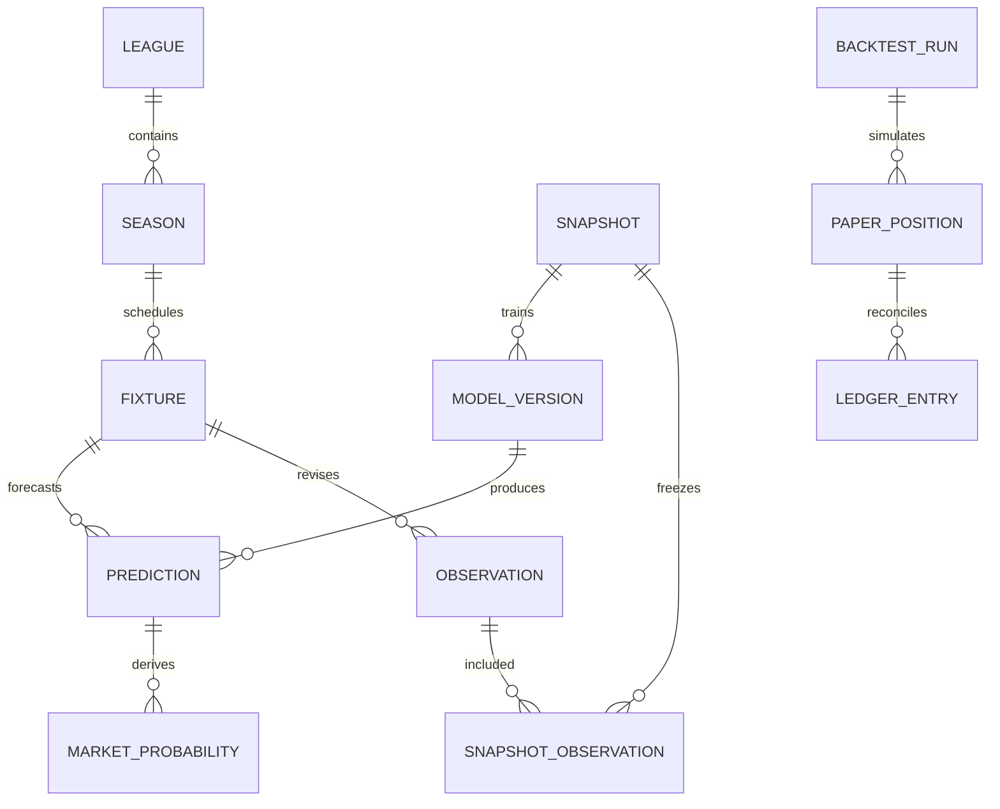

# Data model and EF Core persistence

## Conceptual model

A League has Seasons and participating Teams. A Fixture identifies its competition and participants; ScheduleRevisions capture what kickoff/status was known when. Providers deliver ImportBatches and append ObservationRevisions; aliases map provider identities through reviewed versioned decisions. A DataSnapshot freezes eligible observation membership and all other evidence references. A ModelVersion fits a snapshot; a Prediction binds a target fixture, feature snapshot, model, calibration, config and distribution. MarketProbabilities and OddsGroups are different entities. A BacktestRun replays decisions and writes PaperPositions plus an append-only ledger. Governance approves exact versions; Operations tracks resumable jobs and audit.

## Physical conventions

The executable-looking proposal is reference/schema.sql. It defines PostgreSQL schemas and initial tables; use it as a review contract, then implement equivalent EF migrations. Do not apply both this file and generated initial migrations to the same database. IDs are application-created UUIDs. UTC timestamps use timestamptz; instants serialize with Z. Counts use integer, lines use integer quarter units, money numeric(20,8) plus currency code, odds numeric(18,8), probabilities double precision with explicit finite/range checks. PostgreSQL treats NaN specially; bounds exclude it, and application validation rejects all nonfinite values before persistence. Decimal scale/rounding decisions are part of the contract.

Every table has created_at, created_by and correlation_id. Mutable tables additionally have updated_at, updated_by and version bigint≥1; EF optimistic concurrency checks version and increments in SaveChanges. Append-only tables do not have misleading updated timestamps. All foreign keys default RESTRICT; deletes of referenced evidence fail. No universal soft-delete: active status applies to catalog/config; retention only deletes eligible unreferenced artifacts and derived cache. Corrections append a revision or compensating event.

## Logical tables and ownership

| Schema | Tables | Important natural keys / indexes |
|---|---|---|
| catalog | league, season, team, season_team, fixture, fixture_revision, entity_alias, market, source, bookmaker, referee | league code; season(league,code); fixture(source,external key); aliases(provider,kind,context,normalized,revision); market(family,period,selection,line,rules) |
| ingest | batch, observation, quality_issue, snapshot, snapshot_observation | source+payload+mapping+availability hashes; observation fixture/metric/subject/period available_at descending; snapshot hash |
| model | config_version, model_version, calibration_version | content hash; training cutoff; schema/version metadata |
| forecast | distribution, prediction, market_probability | unique request key; prediction(fixture,as_of); one market result per prediction/contract |
| markets | odds_group, quote | immutable group; book+fixture+captured; selection unique per group |
| backtest | run, fold, position, ledger_entry, metric | run hash; folds run+ordinal; ledger idempotency key; position run/fixture/time |
| governance | approval_event, readiness_event, audit_event | target/version/time; cohort readiness history; correlation/time |
| ops | job, job_attempt, outbox, inbox, schedule, alert | idempotency key; partial pending index; outbox undispatched; inbox consumer/event |

Statistics views and report DTOs are computed reads initially, not duplicate mutable truth. Immutable objects may contain versioned JSONB for fit arrays/distributions/manifests, but core joins and constraints remain relational. Do not store whole aggregates as unvalidated JSON. Store schema version, SHA-256 and application validation result alongside typed payloads. Filesystem artifact path is a relative content-addressed path below the configured root, never a user-supplied absolute traversal.

## Important constraints beyond SQL

SQL protects row identity, referential integrity, ranges, line units and local partitions. Application/transaction verifiers additionally enforce: fixture teams belong to season; observation source definitions/units; SOT≤shots on compatible revisions; first-half≤FT; odds group complete/exhaustive before de-vig; model/calibration training cutoffs; snapshot availability; immutable schema/hash validity; readiness approval binds correct league/market/model; chronological fold boundaries; ledger balance/exposure; job fencing; prediction.fixture_id matches its fixture_revision; prediction model/config/calibration and league match its distribution and snapshot.

Polymorphic references (alias target, audit target, governance artifact target) deliberately use entity-kind plus UUID/hash and a typed resolver rather than unsafe multi-table FKs. The resolver rejects unknown kinds/IDs before insert and deletion is restricted operationally. Evidence manifests enumerate references not represented by a direct FK, so retention must traverse them. Document and test these invariants; SQL alone is insufficient.

## Point-in-time queries

A fact has occurred_at (match event), available_at (earliest evidenced publication), retrieved_at (actual capture), availability_mode (Strict or Assumed) and immutable revision sequence within provider/fixture/metric/subject/period. In Strict mode require non-null available_at and supporting evidence, status Completed and actual finish/publication before cutoff. In Assumed mode the named assumed availability policy determines eligible_at; never backdate retrieved_at as fact. Select latest eligible revision per semantic key using row_number partition and ORDER BY eligible_at DESC, revision DESC, id, filtered BEFORE ranking. Choosing latest current revision then filtering loses earlier valid history.

Snapshots freeze a list of observation IDs and a canonical manifest containing alias IDs, schedule IDs, source precedence, exclusion reasons, eligible-at policy, feature inputs and all hashes. At repeatable-read, build membership, validate and hash, commit snapshot. Forecasts and model versions reference these immutable snapshots. Different ingestion time does not mean historical source availability was proven.

## EF Core mapping and migrations

Use a single FootLensDbContext initially; per-module IEntityTypeConfiguration classes and schemas, internal DbSets accessed only through owning stores. One migration history and migration coordinator avoids multiple contexts racing schema changes. Mapping rules: explicit keys/lengths/types/precision, owned value conversions, no lazy loading, restrict deletes, stable index names. JSON payloads validated before serialization; preserve numeric deterministic canonical form for hashing outside provider serialization.

Read projections use AsNoTracking, keyset pagination by timestamp+ID, bounded ranges and CancellationToken. Query tests run on actual PostgreSQL, not EF InMemory or SQLite. For material bulk import use bounded EF batches initially; Npgsql COPY is a later measured optimization with the same transaction/DQ contract. Snapshot isolation, SQL enums/checks, JSON and SKIP LOCKED behaviour need provider integration tests.

One DbContext per request/job step; dispose after scope. Explicit transaction covers journal/outbox/audit. Parallel numerical work gets no shared context. version bigint is a normal concurrency token with interceptor increment; do not confuse it with immutable observation revision. Handle DbUpdateConcurrencyException as409 or retry-safe job conflict. Unique idempotency violations resolve to the existing same-hash request, or409 if payload hash differs.

Migration authoring is serialized even when slices use separate worktrees. Add migration, inspect generated SQL, run fresh DB and N-1 upgrade tests, compare constraints to this proposal, generate deployment bundle, capture rollback/restore path. Runtime service has no DDL rights and never invokes automatic production Migrate at startup. Large indexes use a reviewed non-transactional migration where required; include cancellation/recovery procedure. Any cross-schema dependency change needs affected owner tests.

## Index and retention strategy

Initial hot indexes: observations(fixture,metric,subject,period,available_at DESC); fixture revisions(fixture,known_at DESC); predictions(fixture,as_of DESC); odds(book,fixture,captured_at DESC); jobs(next_attempt_at,created_at) WHERE status IN Pending/Retry; undispatched outbox(created_at); audit(correlation_id,created_at). Add BRIN/partitioning only from plans/size evidence. Do not partition prematurely or create every possible composite index.

Retain approved models/configs, predictions, settlements, referenced raw evidence and audit by default. Unreferenced rejected staging bytes30 days; successful job diagnostic logs90 days; unreferenced derived caches30 days; preserve hashes and deletion receipts. Licence-imposed deletion overrides retention, records dependent evidence as unavailable, and quarantines reproducibility claims. Backup rotation and restore drills are in OPERATIONS.
