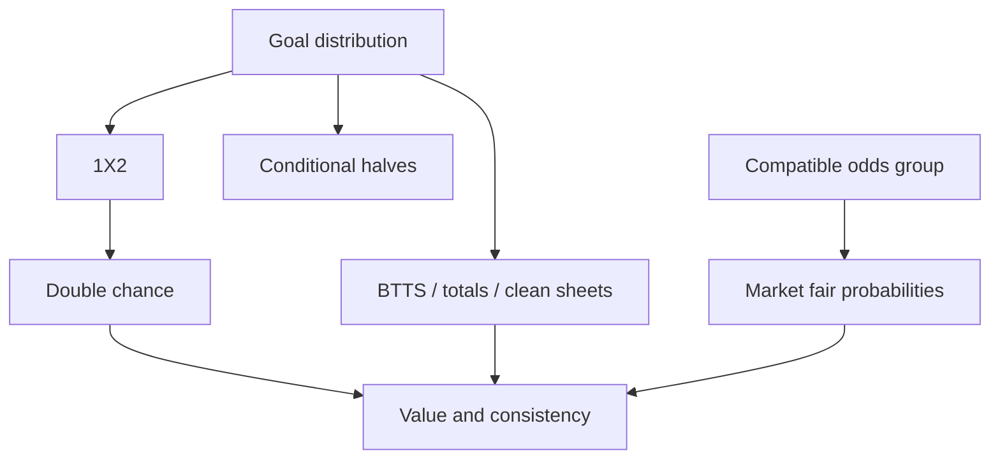

# Market dependency graph

The graph contains deterministic derivations and validation relationships; it is not a causal model and does not imply independence. Every node has key, version, inputs, family, evaluator, numerical budget, output kind and invariant set. Edges are typed DerivesFrom, RequiresCoverage, SharesSnapshot or ValidatesAgainst. Only DerivesFrom participates in topological execution; validation edges may be bidirectional without creating an evaluation cycle.

Shots joint→SOT marginal and shots totals; corners joint→team/total ladders; yellow-card joint→card ladders. Goals→HT/FT only through a versioned period allocator. Do not add BTTS→goals causal edges or use the graph to fit a downstream probability independently.

Algorithm: validate unique node IDs and known inputs; Kahn topological sort with ordinal stable ordering; if visited count differs from graph size, return GraphCycle with a witness path; execute each node once against frozen inputs; propagate Unavailable with root reason; run invariants after required nodes complete; commit only coherent results. Cache key=hash(nodeVersion, ordered input hashes, market key, config/calibration versions, availability mode). Never reuse across fixture cutoff or mapping changes. Invalidation walks reverse derivation edges; preserve old immutable cache objects referenced by forecasts.

Example: odds timestamp changes invalidates fair odds and value, not the goal distribution. Calibration changes invalidates 1X2, BTTS, totals and value. Missing period data invalidates half nodes, not FT. Alias correction creates a new data snapshot and affects every downstream fit using that mapping, without modifying old forecasts.

Tests MG01 topological order stable; MG02 cycle rejected; MG03 one recompute on shared dependency; MG04 failure propagation scope; MG05 cache includes complete identity; MG06 double-chance sums; MG07 market disagreement classified soft; MG08 API cannot assemble outputs from two DistributionIds. A dependency change must include these tests and an updated graph fixture before merge.
