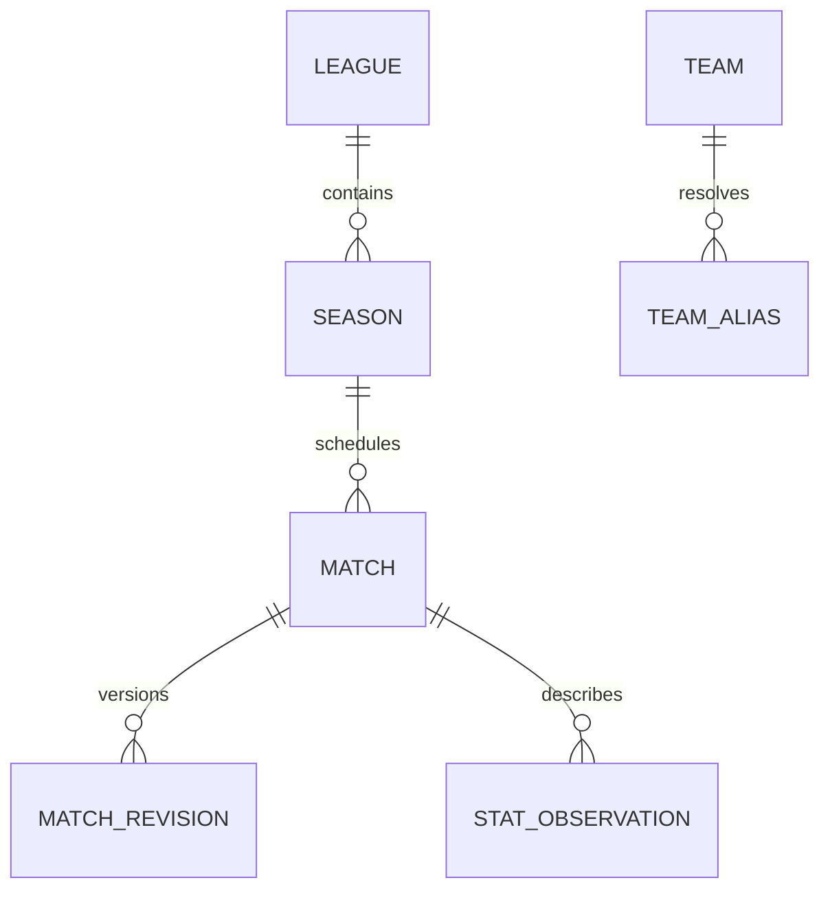
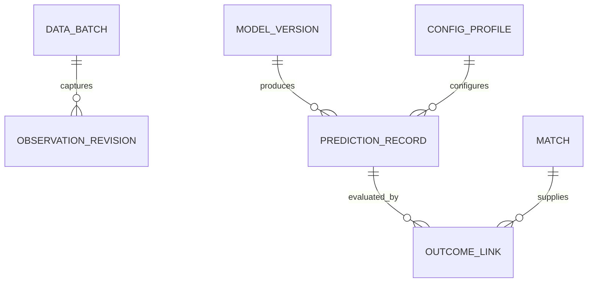
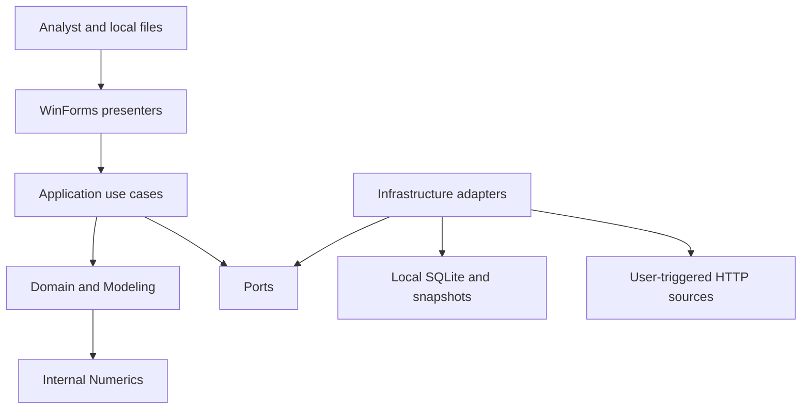
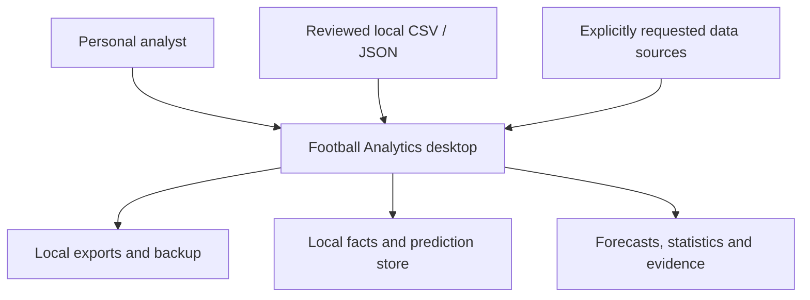
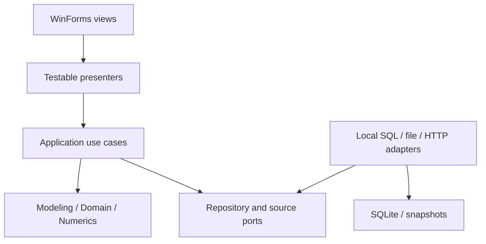
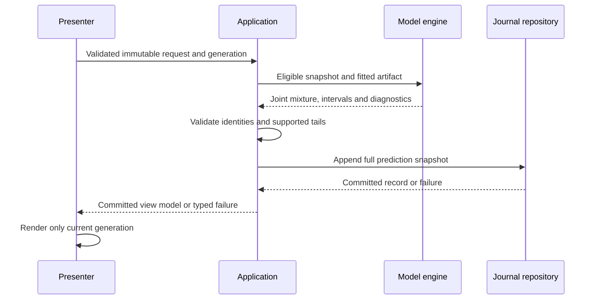
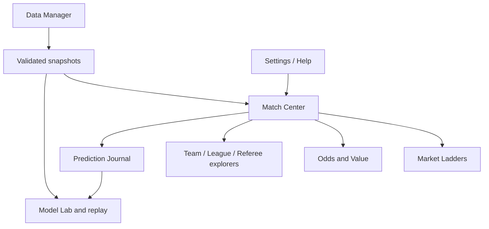
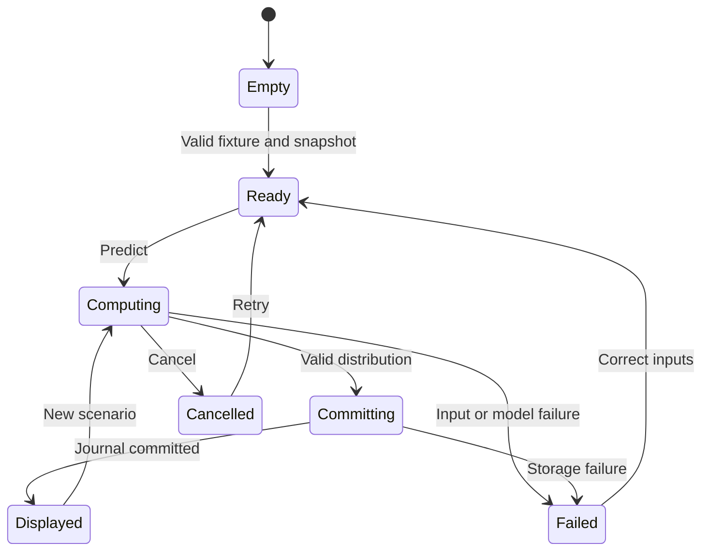

# FootLens — Software Architecture and Detailed Design

**Purpose:** Define a comprehensive, reviewable architecture and detailed software-development design derived from the supplied brief and legacy workbooks.  
**Audience:** Product owner, C# developers, statistical-model maintainers, UX designers and coding agents.  
**Status:** P0 design proposal; implementation and empirical validation not started.  
**Version:** 0.1.0  
**Owner:** Project documentation owner; product owner approves decisions.  
**Last updated:** 2026-09-30  
**Related documents:** The supporting archive includes the authoritative per-topic docs, machine fixtures, source assessment, original brief and agent prompts.

## Design overview

A personal Windows11 x64 application in C#/WinForms, supporting multiple leagues, replaces the spreadsheet Dashboard with eleven focused workspaces. A modular monolith uses ports/adapters and testable presenters. Own numerical/model/settlement/replay code runs locally; additional packages are narrow open-source exceptions requiring exact graph/source/licence evidence. The only initial candidates are SQLite/provider and a development test runner. No remote inference or automatic bet placement is designed.

The baseline preserves documented Tier0 calculations for regression; the proposed Tier1 uses time-decayed DC goals, NB secondary counts, SOT thinning, coherent period allocation, joint adjustment/calibration and parameter uncertainty. Improvement is a hypothesis until preregistered chronological evaluation. Immutable predictions commit before display, and strict known-at availability is distinguished from assumed retrospective replay. The following document specifies behavior, equations, contracts, storage, UX, quality and delivery; planned acceptance criteria are not reported as measured results.

## Contents

1. [Vision and scope](#chapter-1)
2. [Product requirements](#chapter-2)
3. [Glossary](#chapter-3)
4. [Personas and jobs to be done](#chapter-4)
5. [Release plan](#chapter-5)
6. [Domain model](#chapter-6)
7. [Data dictionary](#chapter-7)
8. [Data quality rules](#chapter-8)
9. [Data sources and rights](#chapter-9)
10. [Point-in-time and lineage](#chapter-10)
11. [Statistics and ranking specification](#chapter-11)
12. [Model specification](#chapter-12)
13. [Estimation and fitting](#chapter-13)
14. [Numerical algorithms](#chapter-14)
15. [Calibration and uncertainty](#chapter-15)
16. [Pre-registered evaluation protocol](#chapter-16)
17. [Legacy formula review](#chapter-17)
18. [Tier 0 legacy baseline model card](#chapter-18)
19. [Tier 1 statistical candidate model card](#chapter-19)
20. [Tier 2 planned candidates model card](#chapter-20)
21. [Tier 3 research boundary model card](#chapter-21)
22. [Numerical validation plan](#chapter-22)
23. [Odds, de-vigging and value](#chapter-23)
24. [Per-market decisions](#chapter-24)
25. [Tier extension design](#chapter-25)
26. [Worked mathematical examples](#chapter-26)
27. [Architecture overview](#chapter-27)
28. [Solution structure](#chapter-28)
29. [Ports and contracts](#chapter-29)
30. [Persistence schema](#chapter-30)
31. [Build versus buy](#chapter-31)
32. [Configuration specification](#chapter-32)
33. [Dependency policy](#chapter-33)
34. [Dependency register](#chapter-34)
35. [Deployment and updates](#chapter-35)
36. [Error handling and logging](#chapter-36)
37. [Performance budget](#chapter-37)
38. [Security and privacy](#chapter-38)
39. [ADR-0001: Platform, target and SDK](#chapter-39)
40. [ADR-0002: Internal numerical and statistical stack](#chapter-40)
41. [ADR-0003: One coherent distribution with explicit family assumptions](#chapter-41)
42. [ADR-0004: Conditional period allocation](#chapter-42)
43. [ADR-0005: Coherent adjustment and calibration](#chapter-43)
44. [ADR-0006: Legacy fidelity and deliberate departures](#chapter-44)
45. [ADR-0007: Temporal revisions and immutable predictions](#chapter-45)
46. [ADR-0008: SQLite persistence exception](#chapter-46)
47. [ADR-0009: Minimal test framework exception](#chapter-47)
48. [ADR-0010: Multiple league release and culture boundaries](#chapter-48)
49. [ADR-0011: Modern WinForms without a toolkit](#chapter-49)
50. [ADR-0012: Private release packaging and updates](#chapter-50)
51. [ADR-0013 — Journal persistence before UI](#chapter-51)
52. [ADR-0014 — Formula audit clarification](#chapter-52)
53. [Information architecture and navigation](#chapter-53)
54. [Screen wireframes and behavior](#chapter-54)
55. [Accessibility checklist](#chapter-55)
56. [Component catalogue](#chapter-56)
57. [Design tokens](#chapter-57)
58. [Interaction specifications](#chapter-58)
59. [UX personas](#chapter-59)
60. [Empty, loading and error states](#chapter-60)
61. [Usability test script](#chapter-61)
62. [Code standards](#chapter-62)
63. [Definition of Done](#chapter-63)
64. [Dependency audit](#chapter-64)
65. [Test catalogue](#chapter-65)
66. [Test strategy](#chapter-66)
67. [Golden values and parity contract](#chapter-67)
68. [Known legacy defects and exceptions](#chapter-68)
69. [Legacy behavior baseline](#chapter-69)
70. [Complete legacy source glossary](#chapter-70)
71. [Sheet and formula migration map](#chapter-71)
72. [Backlog](#chapter-72)
73. [Open questions and assumptions](#chapter-73)
74. [Progress log](#chapter-74)
75. [Risk register](#chapter-75)
76. [Roadmap and milestones](#chapter-76)
77. [Working agreement](#chapter-77)
78. [Session checklist](#chapter-78)
79. [References and evidence](#chapter-79)
80. [P0 review report](#chapter-80)


<a id="chapter-1"></a>

## 1. Vision and scope

### Product outcome

Replace the spreadsheet Dashboard with a local desktop workspace that makes historical statistics, model predictions and verification understandable and reproducible. Preserve a clearly labelled legacy baseline. Proposed statistical changes are hypotheses until the pre-registered evaluation succeeds.

### Confirmed choices

| Choice | Decision | Evidence |
|---|---|---|
| Distribution | Personal use | User response in this session |
| Operating system | Windows 11 x64 | User response in this session |
| Competition scope | Multiple leagues in v1.0 | User response in this session |
| Language/UI | C# / Windows Forms | Supplied master prompt |
| Execution | Local, offline after import; no remote inference | Supplied master prompt |
| Dependencies | Own code first; open-source exceptions only | Supplied master prompt section 5 |

The multi-league release must import, filter, fit, predict, replay and evaluate at least two leagues independently. The proposed validation pair is England Premier League and Championship; this pair is an assumption, not a further confirmed user preference. A registry and source mappings support additional leagues without hard-coded team lists. Each league has an eligibility/coverage report. No league is advertised as validated merely because its CSV imports successfully.

### v1.0 scope

Eleven modules: Match Center, Team Explorer, League Tables, Referee Explorer, Market Ladders, Odds and Value Lab, Model Lab, Prediction Journal, Data Manager, Settings/Assumption Profiles, Help/Glossary. Goals, 1X2, double chance, BTTS, correct scores, Asian totals/handicap settlement, shots, SOT, corners, yellow cards, fouls, offsides and half markets have explicit contracts. An unavailable market remains visible with its reason and any disclosed league-prior fallback; absence of source coverage does not become a fabricated estimate.

Tier 0 is legacy comparison; Tier 1 is the release candidate. Tier 2 has selectable extension contracts and disabled, clearly labelled research entries; no unimplemented Tier 2 model is runnable. Tier 3 is interface design only. Tier 1 becomes the default only after P5 promotion criteria pass. Otherwise keep the validated default and identify the candidate as experimental; do not weaken the criterion.

Out of scope: live in-play predictions, automatic betting, cloud sync, multi-user authentication, mobile UI and a Bayesian inference sidecar. Staking is optional, disabled and absent from the mandatory v1.0 critical path. Public distribution is not planned; licences and notices still constrain dependency use and any later sharing.

### Success and exclusions

A user can select a fixture, see each number's type and sample size, inspect its calculation, save an immutable record and compare subsequent outcomes without data from the future. Numerical correctness and reproducibility precede attractive UI. No profit promise, no claimed model improvement from the legacy stored BackTest snapshots, and no claim that all market families have empirically learned dependence.


<a id="chapter-2"></a>

## 2. Product requirements

### Requirement contract

Requirement IDs stay stable. Must items are release gates, not promises that every source already supplies the required fields. A source-dependent market needs a valid, disclosed fallback or an honest unavailable state. Multi-league validation requires at least two independent league reports. Proposed defaults below are not measured evidence.

| ID | Requirement | MoSCoW | Phase | Acceptance criterion | Test |
|---|---|---|---|---|
| REQ-001 | Multi-league fixture selection | Must | P2/P6 | Select league, season, home/away teams and kickoff; prevent equal teams and cross-league fixtures; demonstrate two independent league pipelines. | TEST-001 |
| REQ-002 | Bounded CSV import and mapping | Must | P2 | Quoted CSV with embedded newlines, UTF-8 BOM and declared dialect streams within configured limits; failed rows receive source line/field diagnostics. | TEST-002 |
| REQ-003 | Canonical identity and alias queue | Must | P2 | Resolve exact reviewed aliases; ambiguous identities are quarantined; no fuzzy auto-merge. | TEST-003 |
| REQ-004 | Point-in-time eligibility | Must | P2/P5 | Future outcome or availability changes do not affect a prediction at the same as-of timestamp; strict and assumed-availability modes are separate. | TEST-004 |
| REQ-005 | Data quality and lineage | Must | P2 | Invalid counts, conflicting revisions and unresolved aliases cannot enter affected fits; every observation identifies source, batch and availability provenance. | TEST-005 |
| REQ-006 | Statistics and rankings | Must | P7 | Totals count each fixture once; perspective views yield symmetric team data; summaries show sample sizes and missing coverage. | TEST-006 |
| REQ-007 | Legacy parity engine | Must | P3 | Supported pure golden functions pass declared tolerances; snapshot-only examples stay pending until their inputs exist. | TEST-007 |
| REQ-008 | Dixon–Coles goal model | Must | P4 | Penalised time-decayed fit reports convergence and positivity diagnostics; feasible score matrix normalises with certified tail error. | TEST-008 |
| REQ-009 | NB secondary markets | Must | P4 | Fit league-specific shot/corner/card/foul/offside models with shape diagnostics; Poisson or league-prior fallback is named in output. | TEST-009 |
| REQ-010 | SOT thinning | Must | P4 | Every atomic shot/SOT state has 0≤SOT≤shots; marginal SOT mean equals shot mean times accuracy at fixed parameters. | TEST-010 |
| REQ-011 | Shared probability distribution | Must | P4 | Within a model snapshot every market query uses the same immutable joint-family distribution; identities, complements and monotone ladders pass. | TEST-011 |
| REQ-012 | Adaptive tails and count summaries | Must | P4 | Expose omitted mass/bounds and mean, mode, median, P10/P50/P90; reject truncation beyond supported capacity. | TEST-012 |
| REQ-013 | Market settlement | Must | P4 | Whole, half and quarter lines produce exhaustive win/half-win/push/half-loss/loss partitions and unit-stake return calculations. | TEST-013 |
| REQ-014 | Coherent half markets | Must | P4 | Sum over the joint period allocation reproduces FT; unknown shares use an explicit prior or Unavailable; never assume marginal-half independence under DC. | TEST-014 |
| REQ-015 | Coherent shrinkage and calibration | Must | P4/P5 | Joint-level adjustment preserves all identities; binary calibration cannot independently overwrite displayed event probabilities. | TEST-015 |
| REQ-016 | Parameter uncertainty | Must | P4 | Reproducible Laplace/blocked-bootstrap parameter draws produce predictive mixtures and labelled intervals; singular fits report a fallback. | TEST-016 |
| REQ-017 | Context and referee assumptions | Must | P4/P6 | Profile versions identify provenance; referee effects are penalised; unvalidated context offsets have a badge and sensitivity view. | TEST-017 |
| REQ-018 | Odds normalisation | Must | P8 | Exclusive sets support proportional, power, odds-ratio and feasible Shin methods; overlapping double chance is derived from 1X2. | TEST-018 |
| REQ-019 | EV, edge and CLV | Must | P8 | Use one sign convention and settlement-aware return; CLV requires the same market/line and declared closing evidence. | TEST-019 |
| REQ-020 | Immutable prediction journal | Must | P8 | Persist a complete snapshot before numerical presentation; update/delete attempts on prediction facts fail; outcomes are later linked separately. | TEST-020 |
| REQ-021 | Walk-forward evaluation | Must | P5 | Freeze splits, eligible outcomes and tuning grids before test evaluation; report paired comparisons and insufficient-evidence states. | TEST-021 |
| REQ-022 | Model Lab and model cards | Must | P9 | Replay a recorded run with the same hashes; show data coverage, calibration, scores, PIT diagnostics and promotion status. | TEST-022 |
| REQ-023 | Match Center explanation | Must | P6 | Each headline opens inputs, formulas, source samples and fallbacks; rate decomposition is labelled, not a causal explanation. | TEST-023 |
| REQ-024 | Number-type badges | Must | P6 | OBS/SUM/EXP/PROB/FREQ/ADJ/VER/RULE appear with definitions; a percentage cannot silently change category. | TEST-024 |
| REQ-025 | Asynchronous responsive UI | Must | P6 | Import/fit/export have cancellation and progress; stale requests cannot overwrite a newer fixture; no blocking I/O on UI thread. | TEST-025 |
| REQ-026 | Accessible modern WinForms | Must | P6/P10 | Keyboard workflows and numeric chart alternatives work at 100/125/150/200% DPI; light/dark themes retain focus and readable contrast. | TEST-026 |
| REQ-027 | Localisation | Must | P6/P10 | Every UI string has en-US and pt-BR resources; decimal odds/counts persist invariantly and display culture-aware. | TEST-027 |
| REQ-028 | Backup, restore and export | Must | P2/P10 | Transactional consistent backup restores into a separate verified store before activation; CSV/JSON exports include provenance and versions. | TEST-028 |
| REQ-029 | Own-code dependency controls | Must | P1/P10 | Zero additional production packages in Domain/Numerics/Modeling/Application; resolved graph and native assets match the approved allowlist. | TEST-029 |
| REQ-030 | Numerical validation | Must | P4 | Published/analytic/independent fixtures, gradient checks, limits, tails and non-convergence tests meet the specified accuracy domain. | TEST-030 |
| REQ-031 | Performance and diagnostics | Must | P6/P10 | Measure fixture latency, fit time, allocations and responsiveness on the declared reference machine; export a redacted support bundle. | TEST-031 |
| REQ-032 | Deployment and manual updates | Must | P10 | Publish a signed personal Windows x64 release, test clean installation, offline use, migration rollback and third-party notices. | TEST-032 |
| REQ-033 | Rule signals | Must | P6 | Versioned probability/interval thresholds create labelled rule signals; no accuracy or profit implication. | TEST-033 |
| REQ-034 | Traceability and agent workflow | Must | P0/P1 | Every source formula family has a proposed disposition; every requirement links to a test/story; phase transitions wait for user approval. | TEST-034 |
| REQ-035 | Tier 2 extension contracts | Should | v1.x | Interfaces and model-card skeletons exist; unimplemented models stay disabled until evaluation and their own gate. | TEST-035 |
| REQ-036 | Optional bounded staking | Could | v1.x | Disabled by default; separate exposure limits and settlement-aware Kelly documentation; no bet placement. | TEST-036 |
| REQ-037 | Privacy and release integrity | Must | P1/P10 | No telemetry or runtime licence calls; validate source URLs/archives; no secrets or private paths in exported diagnostics. | TEST-037 |
| REQ-038 | Explicit failure states | Must | P2/P4/P6 | Unavailable and Fallback carry stable reasons and affected scope; n=0 never displays 0% as evidence. | TEST-038 |

### User journeys

1. Import reviewed CSV → inspect DQ/aliases → select eligible model/data snapshot → choose fixture → inspect an immutable prediction → export its explanation.
2. Switch league → statistics and fitting change to that league; no cross-league team statistics leak into its table. An unvalidated league is clearly labelled.
3. Replay a prediction timestamp → inspect only observations available under the selected provenance mode → compare the frozen forecast with the later result.
4. Enter exact market prices → choose de-vig method → inspect fair probability, edge and settlement-aware EV → record a price observation, without sending a bet.

### Nonfunctional acceptance

See performance-budget, security-and-privacy and numerical-algorithms for quantitative contracts. Numerical contracts are checked before promotion; performance numbers are targets until P10 evidence exists. Private release still requires native dependency notices and a recorded signing/trust procedure. No machine-learning package, cloud service or broad framework is a default requirement.


<a id="chapter-3"></a>

## 3. Glossary

### Display taxonomy

| Badge | Definition | Example |
|---|---|---|
| OBS | A recorded observation, with source and availability | A completed score |
| SUM | Summary of a defined historical sample | Median shots; n=37 |
| EXP | Expected count under a named model | 1.12 home goals |
| PROB | Probability from the unadjusted predictive distribution | P(home goals≥1) |
| FREQ | Observed event frequency | 4/5; not a calibrated probability |
| ADJ | Probability from an adjusted/calibrated joint distribution | Same event queried after calibration |
| VER | Outcome-based historical evaluation | Hit rate with n and interval |
| RULE | Configured deterministic classification | Strong; not a fitted likelihood |

### Legacy and mathematical vocabulary

FT/1H/2H mean full/first/second half; SOT is shots on target; BTTS is both teams score. 1/X/2 are home/draw/away; 1X/X2/12 are derived double chance. WGS/WGC are weighted goals scored/conceded; FSF/CSF complement failure-to-score/clean-sheet frequencies. WST/WSC are weighted shots taken/conceded; SSF is rank-based shot strength; ASTA is recent accuracy. WCT/WCC are corners for/against; WYC/WYCO are yellow-card inputs; RFC is referee factor; WFO/WFOO and WOS/WOSO are foul/offside input pairs. MIF/MWF/KPF/TMF are importance/weather/player-availability/motivation assumptions. DP/NB mean legacy dispersion/probability parameters. Forecast xG is a count mean; provider xG is a separately sourced observation.

Joint distribution: probabilities of atomic compatible outcome states. Marginal: sum over other state variables. Tail bound: certified omitted probability, not an error bar on parameters. Calibration: out-of-sample correction of predictive probabilities. Shrinkage: partial movement toward a prior/baseline; does not automatically imply an independent Bayesian update. Laplace interval: approximate posterior parameter-probability interval under the stated ridge prior. Prediction interval: variation in future counts, distinct from uncertainty about a probability. Confidence interval: frequentist procedure; do not label it credible without a posterior construction. Overround excess is Σ(1/odds)−1; legacy sometimes labels the sum itself overround.

AsOfUtc is the information cutoff. KickoffUtc is a fixture schedule fact with revision provenance. KnownAtUtc is documented source availability; RetrievedAtUtc is when this application captured the source, and cannot prove earlier availability. Strict replay excludes unknown availability. Assumed-availability replay is explicitly retrospective and cannot be called proven leak-free.

An atomic settlement can be Win, HalfWin, Push, HalfLoss or Loss. Unit-stake net return differs from probability of winning. Edge is model minus fair-market probability; positive edge favours the model's event estimate. Legacy ValueScore has the opposite sign.

The complete original source glossary is retained in `legacy-source-glossary.md`; normalisation moves bookmaker-wide columns into OddsSnapshot records rather than discarding their original headers.


<a id="chapter-4"></a>

## 4. Personas and jobs to be done

| Persona | Job | Success | Main risk |
|---|---|---|---|
| Personal pre-match analyst | Assess a fixture across several markets before deciding whether a price merits attention | One timestamped forecast, inputs, uncertainty and price comparison are inspectable | Confusing an expected count or historical accuracy with a probability |
| Model investigator | Reproduce and compare a model change on frozen chronological cohorts | Same snapshot hashes reproduce a run; paired scores and sample limits are visible | Tuning on the test period |
| Data steward (same person) | Import, reconcile aliases and correct provider records | Every correction appends a revision; quality problems have field-level reasons | Silently changing historical information |
| Maintainer (human or coding agent) | Implement one bounded slice without hidden spreadsheet dependencies | Contracts, tests, configuration and decisions agree | Adding unreviewed packages or inventing missing inputs |

The analyst's primary sequence is import → resolve issues → choose fixture and as-of time → inspect predictions → explain a number → compare prices → retain the immutable record. The investigative sequence is select frozen protocol → run → inspect calibration and paired score differences → propose promotion. Neither sequence places a bet.


<a id="chapter-5"></a>

## 5. Release plan

v1.0 is a private Windows 11 x64 release, local-first, with Tier 0 legacy comparison and validated Tier 1, all eleven workspaces, en-GB resource, backup/restore, signed packaging and documented rollback. The source adapters and protocol must demonstrate at least two separately reported leagues. EPL and Championship are a proposed validation pair; the dataset decision belongs to P2.

No date is promised before P1/P2 reveal numerical and data effort. Exit criteria are the Must requirements, phase gates, numerical contracts, minimum evidence cohorts, accessibility checks and release audit. Insufficient data does not permit an unsupported claim of model superiority. Tier 0 remains the default until a candidate meets promotion rules; if Tier 1 has not passed required functionality or evaluation, v1 release is blocked or its proposed scope requires an explicit decision.

v1.x candidates are richer period models, bivariate/COM-Poisson goals, xG, ratings/stacking and learned context. Tier 3 is research only. Optional staking is off by default and is not a prerequisite for v1. Live modelling, automatic bet placement, cloud sync, accounts and mobile clients are outside v1.


<a id="chapter-6"></a>

## 6. Domain model

### Entities and boundaries

MOD-001 Ingestion manages SourceDefinition, DataBatch, ObservationRevision, DqIssue and AliasResolution. MOD-002 Statistics reads eligible MatchRevision/MatchStats facts. MOD-003 Legacy preserves documented calculations. MOD-004 Modeling owns fit artifacts and immutable distributions. MOD-005 Markets aggregates distributions and settles lines. MOD-006 Evaluation owns replay runs and scores. MOD-007 Journal owns PredictionRecord and later OutcomeLink. MOD-008 Desktop contains presenters/views, not mathematical rules. MOD-009 Odds owns timestamped prices and fair-market estimates. MOD-010 Settings owns immutable ConfigProfile versions.





### Value types

Use distinct LeagueId/SeasonId/TeamId/MatchId/RefereeId/PredictionId/BatchId types, not interchangeable strings. Count is a nonnegative integer with a metric/unit. ExpectedCount is finite ≥0; Probability is finite in [0,1] with model/distribution provenance; DecimalOdds is finite >1. MarketLine is signed integer quarter-units: +3 means +0.75, never an approximate floating-point line. Period is FT/FirstHalf/SecondHalf. Availability is Available, Fallback(reason,source), Unavailable(reason). Empty samples carry n=0; this is not a probability of zero.

### Temporal and data invariants

- Home and away IDs differ and belong to eligible competition membership at fixture time.
- No current-season/team assumption is encoded in an ID; a promoted team preserves identity and changes season membership.
- Each fixture is stored once. Home/away perspectives are derived; whole-match aggregates never sum both perspectives.
- An observation revision has capture metadata and either documented KnownAtUtc, a declared availability assumption, or Unknown. Never replace Unknown with capture time and then claim historical eligibility.
- SOT cannot exceed shots under the provider's declared same-period definitions. Goals≤SOT is not a universal DQ rule: own goals and provider definitions can violate that inequality.
- Second-half subtraction occurs only for matching definitions and valid FT/1H values with FT≥1H. A missing half is not zero.
- Model/data/config/input hashes identify a complete snapshot. Later source corrections produce new snapshots; existing predictions remain unchanged.
- Journal facts append only. OutcomeLink and notes are separate append-only records. Database triggers enforce application immutability; a user with filesystem/admin access can alter the database, so hashes are integrity diagnostics, not adversarial tamper-proofing.

### Aggregates and transactions

DataBatch import stages rows, DQ issues and aliases, then commits accepted revisions atomically. ModelVersion stores training membership and objective/config. PredictionRecord commits distribution summaries, model state reference, exact request and explanation before numerical display. Backup/restore is a separate transaction boundary. Cross-module orchestration belongs to Application; pure calculations remain in Modeling/Numerics/Domain.

### Authoritative module IDs

| Module | Responsibility | Principal entities/services |
|---|---|---|
| MOD-001 | Ingestion and canonical data | Sources, batch, aliases, revisions, DQ |
| MOD-002 | Statistics | Eligible samples, performance, ranks, referee summaries |
| MOD-003 | Legacy baseline | Exact documented Tier 0 arithmetic and failure adapters |
| MOD-004 | Modeling | Fits, numerical pipeline, lazy joint/mixture and uncertainty |
| MOD-005 | Markets | Event aggregation, exact line settlement and summaries |
| MOD-006 | Evaluation | Temporal replay, frozen runs, proper scores and unverified legacy archive |
| MOD-007 | Journal | Append-only predictions and result links |
| MOD-008 | Desktop | Presenters, views, drawing and navigation |
| MOD-009 | Odds | Quote facts, margin removal, EV/edge/CLV |
| MOD-010 | Settings | Immutable profiles and registry/UI settings |
| MOD-012 | Help | Legacy source glossary and number/equation explanations |

These are logical modules in the single solution, not separate deployable services or necessarily one project each. MOD-011 is unassigned/reserved; do not renumber existing IDs to fill a gap. Repository schema and precise foreign keys are authoritative in persistence-schema; the entity diagram is conceptual.


<a id="chapter-7"></a>

## 7. Data dictionary

### Conventions

Every field in the P0 relational schema is listed below. PK fields are required; other nullability follows constraints. UTC units are microseconds since Unix epoch, numeric odds are decimal, counts are integer-valued even when carried in a shared REAL column. JSON objects have schema versions and validated domain content. Source terms and header mappings are separate from internal field names.

### League

| Field | Storage / logical type | Unit | Nullable | Meaning, source and validation |
|---|---|---|---|---|
| `LeagueId` | TEXT / UUID | none | No | Stable canonical league ID; registry; required UUID |
| `Code` | TEXT | none | No | Internal competition code; registry; nonempty ≤32 |
| `Name` | TEXT | none | No | Display name; registry; nonempty ≤200 |
| `Country` | TEXT | none | No | Country/region code; registry; declared enum |
| `TimeZoneId` | TEXT / UUID | none | No | Windows/IANA mapping key; reviewed source settings; DST-aware |
### Season

| Field | Storage / logical type | Unit | Nullable | Meaning, source and validation |
|---|---|---|---|---|
| `SeasonId` | TEXT / UUID | none | No | Stable ID; registry |
| `LeagueId` | TEXT / UUID | none | No | Owning league; registry |
| `Label` | TEXT | none | No | Display season; source mapping; nonempty |
| `StartUtc` | INTEGER | UTC µs | No | Inclusive nominal season start; registry |
| `EndUtc` | INTEGER | UTC µs | No | Exclusive nominal season end; registry; >StartUtc |
### Team

| Field | Storage / logical type | Unit | Nullable | Meaning, source and validation |
|---|---|---|---|---|
| `TeamId` | TEXT / UUID | none | No | Stable ID; reviewed identity; never reuse |
| `CanonicalName` | TEXT | none | No | Human name; alias review; nonempty |
| `Country` | TEXT | none | No | Team region; reviewed identity |
### TeamAlias

| Field | Storage / logical type | Unit | Nullable | Meaning, source and validation |
|---|---|---|---|---|
| `AliasId` | TEXT / UUID | none | No | Stable alias mapping ID |
| `TeamId` | TEXT / UUID | none | No | Reviewed resolved team |
| `SourceId` | TEXT / UUID | none | No | Source namespace; source registry |
| `LeagueId` | TEXT / UUID | none | No | Scope avoids ambiguous names |
| `Alias` | TEXT | none | No | Exact normalised source spelling; no fuzzy merge |
| `ValidFromUtc` | INTEGER | UTC µs | No | Effective mapping start |
| `ValidToUtc` | INTEGER | UTC µs | Yes | Optional exclusive end; null=open |
| `KnownAtUtc` | INTEGER | UTC µs | No | When mapping was reviewed/known; review event |
| `ReviewNote` | TEXT | none | No | Reason/evidence; no secrets |
### Referee

| Field | Storage / logical type | Unit | Nullable | Meaning, source and validation |
|---|---|---|---|---|
| `RefereeId` | TEXT / UUID | none | No | Stable identity; reviewed mapping |
| `CanonicalName` | TEXT | none | No | Name; source mapping |
### DataBatch

| Field | Storage / logical type | Unit | Nullable | Meaning, source and validation |
|---|---|---|---|---|
| `BatchId` | TEXT / UUID | none | No | Immutable import ID; importer |
| `SourceId` | TEXT / UUID | none | No | Source registry key |
| `RetrievedAtUtc` | INTEGER | UTC µs | No | Actual ingestion time; system clock |
| `RawSha256` | TEXT | none | No | Hash of original input bytes; 64 hex |
| `MappingVersion` | TEXT | none | No | Declared header/dialect/identity map version |
| `DefinitionVersion` | TEXT | none | No | Stat meaning/version; reviewed provider definition |
| `RightsEvidence` | TEXT | none | No | Rights review status/evidence reference; not automatic permission |
| `AvailabilityMode` | TEXT | none | No | StrictKnownAt or AssumedRetrospective |
| `BundleRelativePath` | TEXT | none | No | Content-addressed relative snapshot path; no traversal |
| `Status` | TEXT | none | No | Staged/Committed/Rejected; workflow audit |
### MatchIdentity

| Field | Storage / logical type | Unit | Nullable | Meaning, source and validation |
|---|---|---|---|---|
| `MatchId` | TEXT / UUID | none | No | Canonical fixture identity; reconciliation |
| `LeagueId` | TEXT / UUID | none | No | League partition |
| `SeasonId` | TEXT / UUID | none | No | Season partition |
| `HomeTeamId` | TEXT / UUID | none | No | Home identity |
| `AwayTeamId` | TEXT / UUID | none | No | Away identity; !=HomeTeamId |
### MatchRevision

| Field | Storage / logical type | Unit | Nullable | Meaning, source and validation |
|---|---|---|---|---|
| `RevisionId` | TEXT / UUID | none | No | Append-only fixture revision ID |
| `MatchId` | TEXT / UUID | none | No | Fixture identity |
| `KickoffUtc` | INTEGER | UTC µs | No | Scheduled/actual kickoff at this revision; source timezone conversion |
| `Status` | TEXT | none | No | Scheduled/Postponed/Completed/Abandoned/Cancelled |
| `Matchweek` | INTEGER | none | Yes | Optional positive round; display only |
| `RefereeId` | TEXT / UUID | none | Yes | Optional resolved referee |
| `BatchId` | TEXT / UUID | none | No | Import lineage |
| `SourceRow` | INTEGER | none | No | One-based source logical record number |
| `ObservedAtUtc` | INTEGER | UTC µs | Yes | Optional provider observation timestamp; unknown stays null |
| `KnownAtUtc` | INTEGER | UTC µs | Yes | Evidence-backed availability; null=unknown |
| `AvailabilityBasis` | TEXT | none | No | ProviderTimestamp/ReviewedEvidence/Unknown/AssumedDelay |
| `AssumedKnownAtUtc` | INTEGER | UTC µs | Yes | Retrospective-only assumed availability |
| `RevisionHash` | TEXT | none | No | Canonical hash of revision and provenance |
### StatObservation

| Field | Storage / logical type | Unit | Nullable | Meaning, source and validation |
|---|---|---|---|---|
| `ObservationId` | TEXT / UUID | none | No | Append-only statistic revision ID |
| `MatchId` | TEXT / UUID | none | No | Owning fixture |
| `TeamId` | TEXT / UUID | none | No | Perspective team; must be a fixture participant |
| `Metric` | TEXT | none | No | Goals/Shots/SOT/Corners/Yellows/Reds/Fouls/Offsides/SourceXg plus declared supplementary metric |
| `Period` | TEXT | none | No | FT/1H; 2H derived rather than duplicated |
| `Value` | REAL | metric unit | Yes | Optional nonnegative finite value; counts integral; null=missing |
| `Unit` | TEXT | none | No | Count or expected-goal units; definition dependent |
| `DefinitionVersion` | TEXT | none | No | Provider semantics; cannot mix incompatible definitions |
| `BatchId` | TEXT / UUID | none | No | Raw batch lineage |
| `SourceRow` | INTEGER | none | No | Logical record index |
| `KnownAtUtc` | INTEGER | UTC µs | Yes | Evidence-backed time; null=unknown |
| `AssumedKnownAtUtc` | INTEGER | UTC µs | Yes | Assumed availability isolated from strict mode |
| `RevisionHash` | TEXT | none | No | Canonical observation/provenance hash |
### DataQualityIssue

| Field | Storage / logical type | Unit | Nullable | Meaning, source and validation |
|---|---|---|---|---|
| `IssueId` | TEXT / UUID | none | No | Immutable issue ID |
| `BatchId` | TEXT / UUID | none | No | Owning batch |
| `RuleId` | TEXT / UUID | none | No | Stable DQ rule ID |
| `Severity` | TEXT | none | No | Block/Quarantine/Warning/Info |
| `SourceRow` | INTEGER | none | Yes | Optional row; null=batch issue |
| `Field` | TEXT | none | No | Affected field/scope |
| `Reason` | TEXT | none | No | Safe structured explanation |
| `ResolvedByIssueId` | TEXT / UUID | none | Yes | Optional later resolution record; append resolution rather than editing issue |
### ConfigProfile

| Field | Storage / logical type | Unit | Nullable | Meaning, source and validation |
|---|---|---|---|---|
| `ConfigId` | TEXT / UUID | none | No | Immutable profile version ID |
| `ProfileName` | TEXT | none | No | Display name |
| `SchemaVersion` | TEXT | none | No | Typed config schema |
| `CreatedAtUtc` | INTEGER | UTC µs | No | Version creation time |
| `CanonicalJson` | TEXT | none | No | Invariant ordered config, units and provenance |
| `ConfigHash` | TEXT | none | No | Canonical schema-qualified SHA-256 |
### ModelVersion

| Field | Storage / logical type | Unit | Nullable | Meaning, source and validation |
|---|---|---|---|---|
| `ModelId` | TEXT / UUID | none | No | Immutable fitted artifact ID |
| `ModelKind` | TEXT | none | No | Tier0/Tier1/candidate implementation ID |
| `CodeVersion` | TEXT | none | No | Commit/package-free code version |
| `LeagueId` | TEXT / UUID | none | No | Fit league |
| `TrainingCutoffUtc` | INTEGER | UTC µs | No | As-of cutoff; no future facts |
| `ConfigId` | TEXT / UUID | none | No | Parameter/algorithm config |
| `DataHash` | TEXT | none | No | Ordered eligible revision hash |
| `ArtifactJson` | TEXT | none | No | Parameters/covariance/calibration/algorithm diagnostics |
| `ArtifactHash` | TEXT | none | No | Hash of artifact and provenance |
| `CreatedAtUtc` | INTEGER | UTC µs | No | Actual fit completion time |
### PredictionRecord

| Field | Storage / logical type | Unit | Nullable | Meaning, source and validation |
|---|---|---|---|---|
| `PredictionId` | TEXT / UUID | none | No | Immutable record ID |
| `MatchId` | TEXT / UUID | none | No | Target fixture |
| `ModelId` | TEXT / UUID | none | No | Frozen fitted model |
| `ConfigId` | TEXT / UUID | none | No | Frozen assumption/config version |
| `AsOfUtc` | INTEGER | UTC µs | No | Information cutoff; <target kickoff for pre-match mode |
| `CreatedAtUtc` | INTEGER | UTC µs | No | Commit generation time |
| `DataHash` | TEXT | none | No | Eligible input data hash |
| `DistributionHash` | TEXT | none | No | Joint/calibration/draw artifact hash |
| `SnapshotJson` | TEXT | none | No | Inputs, outputs, number types, intervals, tail, fallbacks, engine version, seeds, availability mode |
| `PreviousRecordHash` | TEXT | none | No | Append chain previous hash or genesis |
| `RecordHash` | TEXT | none | No | Canonical record hash |
### OutcomeLink

| Field | Storage / logical type | Unit | Nullable | Meaning, source and validation |
|---|---|---|---|---|
| `LinkId` | TEXT / UUID | none | No | Append-only evaluation link |
| `PredictionId` | TEXT / UUID | none | No | Frozen prediction |
| `MatchRevisionId` | TEXT / UUID | none | No | Completed result revision |
| `LinkedAtUtc` | INTEGER | UTC µs | No | Actual linking time |
| `OutcomeHash` | TEXT | none | No | Ordered eligible result/stat revisions; outcomes are not rewritten |
| `RulesetVersion` | TEXT | none | No | Settlement/evaluation definitions |
### OddsSnapshot

| Field | Storage / logical type | Unit | Nullable | Meaning, source and validation |
|---|---|---|---|---|
| `OddsId` | TEXT / UUID | none | No | Immutable quote ID |
| `MatchId` | TEXT / UUID | none | No | Target fixture |
| `Bookmaker` | TEXT | none | No | Source bookmaker or declared average/max aggregate |
| `MarketKeyJson` | TEXT | none | No | Family, metric, period, selection, quarter-line, ruleset |
| `DecimalOddsText` | TEXT | decimal odds | No | Invariant decimal >1; exact stored decimal representation |
| `Stage` | TEXT | none | No | Opening/Closing/Observed/Unknown; provider metadata |
| `QuotedAtUtc` | INTEGER | UTC µs | Yes | Provider timestamp; null if unknown |
| `KnownAtUtc` | INTEGER | UTC µs | Yes | Verified availability; null excludes pre-match features in strict mode |
| `RetrievedAtUtc` | INTEGER | UTC µs | No | Actual import time |
| `BatchId` | TEXT / UUID | none | No | Lineage |
| `QuoteHash` | TEXT | none | No | Quote + stage + timestamps + source hash |
### EvaluationRun

| Field | Storage / logical type | Unit | Nullable | Meaning, source and validation |
|---|---|---|---|---|
| `RunId` | TEXT / UUID | none | No | Immutable experiment ID |
| `ProtocolId` | TEXT / UUID | none | No | Frozen protocol version |
| `StartedAtUtc` | INTEGER | UTC µs | No | Actual start |
| `CompletedAtUtc` | INTEGER | UTC µs | Yes | Null while failed/incomplete record is captured |
| `InputHash` | TEXT | none | No | Models, data, cohorts, schedule, environment, config and seeds |
| `ResultJson` | TEXT | none | No | Metrics/null states, intervals, matched sample IDs, failures |
| `ResultHash` | TEXT | none | No | Canonical result hash |
| `Status` | TEXT | none | No | Complete/Cancelled/Failed; never imply partial run success |
### SchemaMigration

| Field | Storage / logical type | Unit | Nullable | Meaning, source and validation |
|---|---|---|---|---|
| `Version` | INTEGER | none | No | Monotone migration number |
| `AppliedAtUtc` | INTEGER | UTC µs | No | Apply time |
| `ScriptHash` | TEXT | none | No | Exact checked-in migration SHA-256 |

### Derived domain objects

A FeatureSnapshot stores ordered eligible revision IDs, window/cutoff, league, definition mappings, config hash and availability mode. IJointDistribution contains lazy family atoms, support/tail bounds, parameter-draw weights and calibration artifact IDs. Neither is a raw match table. CountSummary contains mean/count-mode/median/P10/P90, with a distribution ID. Settlement stores five nonnegative masses summing to one. Statistic stores nullable value, unit, number-type, n, missing count and optional interval; missing is never numeric zero. These objects serialize within versioned artifact JSON and are validated at the boundary.

### Source-header mapping

| Provider fields | Canonical meaning | Important qualification |
|---|---|---|
| Div / Date / Time | League map; kickoff in reviewed league timezone | Missing time is unknown for strict replay; dates alone cannot prove intraday ordering |
| HomeTeam / AwayTeam | Reviewed TeamAlias + MatchIdentity | Match date + home name is not a safe unique identity for all competitions |
| FTHG/FTAG; HTHG/HTAG | Goals for each participant, FT/1H | FTR/HTR are consistency checks; derive from goals |
| HS/AS; HST/AST | Shots and SOT FT | Definition version; SOT≤shots only for compatible counts |
| HC/AC; HY/AY; HR/AR; HF/AF | Corners, cards, fouls FT | Count scope, card rules and abandoned-match treatment recorded |
| Supplementary xG / offsides / halves | SourceXg / Offsides / period facts | Provider/source is not established by an anonymous workbook field |
| B365H/D/A, AvgH/D/A, MaxH/D/A | OddsSnapshot selections | Aggregates are not executable bookmaker prices; opening/closing timestamps may be unknown |
| Closing / AH / O-U fields | Exact market, stage and quarter line | Never mix lines, bookmaker sets or closing quotes into pre-match features without availability evidence |

The full legacy source glossary is preserved separately. New fields may only enter the canonical dictionary with units, definition version, rights/availability provenance and a DQ rule.


<a id="chapter-8"></a>

## 8. Data quality rules

| Rule | Severity | Predicate and action | Requirement / test |
|---|---|---|---|
| DQ-001 | Fatal batch | Undeclared/ambiguous schema or encoding; reject activation | REQ-002 / TEST-002 |
| DQ-002 | Quarantine fixture | Team unresolved/ambiguous, equal IDs or season membership mismatch | REQ-003 / TEST-003 |
| DQ-003 | Quarantine observation | Negative, fractional or nonfinite event count | REQ-005 / TEST-005 |
| DQ-004 | Quarantine metric | Same-period SOT>shots under compatible provider definitions | REQ-010 / TEST-005 |
| DQ-005 | Unavailable 2H | Missing FT/1H, incompatible definitions or FT<1H; never zero-fill | REQ-014 / TEST-014 |
| DQ-006 | Quarantine revision | Conflicting same-source/version fixture result; require explicit correction/precedence | REQ-005 / TEST-005 |
| DQ-007 | Eligibility block | Result not completed or source availability after cutoff | REQ-004 / TEST-004 |
| DQ-008 | Strict replay block | Kickoff/availability unknown or ambiguity at DST transition | REQ-004 / TEST-004 |
| DQ-009 | Quarantine price | Decimal odds≤1, nonfinite, unknown market/line/period, inconsistent exclusive set | REQ-018 / TEST-018 |
| DQ-010 | Warning/exclusion | Low per-metric coverage; show denominator and exclude only affected model/period | REQ-038 / TEST-038 |
| DQ-011 | Quarantine source xG | Negative/nonfinite or source definition missing | REQ-005 / TEST-005 |
| DQ-012 | Cold start | Fewer than five eligible team matches; league-prior fallback, widened uncertainty | REQ-009 / TEST-009 |

No universal goals≤SOT rule is applied. No automatic cap hides a valid high count. Unusual counts generate review warnings with source-specific thresholds, not automatic deletions. Red/yellow-card conventions (including second yellows) and extra-time/stoppage definitions must be source metadata; comparisons across definitions are blocked.

Import preview shows totals accepted/quarantined/warning/unresolved, each source line and field, proposed aliases, and impacted markets. A batch can activate unaffected valid observations while keeping excluded rows and their raw payloads. DQ issues are immutable facts; resolutions append a status event and reviewed correction. A model fit records its exclusion list and per-metric eligible counts.

Unknown team aliases require human confirmation in Data Manager; suggestions are advisory. A validated alias stores source, normalised input, league context, canonical team ID, reviewer and decision time. Sorting/team spelling differences must never silently attach to another team's history.


<a id="chapter-9"></a>

## 9. Data sources and rights

### Supplied evidence

The linked Drive folder was listed read-only in P0 and contains the main 33-tab workbook, RawData, BackTest and Glossary.xlsx. The supplied assessment is unchanged and retained with its SHA-256. Its narrative sections 1–26 were read; the 620 Expected entries and other formula appendices are targeted evidence, not desired product requirements. Existing workbook data are accessible, but P0 has not produced a complete immutable multi-season raw export or re-executed the workbook.

### Adapter register

| Source | Planned adapter / coverage | Rights and availability status | Owner / resolution |
|---|---|---|---|
| User's legacy Drive workbooks | Manual CSV/JSON snapshot; results/statistics/odds and supplementary fields | User supplied for this task; redistribution rights and original observation availability not established | Data owner / P2 |
| football-data.co.uk CSV | Explicit CSV schema mappings by country/league/season; results, common match statistics and odds vary by file | Official page describes freely downloadable data; that is not an open-data licence. Terms and field notes must be archived before automatic refresh or redistribution | Data owner / P2 |
| Supplementary xG/half statistics | Manual import with SourceDefinition and provider-specific metric definitions | Provider not chosen; no scraping or proprietary SDK assumed. Automated adapter remains disabled | Data owner / P2 |
| Manual local CSV | Canonical or mapped schema, source identity and capture metadata required | User asserts lawful possession; importer does not invent earlier availability | Data owner / P2 |

Official football-data pages were inspected on 2026-09-30. Refresh cadence and file semantics must be recorded per source when the adapter is admitted; public availability alone does not authorise scraping or sublicensing. No source authentication token, cloud inference service or proprietary SDK is required by this design.

### SourceDefinition admission

Record exact URL or local file identity; licence/terms evidence date and text/hash; allowed personal use; redistribution restrictions; refresh trigger/cadence; supported leagues/seasons; headers and encodings; timestamp and timezone rules; opening/closing semantics; stat-period definitions; correction policy; known missing fields; maximum payload; and contact/removal procedure. Unknown rights block automated acquisition; unknown metric definition blocks that metric.

The first proposed validation leagues are EPL and Championship; the second league has not been supplied or verified in this folder. Additional leagues may be imported but remain experimental until coverage and evaluation gates pass. Source licences do not become application component licences; the two registers stay separate.


<a id="chapter-10"></a>

## 10. Point-in-time and lineage

### Eligibility contract

Strict eligibility at cutoff t requires scheduled KickoffUtc<t, status Completed, result/stat revision KnownAtUtc≤t, and all covariate/alias/config evidence available under the selected revision policy. Use the latest eligible revision, never the latest current revision. An odds snapshot is a predictor only if its availability≤t; closing prices can still be a later benchmark with an explicit role.

RetrievedAtUtc records application capture and is never substituted for unknown historical KnownAtUtc. A retrospective dataset may contain only dates/current corrected results. Such data cannot prove strict historical availability. `AvailabilityMode.AssumedRetrospective` accepts only declared assumptions, for example availability no earlier than kickoff+24 hours with recorded source caveats; this is a conservative modelling assumption, not a fact. The actual delay is source-specific and must be reviewed in P2. Late corrections remain excluded until their separate known/assumed timestamp.

### Snapshot algorithm

1. Freeze league/fixture/as-of/config and availability mode.
2. Select schedule and membership revisions eligible at as-of.
3. Select each source's latest eligible observation revision with recorded precedence; an unresolved conflict excludes the metric.
4. Build sorted canonical IDs and complete typed feature values; record missing reasons.
5. Canonically serialise and SHA-256 hash source payloads, membership, exclusions and feature inputs.
6. Fit/predict only on that snapshot. Save every hash and training fixture ID with the model/prediction.

JSON canonicalisation is our documented writer: ordinal property ordering, stable array ordering where order is semantically irrelevant, invariant round-trip numeric text, no NaN/infinity, explicit null/missing state and fixed UTC timestamp format. File hash alone is insufficient if semantic source mappings change; include mapping/version/terms metadata hashes.

### Revision and replay cases

Rescheduling adds a schedule revision with availability; late stat corrections append; changing an alias mapping produces a new identity-resolution version. Re-importing identical source bytes is idempotent and preserves the batch hash; a corrected byte payload is a new batch. Old journal predictions and their snapshots never change. A replay that uses an availability assumption records the assumption ID in its run/card.

TEST-004 perturbs future scores, future schedules, odds and late revisions and checks earlier predictions do not change. Include games on the same day and fixtures moved to a different round. TEST-020 independently ensures evaluation attaches outcomes after the prediction without rewriting the prediction timestamp or payload.


<a id="chapter-11"></a>

## 11. Statistics and ranking specification

Count eligible fixtures once before deriving two team views. A team window filters canonical participant, league, venue, period and as-of eligibility. n is the number with a valid observation for that metric, not every fixture if data are missing; report missing count. Goals/points histories require completed results. Wins/draws/losses derive from score; points=3W+D under the initial English-league rule, with deductions/alternate competition rules explicitly supplied in league metadata. Performance=points/(3·played), unavailable if played=0.

Numeric summaries: total Σx, mean Σx/n, sample variance Σ(x−mean)²/(n−1) for n≥2, median sorted middle (average two middle for even n), min/max over valid observations. Weighted summaries use unique match weights; if showing weighted variance declare effective sample n_eff=(Σw)²/Σw² and correction denominator Σw−Σw²/Σw. Historical frequencies show k/n and Wilson intervals. Last-five display uses latest eligible kickoff timestamps then chronological rendering; exact ties use fixture ID, with cutoff/time uncertainty visible. Recent samples are diagnostic and cannot silently count overlapping observations as independent evidence.

Ranks are computed on one declared metric/direction/window with explicit tied rank. Attack totals usually descending; conceded totals ascending when describing defensive strength. A tied statistical rank is not an official league position. Official tables require league-specific point/tie-break/deduction rules known at the queried time; if absent, display statistical standings with the limitation. Switching league clears incompatible filters/team selections. Matchweek is a calendar/display attribute, not temporal eligibility.

Referee summaries use fixtures once; raw mean/median/min/max and home/away split identify n/definitions. Fitted shrunk log-rate effects are a distinct model output. Source xG is a historical observation with provider semantics, not the model forecast's expected goals. Second-half statistics are valid FT−1H on compatible as-of facts; there is no substitution of a full-time count into a missing half.


<a id="chapter-12"></a>

## 12. Model specification

### Status and parameter convention

MOD-003 is a regression baseline; MOD-004 Tier 1 is a hypothesis, not a proven improvement. Fit each league separately by default. Pool only named hyperparameters or calibration parameters after per-league validation; do not silently transfer team strengths between leagues. Defense strength d is positive for stronger defense and is subtracted from log rate.

For eligible match m at cutoff t, use age Δ_m in days and

$$w_m=\exp[-(\log 2)\Delta_m/H].$$

H is a tuned half-life in {60,120,240,480} days. Priorities, tuning data and default 240 days are recorded, not estimated from the held-out test. Outcomes and any fitted covariates must pass point-in-time eligibility. Tier 0 alone uses matchweek cutoff, caps, intermediate rounding and the legacy frequency equation; see its parity contract.

### Goals: time-decayed Dixon–Coles

For home team i and away team j:

$$\eta_H=\mu+h+a_i-d_j+x_H^T\beta,\quad\eta_A=\mu+a_j-d_i+x_A^T\beta,\quad\lambda_s=e^{\eta_s}.$$

Impose Σa_i=Σd_i=0. Context x is absent from the fitted baseline unless timestamped, consistently defined covariates exist; manual offsets are expert assumptions recorded separately. Start μ=log(weighted away mean), h=log(home mean/away mean), a=d=0. Zero-data leagues use a disclosed positive prior mean, never log(0).

$$\pi_G(u,v)=\operatorname{Pois}(u;\lambda_H)\operatorname{Pois}(v;\lambda_A)\tau(u,v),$$

$$\tau(0,0)=1-\lambda_H\lambda_A\rho,\quad\tau(0,1)=1+\lambda_H\rho,\quad\tau(1,0)=1+\lambda_A\rho,\quad\tau(1,1)=1-\rho,$$

and τ=1 otherwise. Require every affected τ>0. Fit only feasible candidates; do not clamp negative matrix entries. At a new extreme fixture where the fitted ρ is infeasible, issue a named `IndependentPoissonFallback` with ρ=0 and record it. The infinite-support DC adjustment conserves mass: the four weighted corrections cancel. Adaptive truncation and final normalisation address the remaining finite tail.

Minimise negative weighted log likelihood plus (κ/2)Σ(a_i²+d_i²)+(κ_h/2)h²+(κ_ρ/2)ρ². Default candidates κ∈{0.1,1,10,100}, κ_h=0.1, κ_ρ=1; all are versioned expert defaults until inner walk-forward tuning selects them. These are a Gaussian-prior interpretation when Laplace intervals are used. Estimation constraints, gradients and stops are in estimation-and-fitting.

### NB secondary counts

For each market M∈{shots,corners,yellows,fouls,offsides}, fit the same league-specific attack/defense log-link and home effect, with separate strengths and a shared league shape r_M. NB2 has

$$P(Y=y)=\frac{\Gamma(y+r)}{\Gamma(r)\Gamma(y+1)}\left(\frac r{r+\nu}\right)^r\left(\frac\nu{r+\nu}\right)^y,\quad E[Y]=\nu,\quad Var(Y)=\nu+\nu^2/r.$$

Use r∈[0.05,10^6], profiled with bounded optimisation. Weighted method-of-moments r=μ²/(v−μ) is initialisation only. If v≤μ or the estimated shape reaches the Poisson boundary with no validated overdispersion benefit, select a disclosed Poisson model. Failed NB optimisation first tries penalised Poisson; insufficient team data use a league prior with widened uncertainty. If the league metric is absent, return Unavailable; a prior must itself have a legitimate declared source.

Home/away count marginals are conditionally independent at fixed parameters for the first release; summing two NB variables with unequal success parameters does not produce an NB with the sum of means and an arbitrary shape. Total-count probabilities use their joint convolution. Joint parameter bootstrap draws can induce dependence in the predictive mixture. Future dependence models need evaluation.

### Shots and SOT

Given shots S_s, draw T_s|S_s∼Binomial(S_s,θ_s). The accuracy estimator uses a beta prior α=n₀θ_league, β=n₀(1−θ_league), with n₀∈{10,30,100} tuned only inside training. Given k SOT in n shots, the posterior mean is (α+k)/(α+β+n); missing shots/definitions exclude the record. At fixed θ and NB shot shape r, SOT thinning has mean θν and the same shape; explicitly enumerate the joint for conditional queries. When θ is uncertain, integrate over θ draws; do not pretend the marginal is the same fixed-θ NB.

Keep direct DC goals as the primary goal model. The proposed shots→SOT→goals chain is an optional Tier 2 candidate because matching it to DC goals and provider own-goal definitions needs an explicit joint construction. No separately fitted chain replaces a headline goal probability behind the user's back.

### One probability source, with disclosed dependence

At fixed parameter vector Θ, define a factorised full joint:

$$\Pi=\pi_G(g_H,g_A)\,\pi_{S,T}(s_H,t_H,s_A,t_A)\prod_{M\in\{C,YC,F,O\}}\pi_M(y_H,y_A).$$

This is a valid joint under the declared cross-family conditional independence assumption. It does not claim an empirically fitted joint dependence between goals and corners, or support arbitrary accumulator pricing. Query each family lazily instead of materialising the enormous Cartesian product. All goal events use π_G; all shots/SOT events use π_{S,T}; same-family totals use the same two-team joint. The mixture over accepted parameter draws is the displayed predictive distribution. Every market is derived after adjustment/calibration, so no per-event override breaks identities. ADR-0003 defines this boundary.

### Half and full-time coherence

For full-time team count G_s, draw first-half H_s|G_s∼Binomial(G_s,f_s), and set second-half K_s=G_s−H_s. Thus

$$P(H_H=h,H_A=j,K_H=k,K_A=l)=\pi_G(h+k,j+l)\operatorname{Bin}(h;h+k,f_H)\operatorname{Bin}(j;j+l,f_A).$$

Summing period allocations recovers the original DC FT distribution exactly. Marginal halves are generally dependent; multiplying two independently fitted half marginals is not this model. HT/FT can be aggregated from this joint if enabled. Default f is an estimated league first-half share with a beta prior equivalent to 20 goals; if only a justified external prior exists, show `PeriodSharePriorFallback`. If neither exists, half probabilities are unavailable. Secondary counts use the same allocation idea only where period definitions/coverage support it. A period-specific, state-dependent model is Tier 2, not silently added to v1. ADR-0004 records the departure from independent-half wording.

### Recent shrinkage and calibration

Never apply q=ps/[ps+(1−p)(1−s)] to Tier 1. To preserve coherence, an optional empirical recent adjustment uses a common atomic partition A and nonnegative recent counts c_a from unique, consistently oriented records:

$$q_a=\frac{n_0\pi_a+c_a}{n_0+n},\quad n=\sum_a c_a.$$

For an event E that is a union of atoms, Σ_{a∈E}q_a=(n₀p_E+k_E)/(n₀+n), recovering beta-binomial-form shrinkage while preserving all unions/complements. Store residual/tail atoms and expand support to cover every recent outcome. The recent selection, orientation and de-duplication are frozen. Because the fitted model may share history with those counts, this is an empirical mixture candidate, not independent new evidence or an automatically valid Bayesian posterior. Tune n₀∈{10,30,100,∞} in chronological validation; ∞ disables the adjustment. Unadjusted recent k/n is always separately shown.

Calibrate atomic probabilities using a temperature T on log mass, then renormalise; optional low-dimensional draw/BTTS tilts have ridge penalties and must win validation. T∈[0.5,2], initial 1. Fit on stored out-of-sample forecasts only. A single temperature/tilt per family changes all derived markets together. Platt/beta/isotonic remain specified diagnostic/candidate tools; independent binary outputs never overwrite an individual coherent market. ADR-0005 resolves the prompt's incompatible per-market-calibration wording.

### Derived outputs and settlement

P(1)=Σ_{u>v}π_G(u,v), P(X)=Σ_{u=v}π_G(u,v), P(2)=Σ_{u<v}π_G(u,v). Double chance is the corresponding sum; BTTS=Σ_{u≥1,v≥1}π_G(u,v). P(total>l) sums u+v>l. Scoreline mode compares full precision; exact ties use deterministic count ordering and are disclosed. Retire legacy ScorelineValue/Helper/MinimumScore from primary UI; keep them labelled in legacy comparison.

Whole Asian lines push at equality; half lines cannot push for integer counts; quarter lines split into neighbouring half-step contracts. `PWin+PHalfWin+PPush+PHalfLoss+PLoss=1`. Store the exact line, side, period, ruleset and distribution ID.

### Tiers, cold starts and limits

Tier 0 exposes legacy numeric results and typed unavailable errors, not an Excel runtime. Tier 1 implements the specified core. Tier 2 candidates: bivariate Poisson, COM-Poisson, xG-informed signals, learned context, league-transfer priors, Elo/pi-rating members, coherent stacking and richer period models. Tier 3 has extension interfaces only. A promoted/new team starts at league mean strength with extra uncertainty; another league's strength transfers only through a validated mapping. Fewer than five eligible team matches invokes that cold-start policy, an expert default subject to validation.

Supported numerical domains and resource ceilings are declared in numerical-algorithms. A resource limit is an unavailable/fallback diagnostic, never a cap applied to the observed data. No test result, calibration gain or betting profitability has been measured during P0.

### Equation provenance

The goal architecture follows Dixon–Coles' published model; NB parameterisation is cross-checked against the official R statistical reference. The conditional period construction, coherent partition adjustment and product-family boundary are explicit design derivations in ADR-0003/0004/0005, not claims made by the legacy workbook. See references-and-evidence for primary links. Numeric worked counterexamples are in legacy-formula-review.


<a id="chapter-13"></a>

## 13. Estimation and fitting

### Identifiability and parameter vector

For a league with T teams, store T−1 free attack and defense parameters; the last is minus their sum. Compute ridge on all T values and differentiate through that transform. μ, h and ρ are separate. Team membership/parameter ordering is ordinal by canonical ID and included in the model hash. Do not allow arbitrary reordering between fit and forecast.

### Likelihoods and gradients

For independent Poisson observations, ℓ=yη−exp(η)−log(y!). The derivative of negative weighted log likelihood with respect to η is w(μ_count−y), and its second derivative is wμ_count. IRLS can initialise the log-linear model; solve (XᵀWX+penalty)δ=Xᵀw(y−μ_count) with parameter-constraint transforms. Never explicitly invert this matrix.

For NB2 at fixed shape r, the derivative of negative weighted ℓ with respect to η=log ν is wr(ν−y)/(r+ν). Evaluate log PMF stably; shape is profiled with a one-dimensional bounded objective on log r. Finite-difference its profile derivative if an independently validated digamma routine is not in the minimal implementation. This avoids adding an unneeded special-function surface.

For DC add log τ to the two Poisson log probabilities. For score 0–0, ∂logτ/∂η_H=∂logτ/∂η_A=−ρλ_Hλ_A/τ and ∂logτ/∂ρ=−λ_Hλ_A/τ. For 0–1, ∂logτ/∂η_H=ρλ_H/τ, ∂logτ/∂η_A=0, ∂logτ/∂ρ=λ_H/τ. For 1–0 swap H/A. For 1–1 rate derivatives are zero and ∂logτ/∂ρ=−1/τ. Other scores have zero correction derivatives. Apply negative objective sign, weights and ridge explicitly. TEST-030 checks the complete transformed gradient against central finite differences.

### Initialisation and optimiser

Initialise from a penalised independent-Poisson fit, ρ=−0.05, reducing |ρ| by halves until every training τ>10⁻¹². If no feasible starting correction remains, use ρ=0. Use own BFGS with safeguarded Armijo backtracking c₁=10⁻⁴, initial step 1, shrink 0.5, at most 40 line-search attempts. An infeasible τ or unsupported rate rejects the step, not the data. Reset the inverse-Hessian approximation when curvature sᵀy≤10⁻¹²‖s‖‖y‖; record resets. Parameter bounds are expert safety defaults, not data capping.

Stop after scaled gradient infinity norm≤10⁻⁶ AND relative objective change≤10⁻⁸ over three accepted iterations; or after step norm≤10⁻⁸ with a small gradient. Maximum 1,000 iterations per fit. A tiny step with a large gradient is stagnation, not convergence. μ∈[−10,5], h∈[−2,2], all reconstructed attack/defense strengths in [−3,3] (including the constrained last team), with every supported forecast rate checked, ρ∈[−1,1] with τ feasibility. Review bounds if a required cohort hits them; never silently widen after observing evaluation gains.

Shape profile uses log r∈[log .05, log 10⁶], at most 100 outer evaluations, returning best feasible solution plus objective bracket/convergence diagnostics. Initial r is weighted moment estimate where defined; otherwise initialise/select Poisson. Penalty and half-life grids are chosen only inside inner chronological folds. Refit frequency is specified in EP-001.

### Referee and context

Yellow-card log rate can include a referee offset b_r with ridge toward 0, and separate home/away effects only if validation supports them. A default ridge equivalent to 20 league matches is a declared expert shrinkage choice; configuration-spec defines the conversion using null-effect expected NB Fisher information; that formula must be independently tested in P4. This is a penalised effect, not a fitted hierarchical variance model. Missing/low-sample referees shrink toward zero and show n.

Manual context profiles add log-rate offsets by team attack/defense/market/period with provenance and optional uncertainty; do not learn a causal weather effect from untimestamped categorical guesses. Default Tier 1 offsets are 0. Legacy fixed multipliers remain only in the labelled baseline unless explicitly chosen as an unvalidated assumption profile.

### Diagnostics and fallback ladder

Record objective, gradients, iterations, line-search failures, bound hits, condition estimates, residuals, sample counts and parameter versions. A DC failure falls back to the validated penalised independent-Poisson fit; an NB failure to penalised Poisson; inadequate team information to a legitimate league prior; absent league metric to Unavailable. A last-known fit can be reused only with its original data/config hash, age and stale badge. It is never relabelled as the failed fresh fit.

Successful fit requires objective finite, parameters feasible, gradient contract met and invariant tests on generated predictions. Singular uncertainty information invokes blocked bootstrap or a named interval-unavailable state. Do not suppress warnings into fabricated certainty. Defaults above are proposed P0 contracts; numerical evidence is pending P4.


<a id="chapter-14"></a>

## 14. Numerical algorithms

### Scope and error contracts

Implement only required primitives in C# over standard Math/double operations. Return typed InvalidParameter, OutOfDomain, NonConverged and ResourceLimit diagnostics. Deterministic summation order and compensated summation are mandatory where many probabilities are added. No third-party numerical source is vendored as own code. Published equations and rational coefficient provenance are recorded.

| Routine | Proposed supported domain | Algorithm and limits | Acceptance |
|---|---|---|---|
| Log1p / Expm1 helpers | Finite x; log input x>−1 | Small-x power series with compensated sum; ordinary Math outside the stable switch; ≤100 terms and remainder bound | Absolute error≤2e−15 for tested domain; preserve small positive complements |
| LogGamma | Positive x∈[1e−6,100001] | Shift with Γ(x+1)=xΓ(x) to x≥16; Stirling expansion and next-term error estimate | Abs error≤1e−10, rel≤1e−12 where meaningful; verify cancellation-sensitive uses separately |
| Poisson PMF/CDF/SF | λ∈[0,1000], integer k∈[0,10000] | λ=0 exact; initialise near mode in log space; upward/downward recurrences; geometric tail bounds; direct small tail/SF, not 1−CDF | Probability abs≤1e−12, rel≤1e−9 for p≥1e−10; normalization error≤1e−10 |
| NB2 PMF/CDF/SF | ν∈[0,1000], r∈[.05,1e6], k≤10000 | ν=0 exact; log p0=−r log1p(ν/r); mode recurrence; finite product for Γ(r+k)/Γ(r) avoids subtracting nearly equal LogGamma values | Same probability target; capacity/tail may return ResourceLimit |
| Binomial | n∈[0,10000], θ∈[0,1] | Exact θ=0/1; log-mode initialise and recurrences; stable small tails | Abs≤1e−12; θn mean and exact support checks |
| Beta / beta CDF / quantile | α,β∈[.05,10000], x∈[0,1] | LogBeta from stable log-gamma; incomplete-beta continued fraction with symmetry; ≤500 iterations; bisection quantile ≤200 iterations | CDF abs≤1e−10; quantile CDF residual≤1e−9; no silent non-convergence |
| Bracketed scalar root | Continuous monotone bracketed function | Safeguarded bisection/secant; ≤200 iterations; bracket and residual both checked | Root interval≤1e−10*(1+|x|), residual≤1e−10 where scaled |
| Cholesky solve | Symmetric positive definite matrices ≤512 parameters | Factorisation with condition diagnostics; no inversion; insufficient pivots fail | Scaled residual≤1e−10; ill-conditioning disclosed |
| BFGS/line search | Declared feasible model parameter region | See fitting doc; ≤1000 iterations and 40 search attempts | Gradient/objective convergence, independent derivative checks |
| Normal draws / bootstrap | Recorded generator state/seed/environment | Own small statistical sampling over a standard seeded generator; Box–Muller with explicit uniform bounds; resample declared blocks | Deterministic within recorded environment; limits and sample diagnostics |

These tolerances are acceptance targets, not measured results. Extreme domains not meeting them are explicit blockers or scope/exception decisions. Standard runtime functions and cryptography are reused rather than reimplemented.

### Gamma provenance and expansion

For x≥16, use (x−1/2)log x−x+(1/2)log(2π), then terms 1/(12x)−1/(360x³)+1/(1260x⁵)−1/(1680x⁷)+1/(1188x⁹)−691/(360360x¹¹). Bound the next term 1/(156x¹³) under the positive-real expansion conditions. Record these Bernoulli-derived rational constants with NIST DLMF §5.11 provenance. For smaller x use recurrence; no copied implementation is needed. Accuracy of a difference of log-gammas is not guaranteed merely by each term's tolerance, hence finite-product NB evaluation and independent cancellation tests.

### Recurrences and tails

Poisson: p(k+1)=p(k)λ/(k+1). NB: p(k+1)=p(k)(k+r)/(k+1)·ν/(r+ν). For NB shape<1, use the limiting upper ratio ν/(r+ν) when bounding the remaining right tail; for shape≥1 the next ratio decreases toward that limit. A geometric bound is valid only with an actual upper ratio<1. Binomial has finite support and ratio (n−k)/(k+1)·θ/(1−θ).

Goal matrices extend until omitted mass≤1e−9, then renormalise and retain the original bound/mass. Never label 1e−6 as the normal tail target: it is a separate severe-warning threshold. The goal numerical rate limit is λ≤50 with at most 256 states per axis; numerical primitives have a wider domain. Secondary distributions allow support up to 2048, with at most 10⁶ pairwise convolution operations and bounded memory. If the requested accuracy cannot fit these ceilings, return ResourceLimit and the documented supported fallback; do not silently cut the tail or change data counts. Fixed tolerances/support limits are versioned configuration.

### Verification and reproducibility

Test symmetry, monotonicity, support, exact zero/boundary cases, limiting Poisson behaviour, direct survival probabilities and adversarial parameters. Finite-difference step h≈1e−5(1+|θ|), repeat h/2 and 2h, and require stable agreement. Stored oracle fixtures have source/tool version, inputs, high precision, expected values, licence/provenance and tolerances. Our routine's output cannot become its own oracle.

Normal builds/tests use C# and stored fixtures only. A minimal isolated oracle stack may be proposed in P4 if analytic/published values are insufficient; it remains unapproved until its exact version/licence passes ADR-0002 and the register. No reference tool was installed or run in P0.

### Minimal special-function and quantile detail

For log1p use Σ_{n≥1}(−1)^(n+1)x^n/n when |x|≤.125; for expm1 use Σx^n/n! when |x|≤.125. Outside use standard Math.Log(1+x)/Math.Exp(x)−1 as appropriate. Stop using a valid next-term remainder bound at ≤2e−16 absolute, bounded by100 terms; compensated summation and tests establish final accuracy. x=−1 or invalid log input is explicit failure. Switch and series limits are versioned numerical constants.

For regularized incomplete beta I_x(a,b), handle x=0/1 exactly; use symmetry when x>(a+1)/(a+b+2). Evaluate exp[a log x+b log1p(−x)−log B(a,b)]/a times the continued fraction. Its alternating coefficients are d_(2m)=m(b−m)x/[(a+2m−1)(a+2m)] and d_(2m+1)=−(a+m)(a+b+m)x/[(a+2m)(a+2m+1)]. Use modified Lentz evaluation, denominator safeguards at1e−300 with sign preserved, relative increment tolerance1e−14 and max500 iterations. Safeguards are algorithmic numerical protections; a failed/error-bound check is NonConverged, not clamped probability success. Independent fixtures establish the supported domain before use. Beta quantiles use bounded bisection and both bracket/CDF residual checks.

Discrete quantile returns the smallest integer k with F(k)≥q. Verify F(k−1)<q≤F(k), with q endpoints and omitted support handled explicitly. Median/P10/P90 all use this definition; mean integrates full certified support rather than rounding the forecast rate. Ties in a mode use smallest total count then home count, with tied candidates disclosed.

For beta density on 0<x<1, log f(x)=(a−1)log x+(b−1)log1p(−x)−log B(a,b), with the beta CDF/quantile domain above. A density can exceed1 and is never clamped to probability range. Endpoint densities use analytic limits where finite; singular infinite limits return a disclosed SingularDensity state if a finite API is requested. Product forecasts use beta draws/CDF, not endpoint density placeholders. Cholesky ill-conditioning trigger is reciprocal condition estimate<1e−12; the exact estimator and independent residual fixtures are implemented and verified before uncertainty admission in P4.


<a id="chapter-15"></a>

## 15. Calibration and uncertainty

### Coherent update pipeline

For each accepted parameter draw: build base family distribution → apply the same frozen empirical atomic adjustment if selected → apply fitted joint calibration → aggregate event queries. Average those adjusted distributions for the headline predictive mixture. Probability intervals are quantiles of the per-draw event probabilities; mean/mode/quantiles of future counts come from the mixture itself. They answer different questions. All supports use a common certified partition across draws, including residual atoms, before mixing.

Accuracy beta posterior uses θ∼Beta(α+k,β+n−k) with league prior strength/mean estimated only from eligible training. Period shares have the analogous count-based posterior. For a Bernoulli diagnostic with model-prior mean p and pseudo-count n0, posterior-form mean is (n0p+k)/(n0+n). If p was learned from overlapping observations, call the resulting combined estimator empirical shrinkage, not independent Bayesian evidence. Joint atomic shrinkage in ADR-0005 ensures this formula aggregates coherently.

### Calibration fitting

Given stored out-of-sample atomic distributions π_m and realised atoms a_m, minimise −Σ log softmax(log π_m/T)_{a_m}+λ(log T)². Structural-zero atoms remain zero; a realised structural zero is a model failure. Optional draw/BTTS tilts z_{m,a}=logπ_{m,a}/T+u_D I(draw)+u_B I(BTTS) are bounded/ridge-penalised and evaluated as a separate candidate. Renormalisation is log-sum-exp. Initial T=1, u=0; fit T∈[.5,2], u∈[−1,1] with bounded optimiser and EP-001 inner chronology. Require at least 500 past OOS fixtures for temperature and 1,000 for additional tilts in a calibration cohort; otherwise use identity and an insufficient-calibration badge. These are expert defaults, not proven sample-optimal thresholds.

Platt diagnostic: logit q=a logit p+b. Beta diagnostic: logit q=a log p+b log(1−p)+c. Isotonic uses own pooled-adjacent-violators on sorted probabilities with sample weights. They require OOS training and endpoint handling. They remain diagnostic or coherent model-selection candidates, not independently overwritten market outputs. With sparse per-league data, pooled calibration is allowed only with equal-league validation and visible pooling provenance.

### Parameter intervals

At a feasible penalised optimum, form observed posterior information J (objective Hessian) in free constrained coordinates. Factor J=LLᵀ, draw z∼N(0,I), solve Lᵀδ=z, and use θ*=θhat+δ. Reject infeasible draws rather than clip probabilities. Use 256 accepted draws, seed 1729, cap 2,560 attempts; acceptance below 90% triggers the named bootstrap fallback and a diagnostic. Intervals from this approximation are labelled `ApproximateLaplaceCredible`; priors and local-normal approximation are disclosed.

Fallback: resample chronological matchweek blocks from training, refit 200 samples with recorded seed; ≥180 feasible fits are required. Report `BlockedBootstrapInterval`, not credible posterior. If that fails, headline point estimate may remain with `IntervalUnavailable(reason)`; a precise point is not silently given a narrow interval. Interval work runs off-thread with progress and can be cancelled.

### Reliability displays

Ten fixed probability bins use observed k/n and Wilson 95% intervals. With z=1.959963984540054, denominator D=1+z²/n, center=(k/n+z²/(2n))/D and half-width=z sqrt[(k/n)(1−k/n)/n+z²/(4n²)]/D. n=0 is unavailable; never zero-fill. Plot the expected mean probability of the bin against observed frequency and show n/coverage. Counts use randomized PIT with a recorded RNG seed and declared discrete distribution. Calibration slope/intercept and ECE are evaluation diagnostics, not current-fixture confidence scores.

### Tail certification after transforms

A base omitted-mass bound is not automatically the final bound after temperature scaling. Apply support expansion to the final transformed atoms. Outside recent-count support, the empirical mixture has a known multiple of the base tail; DC modifies only four low-score atoms. For temperature T, an applicable successive-tail ratio becomes r_k^(1/T); bounded tilts add their declared exponential factor. Bound the transformed unnormalized remainder geometrically where an upper ratio<1 exists, then divide by the total lower bound for normalized omitted mass. Recompute across draw supports until the final target≤1e−9; record base and final bounds separately. If no valid bound or capacity exists, fail with ResourceLimit, never reuse the smaller base bound. Numerical fixtures test T=2, heavy NB tails and tilt extremes.

Calibration objective penalty is λ=0.1 on (log T)² and each tilt², an expert default tuned only on development folds; max iterations1000 and fit stops reuse the fitting contract. Ordinary diagnostics may clip p to [1e−12,1−1e−12] only for a separately labelled finite logistic diagnostic, never mutate forecasts or primary scores. Empty/structural-zero outcomes retain their explicit state.

Bootstrap draws preserve temporal blocks/within-block fixture membership and represent repeated blocks as multiplicity weights on immutable observations, not duplicate source fact IDs. Record sampled block IDs and multiplicities. Predictive interval coverage is measured on future count distributions; a credible interval around an event probability is checked by known-parameter simulation, not by treating a single realised event as the true probability.


<a id="chapter-16"></a>

## 16. Pre-registered evaluation protocol

### Registration and status

Protocol EP-001 v0.1 is a proposed registration awaiting P0 approval. Freeze a signed-off JSON manifest of league IDs, season IDs, included source batches, eligible fixtures, provenance mode, metrics, grids, seeds and exclusions before running comparisons. A change after viewing test outcomes requires an ADR and a new run; keep the original results. P0 contains no executed backtest.

### Multi-league chronological design

For each proposed validation league, require at least seven completed seasons where possible: first three for warm-up/inner training, next season for chronological calibration development, final three for locked evaluation. Select the last eligible completed seasons before the declared study cutoff and freeze their IDs before scoring. Do not cherry-pick seasons after seeing results. If insufficient data exist, produce an exploratory report and `InsufficientEvidence`, not a promotion claim. Coverage must be checked separately for each secondary metric; sparse metrics can have a shorter declared window and cannot inherit goal-model evidence.

Run expanding-window fits every Monday at 00:00 UTC (versioned default). Predict fixtures using their as-of schedule and eligible observations at that cutoff. A fixture played before that week's fit uses the prior fit; never use its own result to refit its prediction. Fit covariates, priors, normalisers, team aliases and hyperparameters only within the current training data. Closing odds are a post-hoc comparator unless genuinely available before the prediction timestamp. No random k-fold.

Inner tuning uses earlier chronological blocks to select half-life, penalties, shape, recent pseudo-count strength and calibration method. Calibration uses past out-of-sample forecasts from those folds, not in-sample fitted outputs. The outer test is never used for model selection. Each league reports both per-league and macro-averaged results; pooled match averages are additional, not substitutes for a weak league.

### Baselines and comparison cohorts

Baselines: league-average home/away rates, a feasible independent-Poisson model, reproducible Tier 0 formulas where historical inputs exist, and de-vigged same-market closing prices with documented semantics. Legacy BackTest rows with unknown generating timestamps are an archive, not a causal benchmark. All paired comparisons use the same frozen eligible fixture/market cohort. Report missing forecasts, fallbacks, impossible probabilities and DQ exclusions; do not drop difficult cases without showing their effect.

### Metrics

For binary event outcome y, Brier=(p−y)² and log loss=−[y log p+(1−y)log(1−p)]. Report infinite loss for an impossible realised event; an optional numerical-floor score at ε=10⁻¹⁵ is separate and labelled. Never alter the recorded forecast to make scoring finite.

For 1X2 use order Away, Draw, Home and RPS=(1/2)Σ_{j=1}^{2}(F_j−O_j)². For integer counts use discrete CRPS=Σ_{k≥0}(F(k)−1[y≤k])² with a verified summation/tail error budget. Also report full-scoreline log score, calibration intercept/slope, fixed ten-bin ECE with intervals, randomized PIT (seeded), 80%/90% prediction-interval coverage and sharpness. Reliability bins with n=0 are unavailable. ECE is descriptive and bin-sensitive; it is not the promotion metric.

### Intervals and promotion

Paired bootstrap resamples complete matchweek blocks within league/season, not individual market rows, with 2,000 replicates and seed 1729. Keep all markets from a fixture in its block. Require ≥50 nonempty blocks and ≥1,000 paired fixtures for a headline league claim, plus ≥100 positives and negatives for a binary event. Record the bootstrap unit and temporal dependence limitation.

Tier 1 promotion requires: numerical/consistency gates pass; the upper bound of the 95% paired interval of candidate minus current-default primary log loss is <0 for the declared primary goal/result cohort; RPS/Brier secondary scores show no pre-registered material degradation (margin 0.002 per fixture, expert decision threshold); coverage diagnostics are acceptable; neither required validation league fails its guardrail. Compare with the market benchmark but do not require a betting-profit claim. Testing many markets is exploratory unless separately registered; no isolated favourable p-value promotes the whole model.

If intervals overlap zero, report inconclusive. If a league lacks the sample threshold, keep its experimental badge. A candidate may remain selectable while the previous validated model remains default. Thresholds are policy defaults, not established optimal values.

### Leakage and reproducibility tests

TEST-004/021 permute all future results and future revisions: forecasts before the cutoff must be byte-identical within the supported execution environment. Include a rescheduled fixture, same-day fixture, late correction, missing kickoff time and unknown odds timestamp. Strict replay uses documented availability only. Retrospective assumed availability is a separate analysis and cannot be labelled proven leak-free.

Every run saves data/config/model hashes, source availability mode, fixture IDs, training membership, runtime/CPU metadata, seeds, failures and metric implementations. Forecasts are immutable; settlement/outcomes append later. Release model cards include intended use, per-league coverage, metrics/intervals, fallbacks and failed experiments. No outcome-adjusted prediction is substituted into an earlier journal row.

### Frozen primary endpoint and operational thresholds

Primary promotion endpoint is multiclass 1X2 log loss −log p_realised on the same matched cohort in both leagues. Full-scoreline log loss is an additional diagnostic. Tier 0's raw finite score matrix is normalized for this evaluation adapter, with retained finite-tail disclosure; its source outputs and adjusted Dashboard probabilities are preserved separately for parity. Independently adjusted legacy events are not forced into an invented coherent probability vector. This normalization/endpoint is pre-registered before execution.

The per-league guard requires the 95% upper paired 1X2 log-loss difference<0 against current default; macro report uses equal league weighting. Secondary RPS/Brier paired upper difference≤.002 is the non-degradation rule. Count predictive 90% intervals must achieve empirical coverage≥.85 on ≥1000 eligible counts in the market cohort; report actual discrete overcoverage and interval width. Nominal 80% coverage and count CRPS are additional diagnostics. Probability-parameter intervals require known-parameter simulation evidence; they cannot claim empirical football coverage against unobserved true probabilities. These are expert acceptance thresholds, not empirically established optima.

Freeze inner folds as contiguous completed season blocks, with at least one completed season of training before each scored inner block; expand training to the next block and retain only genuinely OOS forecasts for calibration. In each outer refit, select hyperparameters using only those past inner blocks. Calibration development/testing cohort membership is stored before outcomes are scored. A failed cohort/evidence floor produces inconclusive/unavailable status rather than a changed split.


<a id="chapter-17"></a>

## 17. Legacy formula review

### ADR-0006 detailed decisions

The master prompt calls these redesigns; they are proposed experiments rather than demonstrated corrections in predictive accuracy. Some spreadsheet arithmetic is mathematically defined but has misleading statistical interpretation. Never claim every heuristic is algebraically invalid.

| # | Legacy construction | Worked issue / observation | Recommendation | When alternative is preferable | Validation experiment | Fallback / parity |
|---|---|---|---|---|---|---|
| 1 | Overlapping weighted views | 10/20/40/30 repeats a recent venue match in several samples. | Use unique records with time decay and explicit venue effect. | Learned recent-form ensemble if chronological ablation helps. | Ablate half-life/recency features on common fixtures. | Tier 0 preserves weights; Tier 1 uses league prior when sparse. |
| 2 | Median-as-rate inputs | Counts [0,0,0,3,3] have median 0, mean 1.2; a zero-rate Poisson cannot represent their positive-count mass. | Fit likelihood means with shrinkage; keep medians descriptive. | Robust estimator only if held-out gains justify it. | Compare mean/median inputs under proper scores. | League prior for missing means; never no-data median→0. |
| 3 | Heuristic goal mixture | The .2 frequency-product coefficient implicitly needs count units; no fitted calibration is established. It is a usable heuristic rate, not automatically an invalid probability. | Fit log-linear attacker/opponent effects. | Bivariate/dependence candidate when data support it. | Compare calibrated DC versus the exact legacy baseline. | Independent Poisson/league prior with badge. |
| 4 | Caps | Counts [0,1,2,3,8] have mean 2.8; cap 3 gives mean 1.8. | Retain valid uncapped counts; model tails. | Winsorisation as an estimator candidate only. | Tail/outlier ablation with raw outcomes unchanged. | Caps only in Tier 0. |
| 5 | Poisson for secondary counts | Mean 5 and variance 15 imply NB shape 2.5; Poisson assumes variance 5. | NB2 with shared league shape. | Zero-inflated/hurdle/COM-Poisson where justified. | Dispersion and predictive-score comparison. | Poisson when shape boundary/fit warrants it. |
| 6 | Independent fixed score grid | For λ=12, a 0–10 grid omits material mass; low scores receive no dependence correction. | DC with feasible positivity and certified adaptive support. | Bivariate Poisson if it wins evaluation. | Tail certificate and draw/scoreline loss. | Independent Poisson on infeasible correction, disclosed. |
| 7 | Frequency odds multiplication | p=.674566, s=.8 gives q≈.892372; s=1 drives q to 1; p=0,s=1 is undefined. | Coherent atomic empirical shrinkage plus OOS calibration. | Learned stacking with common joint support. | n0/calibration inner chronological comparison. | Identity adjustment; show raw frequency separately. |
| 8 | Context multipliers | Two .9 multipliers imply .81 without an estimated or causal effect. | Typed log offsets with provenance/uncertainty; default neutral. | Learn effects only from timestamped covariates. | Sensitivity and covariate ablation. | Unvalidated assumption badge or neutral. |
| 9 | Harmonic/rank secondary estimates | a=2,b=8 gives harmonic 3.2 versus arithmetic 5; rank throws away magnitude. | NB log-link attacker/opponent effects. | Validated state covariates later. | Secondary count loss and calibration. | League/Poisson baseline. |
| 10 | Parallel SOT/goal estimates | Team SOT sum 10.12 differs from match field ≈10.1119. | Coherent shot/SOT thinning; direct DC goals remain separate family. | Joint shot-to-goal chain with own-goal definitions. | Support/mean invariants then performance comparison. | Legitimate accuracy prior or unavailable. |
| 11 | Referee raw ratio | One 8-card fixture can double a 4-card baseline, despite n=1. | Penalised referee effect toward league baseline. | Hierarchical referee variance model later. | Shrinkage strength validation and coverage. | Zero referee offset with n/badge. |
| 12 | Separate half estimates | If FT mean 2 but 1H mean 1.5 and 2H mean 1.5, means fail consistency. | Conditional allocation preserves FT joint. | Richer state-dependent period model. | FT recovery and held-out half-market scoring. | Justified share prior or unavailable. |
| 13 | Minimum/Score/Helper semantics | 1−P(X=1) is not P(X≥1); (0.2016+100)/2≈50.1008 mixes scales. | Explicit count quantiles and event probabilities. | Legacy outputs only for comparison. | Label/type tests against analytic probabilities. | Unavailable rather than malformed score. |
| 14 | Source xG | Provider xG and forecast xG are different definitions; coverage varies. | Keep xG provenance; later candidate signal. | Skip poor-definition/coverage sources. | Goal/xG blend chronological ablation. | Direct goal model. |
| 15 | Odds and overlapping sets | P(1X)+P(X2)+P(12)=2 for coherent 1X2; normalising that sum to 1 changes the events. | De-vig exclusive 1X2; derive overlaps. | Power/Shin/odds-ratio compared with proportional baseline. | Exclusive-set invariants/calibration. | Labelled proportional baseline. |
| 16 | Value/confidence errors | Market−model reverses the new edge sign; no-sample IFERROR(…,0) conflates absence and failure. | Settlement EV, model−market edge and outcome-based scores. | Keep archived fields clearly labelled. | Known sign/return examples and n=0 states. | Unavailable(reason). |
| 17 | Matchweek cutoff | A rearranged old-round fixture after cutoff must not enter history merely through round number. | Availability-aware kickoff eligibility. | Assumed retrospective mode when timestamp evidence is missing. | Future-perturbation replay tests. | Strict replay unavailable for unknown information. |
| 18 | One-season/cold starts | 37 matches per team cannot establish every low-frequency effect. | Multi-season, per-league fits and cold-start priors. | League-transfer priors only when validated. | Training-window/cold-start ablation. | League mean with widened uncertainty. |
| 19 | Limited error monitor | A1:Z1000 excludes later/right-hand cells and omits NUM. | Typed DQ and per-model input validation. | No parallel spreadsheet-string monitor. | Every failure state and affected scope tests. | Explicit unavailable/fallback. |
| 20 | INDIRECT mappings | A changed header/reference string can break a hidden dependency. | Typed canonical schema/versioned mappings. | Schema adapter for a genuinely different source. | Header-mapping and revision tests. | Reject ambiguous mapping, preserve raw rows. |

Additional source evidence: Expected AB4/AB14, although labelled BTTS, compute 1−exp(−λH)exp(−λA), the probability of at least one goal. At λH=λA=1, this is 1−e−2≈.864665, while BTTS=(1−e−1)²≈.399576. Primary UI uses the latter event aggregation from its joint. The alternative Expected block retains selected last-five venue references and empty H9/O9 dependencies; preserve traceability, not a claim that every alternative is an active forecast.


<a id="chapter-18"></a>

## 18. Tier 0 legacy baseline model card

### Intended use

Regression baseline for supported spreadsheet functions; caps, intermediate rounding, 10/20/40/30 weighting and frequency adjustment.

### Data and ownership

Personal pre-match analytical use. League-specific canonical observations with eligibility/definition provenance; no claim of automatic live source access. Product/model maintainer owns fitting artifacts and evaluation decisions.

### Evaluation status

P0 design only. No trained artifact, fit convergence evidence, held-out metrics or interval coverage exists. Evaluation protocol EP-001 is the promotion contract; report per-league and matched cohorts, failure counts, baseline comparison and intervals. Metrics remain **not run**, never zero.

### Limitations

Not coherent across independent adjusted markets; no validated calibration; stored historical snapshots have unknown timing. All model outputs are forecasts with uncertainty, not profit promises. Closing odds are a separately labelled retrospective benchmark when timestamp precision is insufficient.

### Version and change control

Initial design 0.1.0. Record code/config/data/algorithm/protocol hashes on implementation. Any promotion needs reproducible evidence and an ADR; identity of an archived record never changes.


<a id="chapter-19"></a>

## 19. Tier 1 statistical candidate model card

### Intended use

Time-decayed DC goals; NB secondary markets; thinning, period allocation, coherent adjustment/calibration, parameter uncertainty and temporal replay.

### Data and ownership

Personal pre-match analytical use. League-specific canonical observations with eligibility/definition provenance; no claim of automatic live source access. Product/model maintainer owns fitting artifacts and evaluation decisions.

### Evaluation status

P0 design only. No trained artifact, fit convergence evidence, held-out metrics or interval coverage exists. Evaluation protocol EP-001 is the promotion contract; report per-league and matched cohorts, failure counts, baseline comparison and intervals. Metrics remain **not run**, never zero.

### Limitations

Conditional cross-family independence, constrained local approximation, data/availability/definition limits; superiority unproven. All model outputs are forecasts with uncertainty, not profit promises. Closing odds are a separately labelled retrospective benchmark when timestamp precision is insufficient.

### Version and change control

Initial design 0.1.0. Record code/config/data/algorithm/protocol hashes on implementation. Any promotion needs reproducible evidence and an ADR; identity of an archived record never changes.


<a id="chapter-20"></a>

## 20. Tier 2 planned candidates model card

### Intended use

Bivariate/COM-Poisson, xG, ratings, learned context, richer periods and coherent stacking; separate candidate IDs.

### Data and ownership

Personal pre-match analytical use. League-specific canonical observations with eligibility/definition provenance; no claim of automatic live source access. Product/model maintainer owns fitting artifacts and evaluation decisions.

### Evaluation status

P0 design only. No trained artifact, fit convergence evidence, held-out metrics or interval coverage exists. Evaluation protocol EP-001 is the promotion contract; report per-league and matched cohorts, failure counts, baseline comparison and intervals. Metrics remain **not run**, never zero.

### Limitations

Design only; disabled UI entries; each needs data, numerical specification and chronological gate. All model outputs are forecasts with uncertainty, not profit promises. Closing odds are a separately labelled retrospective benchmark when timestamp precision is insufficient.

### Version and change control

Initial design 0.1.0. Record code/config/data/algorithm/protocol hashes on implementation. Any promotion needs reproducible evidence and an ADR; identity of an archived record never changes.


<a id="chapter-21"></a>

## 21. Tier 3 research boundary model card

### Intended use

Hierarchical/player/in-play research interfaces, own tractable approximation first.

### Data and ownership

Personal pre-match analytical use. League-specific canonical observations with eligibility/definition provenance; no claim of automatic live source access. Product/model maintainer owns fitting artifacts and evaluation decisions.

### Evaluation status

P0 design only. No trained artifact, fit convergence evidence, held-out metrics or interval coverage exists. Evaluation protocol EP-001 is the promotion contract; report per-league and matched cohorts, failure counts, baseline comparison and intervals. Metrics remain **not run**, never zero.

### Limitations

Not implemented, no sidecar selected, no normal runtime dependency; explicit separate scope/admission gate. All model outputs are forecasts with uncertainty, not profit promises. Closing odds are a separately labelled retrospective benchmark when timestamp precision is insufficient.

### Version and change control

Initial design 0.1.0. Record code/config/data/algorithm/protocol hashes on implementation. Any promotion needs reproducible evidence and an ADR; identity of an archived record never changes.


<a id="chapter-22"></a>

## 22. Numerical validation plan

### Evidence state

P0 has verified document structure, requirement/test links, formula-family coverage and analytic worked examples. It has not implemented a numerical routine, fitted a model, run a reference stack or measured a backtest. The validation matrix below is a plan; no green status is fabricated.

| Family | Independent cases | Required adversarial/limit cases | Phase / owner |
|---|---|---|---|
| Poisson | p0=exp(−λ), p1=λexp(−λ), λ=0 exact; published count values | λ=1e−8, 1, 50, 1000; direct extreme SF; all quantile boundaries | P4 / Numerics |
| NB2 | r=1 geometric distribution; finite integer-shape product; approved high-precision fixture | r=.05,1,1e6; ν=0/1e−8/1000; Poisson limit and ResourceLimit | P4 / Numerics |
| Binomial/beta | n=0/1, θ=0/1; Beta(1,1) uniform, Beta(2,2) CDF=3x²−2x³ | extreme α/β, x near 0/1, quantile inversion and non-convergence | P4 / Numerics |
| DC matrix | ρ=0 independent Poisson; four correction masses cancel analytically | symmetry on team swap, τ positivity failure, tail certificate | P4 / Modeling |
| Fitting | Gradient central differences independent of analytic gradient; a known synthetic optimum | all-zero counts, disconnected fixtures, singular info, bound/stagnation failure | P4 / Modeling |
| Period allocation | Binomial theorem and exact FT recovery | Missing 1H; unknown share; extreme share 0/1; DC half dependence | P4 / Modeling |
| Settlement | Enumerated integer scores and unit-stake returns | Exactly integer line; ±quarter handicap signs; zero probability/push | P4 / Markets |
| Odds | Zero overround identity; rational known exclusive example | S<1 Shin unsupported, invalid odds, root bracket failure | P8 / Odds |

Each fixture stores expected value precision rather than just a rounded screenshot. Use absolute AND relative error diagnostics with a declared pass rule appropriate to near-zero values. An analytic reference evaluated in the same algorithm path is not independent; derive closed forms or use a separately verified source/tool. Retain every failure case and seed.

P4 evidence table must include max/RMS error, tested parameter grid, failures, execution environment, timing/allocation, algorithm version and reviewers. Independent oracle generation is isolated and reproducible, never added to normal .NET builds. Recheck affected fixtures after any SDK/math/algorithm change. A numerical exception cannot be used until its narrow capability and exact dependency graph are approved.


<a id="chapter-23"></a>

## 23. Odds, de-vigging and value

### Admitted inputs

A price identifies bookmaker, fixture, market, side, exact quarter-unit line, period, ruleset, timestamp and opening/closing quality. Decimal odds o>1. An exclusive exhaustive set can be de-vigged together; 1X/X2/12 overlap and cannot be normalised as an exclusive set. Draw-no-bet prices describe conditional non-push outcomes unless a model/source supplies draw mass.

Let q_i=1/o_i and S=Σq_i. Report overround sum S and excess S−1 separately. Proportional p_i=q_i/S is the labelled baseline. Power finds c>0 with Σq_i^c=1; odds-ratio finds c>0 with Σq_i/[q_i+c(1−q_i)]=1. Use a bounded monotone root solver and reject invalid brackets. For power, start bracket [1e−6,128]; for odds-ratio expand positive c up to 1e6, recording failure rather than claiming a solution.

For Shin on an overround exclusive set:

$$p_i(z)=\frac{\sqrt{z^2+4(1-z)q_i^2/S}-z}{2(1-z)}=\frac{2q_i^2/S}{\sqrt{z^2+4(1-z)q_i^2/S}+z}.$$

Solve Σp_i(z)=1 on z∈[0,1). Use the rationalised form for stability; S=1 returns q directly. An underround set S<1 is outside this chosen Shin contract; report UnsupportedUnderround and offer a labelled proportional/power alternative. No method is claimed universally superior; compare calibration on admitted price data. The algebraic solver and properties must be independently checked in P8.

### Model comparisons and returns

Edge=p_model−p_fair_market. Legacy ValueScore has the opposite sign and remains labelled only in the legacy view. For a win/lose contract, unit-stake EV=p_model·o−1. For Asian settlement:

$$EV=(o-1)P_W+\tfrac12(o-1)P_{HW}-\tfrac12P_{HL}-P_L.$$

Push contributes zero net profit. A quarter line is two half-stakes on adjacent whole/half lines; do not describe its winning probability as a simple binary event. Fair price, where A=P_W+0.5P_HW>0, is 1+(P_L+0.5P_HL)/A. A=0 is unavailable, not infinite odds displayed as a normal quote.

Price CLV=o_taken/o_close−1 compares the same side/period/line/ruleset and excludes unrelated line moves. Fair-close edge=p_fair_close−1/o_taken and close-implied EV=p_fair_close·o_taken−1 are different labelled quantities; push-aware variants use the full settlement vector. An odds field called closing without a precise availability timestamp can be an approximate retrospective comparator, not a point-in-time predictor. Do not infer a sharp benchmark from a bookmaker name alone.

### Worked example and checks

Odds 3.20/3.40/2.25 yield raw probabilities .3125/.294117647/.444444444, S≈1.051062091 and proportional probabilities ≈.297318305/.279828993/.422852701. Double chance is then derived by pairwise sums. For p=.60 and odds 1.80, binary EV=.08, distinct from edge against a de-vigged market probability. A 50% push mass changes the return calculation even if conditional non-push win probability is .60.

TEST-018/019 check normalisation, identity at S=1, outcome permutation, line/side sign conventions, quarter-line half outcomes, zero denominator and missing timestamps. A model-versus-market squared difference is not an outcome-based proper score. Closing prices are benchmarks, not promised profit opportunities.

### Optional staking

Not on the mandatory v1 critical path. A binary fractional Kelly candidate uses f=(po−1)/(o−1) then a disclosed fraction, uncertainty haircut and hard exposure cap. Push/quarter contracts require optimisation over their actual payoff distribution instead of this binary expression. Disabled by default; no network bet-placement port is implemented.


<a id="chapter-24"></a>

## 24. Per-market decisions

| Market | v1 candidate | Failure / missing-data policy | Later alternative | Test |
|---|---|---|---|---|
| Goals / 1X2 / double chance / BTTS / scores | DC family joint, adaptive support | Independent-Poisson named fallback; Unavailable if legitimate league rate absent | Bivariate Poisson / COM-Poisson / xG signals | TEST-008/011/012 |
| Asian totals and handicaps | Goal matrix plus settlement partitions | Same distribution fallback; no push omitted | Extended rulesets only with settlement fixtures | TEST-013 |
| Shots | League NB2 attack/defense with home effect | Penalised Poisson, then legitimate league prior | Validated dependence/game-state | TEST-009 |
| SOT | Binomial thinning conditional on shots; beta accuracy uncertainty | League accuracy prior with badge; unknown definitions unavailable | Validated coherent shot/goal chain | TEST-010 |
| Corners | NB2, two-team joint and total convolution | Poisson or legitimate league prior | State/correlation covariates | TEST-009/011 |
| Yellow cards | NB2 plus penalised referee effect; explicit ruleset | Referee zero offset/league prior; missing metric unavailable | Hierarchical variance / zero inflation if validated | TEST-009/017 |
| Fouls / offsides | NB2 with per-metric source coverage | Disclosed available league prior; no invented priors | Hurdle/zero-inflated candidate | TEST-009/038 |
| 1H / 2H / optional HTFT | Conditional FT allocation with beta share | Named justified period-share prior or unavailable | State-dependent period model | TEST-014 |
| Recent frequencies | Separate k/n; optional atomic empirical adjustment | Identity adjustment when sparse/unvalidated | Coherent stacking/learned recency | TEST-015/021 |

Each league receives separate eligibility, coverage, fit and evaluation status. No distribution recommendation is a demonstrated gain before EP-001 executes. Promotion, fallbacks and definitions use the same configuration and model IDs across UI, exports and journal.


<a id="chapter-25"></a>

## 25. Tier extension design

| Candidate | Mathematical boundary | Data / validation gate |
|---|---|---|
| Bivariate Poisson | GH=UH+U3, GA=UA+U3; independent Poisson components, Cov(GH,GA)=λ3≥0. Preserve means with λH,ind=μH−λ3 and λA,ind=μA−λ3; λ3≤min(μH,μA). P(h,a)=exp[−(λH,ind+λA,ind+λ3)]·Σ_{k=0}^{min(h,a)} λH,ind^(h−k)λA,ind^(a−k)λ3^k/[(h−k)!(a−k)!k!] | Per-league joint scoreline fit, tail/convergence fixtures, draw/goal-count paired scores; positive correlation only |
| COM-Poisson | P(k)=λ^k/(k!)^ν / Z(λ,ν), ν>0; λ is not generally the mean. Compute/bound Z and derivatives; solve for λ if parameterizing by mean | Essential normalizer/tail/gradient independent evidence before candidate code; no assumption λ=expected goals |
| xG-informed rates | Weighted quasi-likelihood with response y*=(1−c)goals+c·source_xG, c∈[0,1] tuned inside chronology; log link same as core. A fractional response is a pseudo-count/quasi fit, not a literal Poisson observation likelihood | Timestamped same-provider xG, coverage and definition review; evaluate actual goals OOS, not xG fit loss |
| Elo ensemble | Expected score=1/[1+10^((RA−RH−homeOffset)/400)]; Rnew=Rold+K(actual−expected), actual=1/.5/0 | Chronological updates, per-league initialization and tuned K/scale; rating probability is not automatically a coherent score distribution |
| Coherent stacking | π=Σw_jπ_j, w_j≥0, Σw_j=1, optimize OOS joint log score; common support/tail representation | Unique past OOS members; no event-wise mixing that breaks identities |
| Learned context / periods | Add timestamped covariate offsets or richer conditional period allocation; all half sums recover FT | Covariate availability, regularization, period-support and ablation evidence |
| Hierarchical seasons | a_i,s=ψa_i,s−1+ε_i,s, ε∼N(0,σa²), analogous defense with zero-sum constraints; own Laplace approximation first | Separate Tier 3 specification for priors/identifiability/convergence and source coverage; no sidecar default |

These equations are design candidates, not complete admitted numerical implementations. Parameter grids/normalizer domains and new fixtures are resolved by the model owner in the candidate's v1.x/research gate before coding. The Tier 1 default uses time decay and zero-centered ridge; it does not silently apply a new seasonal carry-over or cross-league transfer coefficient. Ratings/xG may become members only through a common coherent distribution construction and EP-001-style pre-registration. In-play/player models have extension ports only; they are outside v1.


<a id="chapter-26"></a>

## 26. Worked mathematical examples

### Interpretation

These are independent arithmetic illustrations of the design equations. They are not trained model forecasts, numerical-library validation or performance results. Full football evaluation is pending EP-001.

| Component | Inputs / equation | Result / implication |
|---|---|---|
| Time decay | H=240 days, age=240 | w=0.5; each unique match receives one weight |
| Log-link | μ=log(1.2), h=.1, aH=.2, dA=.1 | λH=1.2·exp(.2)≈1.465683; offsets combine before exponentiation |
| DC low cells | λH=1.2, λA=.9, ρ=−.1 | τ00=1.108; τ01=.88; τ10=.91; τ11=1.1; all positive |
| DC exact masses | P00/P01/P10/P11 | 0.135681723 / 0.096985491 / 0.133722420 / 0.145478237; correction differences sum to zero |

| NB2 | ν=10, r=5 | variance=30; P0=(1/3)^5≈.004115226 |
| Thinning | shots NB mean10/shape5; accuracy .3 | SOT mean3, variance=3+9/5=4.8; T never exceeds S in the joint |
| Accuracy shrink | league θ=.3, n0=30, k=12 in n=40 shots | posterior mean=(9+12)/(30+40)=.3; separate sample n=40 |
| Period allocation | fixed FT count3, f=.4 | H masses .216/.432/.288/.064; K=3−H, so total always3 |
| Coherent shrink | prior atoms [.2,.3,.5], n0=10, recent counts[1,2,2] | new atoms [3,5,7]/15; first-two union=8/15; every complement agrees |
| Calibration identity | T=1, all tilts0 | unchanged normalized atomic probabilities |
| Uniform beta | α=β=1 | CDF(x)=x; q quantile=q, an exact independent test |
| Wilson | k=4,n=5,z=1.95996398454 | observed .8; 95% interval≈[.3755,.9638]; sample uncertainty is wide |
| Asian over2.75 | split over2.5 and over3.0; total=3 | half-win; net profit .5(o−1), not a full win |
| Quarter payoff EV | o=2, Pwin=.4, Phalfwin=.1, Ppush=.1, Phalfloss=.1, Ploss=.3 | EV=.4+.05−.05−.3=.10 per unit stake |
| Brier / binary log loss | p=.6,y=1 | .16 and −log(.6)≈.510826; no comparison-to-market term |
| 1X2 RPS | order Away/Draw/Home, p=[.2,.3,.5], outcomeHome | .5(.2²+.5²)=.145 |
| Discrete PIT | Y=y, uniform U | F(y−1)+U·P(Y=y); record seed; discrete outcomes do not use plain F(y) |

At λH=λA=1, both-teams-score=(1−e−1)²≈.399576 while at-least-one-goal=1−e−2≈.864665. These are different events even when a source label says BTTS. Context and referee offsets are expert or fitted quantities with separate provenance; none of these examples estimates an effect from data.


<a id="chapter-27"></a>

## 27. Architecture overview

### Context and deployment

A single Windows 11 x64 process runs WinForms, application use cases and local model code. The local SQLite store holds imported/revised facts and immutable predictions. User-triggered HTTP refresh and manual files enter through bounded ingestion adapters; no cloud computation, telemetry or runtime licence call exists. Multiple league IDs are first-class in storage, cache keys, fitting and UI filters.



The arrows from Infrastructure to Ports mean interface implementation, not that SQL drives the domain. Runtime calls from Application go through those ports. Dependency direction is specified by the solution-reference table; graph layout is explanatory, not a substitute for that table.

### Components and use cases

Import uses SourceAdapter → streaming parser → identity resolver → DQ gate → transactional revisions. Fit uses AsOf query → FeatureSnapshot → constrained fitter → validated ModelArtifact. Predict uses validated request/config/model/data snapshots → distribution/calibration/uncertainty → market aggregation → journal commit → view model. Replay uses historical availability and the same prediction path, with fixed inputs and recorded execution metadata.

Model/feature caches are keyed by league, season window, cutoff, availability mode, data hash, model version and config hash. A task started for one fixture cannot commit into another fixture's view model. Only snapshot IDs cross presenter boundaries; no mutable fit object is shared with a form.

The UI composition root constructs concrete services manually. Forms handle controls/events/drawing only. Application returns plain own-type contracts; SQLite objects and package types never appear in Domain/Modeling contracts. Async interfaces permit off-thread execution; SQLite's synchronous native work is scheduled on a bounded background worker rather than misleadingly assumed nonblocking because a method ends with Async.

### Trust and failure boundaries

CSV/HTTP/archive input is untrusted. Validate lengths, paths, encodings, compression expansion, URLs, IDs and numbers before storage. Expected import/fitting/storage failures return typed outcomes; programmer defects raise exceptions and a friendly global error dialog. Before showing a prediction number, the journal transaction must succeed. Retain the previous valid snapshot on cancellation or failure, clearly labelled with its old fixture/time.

ADR-0001/0002 define platform and numerics; ADR-0003/0004/0005 settle distribution coherence; ADR-0007/0008 define append-only data and SQLite isolation. No P1 solution or app code has been created in P0.

### C4 context and containers



The application boundary is one desktop process. Files/network responses are untrusted inputs. SQLite and snapshot bundles are local persistence, not a second analytics service. Providers do not receive fixture data for inference.



Component responsibilities are specified in ports-and-contracts and solution-structure. Modeling is an internal project, not remote inference. Computational work runs on bounded background jobs; I/O/cancellation is explicit.

### Prediction execution sequence



The repository never computes a probability; the presenter never constructs a fit. A persistence failure prevents a new numerical result from being shown. Old snapshot provenance remains visible until a new one commits.


<a id="chapter-28"></a>

## 28. Solution structure

| Project | Responsibility | Permitted project references | Extra production packages |
|---|---|---|---|
| FootballAnalytics.Domain | Identity, facts, typed outcomes, market definitions, invariants | None | Zero |
| FootballAnalytics.Numerics | Bounded distribution/special-function, solve and optimiser routines | None | Zero |
| FootballAnalytics.Modeling | Fits, distributions, calibration, parameter draws, settlement and scores | Domain, Numerics | Zero |
| FootballAnalytics.Application | Use cases, ports, request/result contracts, replay orchestration | Domain, Modeling | Zero |
| FootballAnalytics.Infrastructure | SQL repositories, migrations, file/HTTP import, backups, logging | Domain, Application; Modeling only for artifact serialisation if needed | Approved database/provider graph only |
| FootballAnalytics.UI.WinForms | Views, presenters, drawing and the composition root | Application, Domain; Infrastructure/Modeling only at composition root | Standard WinForms only |

Domain/Numerics/Modeling/Application target `net10.0`; UI targets `net10.0-windows` with UseWindowsForms and PerMonitorV2. Pin SDK 10.0.401 in global.json. P1 creates nullable-enabled, warning-as-error projects, SDK analyzers, formatting configuration and a Windows CI build. Tests are separated into Unit, Invariants, Parity, Integration, UiSmoke and focused Benchmarks. All tests reference only their subject boundary and an admitted development runner; oracle tools never enter this graph.

Architecture enforcement inspects project references and assembly metadata with our own small check. Infrastructure namespaces may not appear in domain/model signatures. Inspect UI call sites as well: permitted composition references do not permit SQL/model logic in a form. Manual factories supply explicit dependencies and disposables; no service locator, DI container, mediator or hosting package is planned.

The composition root creates one store/session factory, a bounded job scheduler, a clock, logger, repositories, adapters, fit/distribution services, use cases and presenters. Dispose jobs before repositories on exit; prompt about running jobs, cancel, await bounded shutdown and retain committed data. A Windows mutex with a path-derived name prevents a second writer instance; a second launch focuses the existing process or opens a read-only diagnostic path. File-lock races are still handled by SQLite transactions.


<a id="chapter-29"></a>

## 29. Ports and contracts

### Contract status

The following single compilation-unit design declares every external port and the types used in its signatures. It deliberately contains no implementations or package types. Split these into the project boundaries in solution-structure during P1; the design namespace is not the final assembly layout. Compilation is a P1 acceptance check because no .NET SDK is installed in this authoring environment. A reviewed signature listing is not compilation evidence.

```csharp

using System;
using System.Collections.Generic;
using System.IO;
using System.Threading;
using System.Threading.Tasks;

namespace FootballAnalytics.Design.Contracts;

public readonly record struct EntityId(Guid Value);
public readonly record struct ContentHash(string Value);
public enum FailureKind { InvalidInput, Unavailable, DataQuality, Conflict, NonConverged, ResourceLimit, Storage, Network }
public sealed record Diagnostic(string Code, FailureKind Kind, string Scope, string Message);
public abstract record Outcome<T>;
public sealed record Success<T>(T Value, IReadOnlyList<Diagnostic> Diagnostics) : Outcome<T>;
public sealed record Failure<T>(Diagnostic Reason) : Outcome<T>;
public sealed record Unit;
public sealed record JobProgress(Guid JobId, string Stage, long Completed, long? Total);
public enum AvailabilityMode { StrictKnownAt, AssumedRetrospective }
public enum Period { FullTime, FirstHalf, SecondHalf }
public enum StatMetric { Goals, Shots, ShotsOnTarget, Corners, YellowCards, RedCards, Fouls, Offsides, SourceXg }
public enum MarketFamily { Result, DoubleChance, Btts, CorrectScore, TeamTotal, Total, Handicap }
public enum Selection { Home, Draw, Away, Yes, No, Over, Under, HomeOrDraw, AwayOrDraw, HomeOrAway }
public readonly record struct QuarterLine(int Quarters);
public sealed record MarketKey(MarketFamily Family, StatMetric Metric, Period Period, Selection Selection, QuarterLine? Line, string Ruleset);
public sealed record Provenance(EntityId BatchId, string SourceId, DateTimeOffset? ObservedAt, DateTimeOffset RetrievedAt, DateTimeOffset? KnownAt, string AvailabilityBasis, ContentHash RawHash);
public sealed record StatFact(EntityId MatchId, EntityId TeamId, StatMetric Metric, Period Period, double? Value, string Unit, string DefinitionVersion, Provenance Provenance);
public sealed record MatchFact(EntityId MatchId, EntityId LeagueId, EntityId SeasonId, EntityId HomeId, EntityId AwayId, DateTimeOffset KickoffUtc, string Status, int? Matchweek, EntityId? RefereeId, Provenance Provenance);
public sealed record ImportRequest(Stream Input, string SourceId, string DialectId, string DefinitionVersion, bool LeaveOpen);
public sealed record RawSourceRow(long RowNumber, IReadOnlyDictionary<string,string?> Fields, ContentHash RowHash);
public sealed record SourceDescriptor(string SourceId, string Format, string RightsStatus, IReadOnlyList<StatMetric> Metrics);
public sealed record IdentityQuery(string SourceId, string Alias, EntityId LeagueId, DateTimeOffset At);
public sealed record AliasResolution(EntityId? TeamId, string State, IReadOnlyList<EntityId> Candidates);
public sealed record QualityIssue(string RuleId, string Severity, long RowNumber, string Field, string Reason);
public sealed record QualityReport(EntityId BatchId, IReadOnlyList<QualityIssue> Issues, int Accepted, int Quarantined);
public sealed record CanonicalBatch(EntityId Id, IReadOnlyList<MatchFact> Matches, IReadOnlyList<StatFact> Stats, QualityReport Quality, ContentHash Hash);
public sealed record ImportReceipt(EntityId BatchId, int Accepted, int Quarantined, ContentHash Hash);
public sealed record AsOfQuery(EntityId LeagueId, DateTimeOffset AsOfUtc, AvailabilityMode Mode, DateTimeOffset WindowStart, IReadOnlyList<StatMetric> Metrics);
public sealed record DataSnapshot(EntityId Id, AsOfQuery Query, IReadOnlyList<MatchFact> Matches, IReadOnlyList<StatFact> Stats, ContentHash Hash);
public sealed record ParameterValue(string Key, double Value, string Provenance, string Units);
public sealed record ConfigSnapshot(EntityId Id, string Version, IReadOnlyList<ParameterValue> Parameters, ContentHash Hash);
public sealed record FeatureSnapshot(EntityId Id, DataSnapshot Data, ConfigSnapshot Config, ContentHash Hash);
public sealed record FitRequest(FeatureSnapshot Features, string ModelId, string ModelVersion, int Seed);
public sealed record ModelArtifact(EntityId Id, string ModelId, string Version, EntityId LeagueId, DateTimeOffset TrainingCutoff, ContentHash DataHash, ContentHash ConfigHash, IReadOnlyList<ParameterValue> Parameters, ContentHash ArtifactHash);
public sealed record FitDiagnostics(bool Converged, int Iterations, double Objective, double GradientNorm, string ConditionStatus, IReadOnlyList<Diagnostic> Warnings);
public sealed record FitResult(ModelArtifact Artifact, FitDiagnostics Diagnostics);
public sealed record PredictionRequest(EntityId MatchId, EntityId LeagueId, EntityId HomeId, EntityId AwayId, DateTimeOffset KickoffUtc, DateTimeOffset AsOfUtc, FeatureSnapshot Features, ModelArtifact Model, IReadOnlyList<ParameterValue> Assumptions, int Seed);
public sealed record AtomicMass(IReadOnlyList<int> Coordinates, double Probability);
public sealed record Interval(double Lower, double Upper, double Level, string Interpretation);
public sealed record CountSummary(double Mean, int Mode, int Median, int P10, int P90);
public sealed record Settlement(double Win, double HalfWin, double Push, double HalfLoss, double Loss);
public interface IJointDistribution
{
    EntityId Id { get; }
    double OmittedMassBound { get; }
    Outcome<double> Probability(MarketKey market);
    Outcome<Settlement> Settle(MarketKey market);
    Outcome<CountSummary> Summarize(StatMetric metric, Period period, EntityId? teamId);
    Outcome<IReadOnlyList<AtomicMass>> Atoms(StatMetric metric, Period period, int maximum);
}
public sealed record PredictionSnapshot(EntityId Id, PredictionRequest Request, ContentHash DistributionHash, IReadOnlyDictionary<MarketKey,double> Probabilities, IReadOnlyDictionary<MarketKey,Interval> Intervals, IReadOnlyList<Diagnostic> Diagnostics, DateTimeOffset CreatedUtc, ContentHash Hash);
public sealed record JournalEntry(EntityId RecordId, PredictionSnapshot Snapshot, ContentHash PreviousHash);
public sealed record OddsQuote(EntityId Id, EntityId MatchId, MarketKey Market, string Bookmaker, decimal DecimalOdds, DateTimeOffset? QuotedAt, DateTimeOffset? KnownAt, string Stage, Provenance Provenance);
public sealed record FairOdds(IReadOnlyList<double> Probabilities, double Overround, string Method, IReadOnlyList<Diagnostic> Diagnostics);
public sealed record ValueMetrics(double Edge, double ExpectedNetReturn, double? Clv, string ClvDefinition);
public sealed record EvaluationRequest(string ProtocolId, IReadOnlyList<EntityId> Leagues, DateTimeOffset From, DateTimeOffset To, IReadOnlyList<string> Models, int Seed);
public sealed record EvaluationRun(EntityId Id, string ProtocolId, ContentHash InputHash, ContentHash ResultHash, string Status, IReadOnlyDictionary<string,double?> Metrics);
public sealed record StatisticsQuery(EntityId LeagueId, EntityId? TeamId, EntityId? RefereeId, DateTimeOffset AsOf, Period Period, string Venue, string Window);
public sealed record Statistic(string Key, double? Value, string NumberType, int SampleSize, int MissingCount, string Unit, Interval? Interval);
public sealed record Explanation(EntityId PredictionId, string Quantity, string Equation, IReadOnlyList<ParameterValue> Inputs, IReadOnlyList<Diagnostic> Diagnostics);
public sealed record ExportRequest(string Format, string Destination, IReadOnlyList<EntityId> Records, bool IncludeSourceRows);
public sealed record BackupReceipt(string Path, ContentHash Hash, string SchemaVersion);
public sealed record UpdateDescriptor(string Version, Uri DownloadUri, ContentHash Hash, string Publisher);


public sealed record NamedEntity(EntityId Id, string Name, EntityId? ParentId);
public sealed record ReviewedAlias(EntityId TeamId, string SourceId, EntityId LeagueId, string Alias, DateTimeOffset ValidFrom, DateTimeOffset? ValidTo, DateTimeOffset KnownAt, string Evidence);
public sealed record HttpSnapshotRequest(Uri SourceUri, string SourceId, long MaximumBytes);
public sealed record SourceBundle(string LocalPath, ContentHash RawHash, DateTimeOffset RetrievedAt);
public interface IReferenceDataRepository { Task<Outcome<IReadOnlyList<NamedEntity>>> ListAsync(string EntityKind, EntityId? ParentId, DateTimeOffset asOf, CancellationToken ct); }
public interface IAliasReviewRepository { Task<Outcome<Unit>> AppendReviewedAsync(ReviewedAlias alias, CancellationToken ct); }
public interface IHttpSnapshotFetcher { Task<Outcome<SourceBundle>> FetchExplicitAsync(HttpSnapshotRequest request, IProgress<JobProgress>? progress, CancellationToken ct); }
public interface IStoreMaintenance { Task<Outcome<Unit>> VerifyAsync(CancellationToken ct); Task<Outcome<Unit>> ApplyMigrationsWithBackupAsync(string backupDirectory, CancellationToken ct); }

public interface IClock { DateTimeOffset UtcNow { get; } }
public interface IMatchDataSource
{
    SourceDescriptor Describe();
    IAsyncEnumerable<Outcome<RawSourceRow>> ReadAsync(ImportRequest request, CancellationToken ct);
}
public interface IIdentityResolver { Task<Outcome<AliasResolution>> ResolveAsync(IdentityQuery query, CancellationToken ct); }
public interface IDataQualityEngine { Outcome<QualityReport> Validate(CanonicalBatch batch, ConfigSnapshot config); }
public interface IDataImportService { Task<Outcome<ImportReceipt>> ImportAsync(ImportRequest request, IProgress<JobProgress>? progress, CancellationToken ct); }
public interface IDataBatchRepository { Task<Outcome<ImportReceipt>> CommitAsync(CanonicalBatch batch, CancellationToken ct); }
public interface IMatchHistoryRepository { Task<Outcome<DataSnapshot>> QueryAsync(AsOfQuery query, CancellationToken ct); }
public interface IFeatureFactory { Outcome<FeatureSnapshot> Build(DataSnapshot data, ConfigSnapshot config); }
public interface IMatchModel
{
    string ModelId { get; }
    Task<Outcome<FitResult>> FitAsync(FitRequest request, IProgress<JobProgress>? progress, CancellationToken ct);
    Outcome<IJointDistribution> Predict(PredictionRequest request);
}
public interface ICalibrationService { Task<Outcome<ModelArtifact>> FitAsync(IReadOnlyList<PredictionSnapshot> outOfSample, ConfigSnapshot config, CancellationToken ct); Outcome<IJointDistribution> Apply(IJointDistribution distribution, ModelArtifact calibration); }
public interface IUncertaintyService { Task<Outcome<PredictionSnapshot>> SummarizeAsync(PredictionRequest request, IProgress<JobProgress>? progress, CancellationToken ct); }
public interface IPredictionService { Task<Outcome<JournalEntry>> PredictAndRecordAsync(PredictionRequest request, IProgress<JobProgress>? progress, CancellationToken ct); }
public interface IPredictionRepository
{
    Task<Outcome<JournalEntry>> AppendAsync(PredictionSnapshot snapshot, CancellationToken ct);
    Task<Outcome<JournalEntry>> GetAsync(EntityId id, CancellationToken ct);
    Task<Outcome<Unit>> LinkOutcomeAsync(EntityId recordId, EntityId outcomeRevisionId, DateTimeOffset linkedAt, CancellationToken ct);
}
public interface IModelRegistry { Task<Outcome<ModelArtifact>> GetAsync(EntityId id, CancellationToken ct); Task<Outcome<Unit>> AppendAsync(ModelArtifact artifact, CancellationToken ct); }
public interface IConfigRepository { Task<Outcome<ConfigSnapshot>> GetAsync(EntityId id, CancellationToken ct); Task<Outcome<Unit>> AppendVersionAsync(ConfigSnapshot config, CancellationToken ct); }
public interface IOddsRepository { Task<Outcome<Unit>> AppendAsync(OddsQuote quote, CancellationToken ct); Task<Outcome<IReadOnlyList<OddsQuote>>> QueryAsync(EntityId matchId, DateTimeOffset asOf, CancellationToken ct); }
public interface IOddsService { Outcome<FairOdds> RemoveMargin(IReadOnlyList<decimal> prices, string method); Outcome<ValueMetrics> Evaluate(Settlement settlement, decimal odds, double modelProbability, double marketProbability, OddsQuote? closing); }
public interface ISettlementEngine { Outcome<Settlement> Settle(IJointDistribution distribution, MarketKey market); }
public interface IBacktestRunner { Task<Outcome<EvaluationRun>> RunAsync(EvaluationRequest request, IProgress<JobProgress>? progress, CancellationToken ct); }
public interface IEvaluationRepository { Task<Outcome<Unit>> AppendAsync(EvaluationRun run, CancellationToken ct); Task<Outcome<EvaluationRun>> GetAsync(EntityId id, CancellationToken ct); }
public interface IStatisticsService { Task<Outcome<IReadOnlyList<Statistic>>> QueryAsync(StatisticsQuery query, CancellationToken ct); }
public interface IExplanationService { Outcome<Explanation> Explain(JournalEntry entry, string quantity); }
public interface IExportService { Task<Outcome<Unit>> ExportAsync(ExportRequest request, CancellationToken ct); }
public interface IBackupService { Task<Outcome<BackupReceipt>> CreateAsync(string destination, CancellationToken ct); Task<Outcome<Unit>> RestoreToNewStoreAsync(string bundle, string destination, CancellationToken ct); }
public interface IUpdateService { Task<Outcome<UpdateDescriptor>> CheckAsync(CancellationToken ct); Task<Outcome<Unit>> DownloadAndVerifyAsync(UpdateDescriptor update, string destination, CancellationToken ct); }
public interface IStructuredLogger { void Write(string level, string eventCode, Guid correlationId, IReadOnlyDictionary<string,object?> safeFields); }
public interface IJobScheduler { Task<Outcome<T>> RunAsync<T>(Func<CancellationToken,Task<Outcome<T>>> work, CancellationToken ct); }
public interface IMatchCenterView { void Render(JournalEntry entry); void RenderFailure(Diagnostic diagnostic); void RenderProgress(JobProgress progress); }

```

### Behavioral contracts

| Port group | Preconditions and guarantees | Failure / ownership |
|---|---|---|
| Source/import | Declared dialect/definition, bounded stream; line hashes and row numbers retained; stage batch before one atomic commit | Caller owns stream unless LeaveOpen=false; expected bad rows produce failures/quality issues; cancellation rolls back uncommitted batch |
| History/features | Strict KnownAt uses only eligible revisions; immutable ordered snapshot; no future outcome covariates | Unknown availability excluded in strict mode; assumptions hashed in retrospective mode |
| Model/registry | Versioned feasible fit with diagnostics; immutable serialized parameters and covariance provenance | Non-convergence cannot masquerade as fit success; fallback model ID recorded |
| Distribution | Lazy coherent joint queries; exact market/ruleset scope; no per-event overwrite | Unsupported joint query is unavailable; arbitrary correlated accumulators are outside scope |
| Prediction/journal | Validate kickoff/as-of/model cutoff; commit snapshot before presenter receives numbers | No update/delete API; cancellation after commit retains record even if view is not shown |
| Calibration/uncertainty | Calibration artifacts identify OOS training records; draws use the same transformation pipeline | Invalid draw counts trigger documented bootstrap/unavailable state |
| Odds/settlement | Decimal odds >1; exclusive outcome set and common timestamp/line; line represented in integer quarters | Mixed-stage quotes rejected; void/abandoned settlement requires explicit ruleset |
| Evaluation | Frozen protocol ID, cohorts, hashes and seeds; artifacts append-only | Existing run never overwritten; revised protocol needs ADR and a new ID |
| Backup/updates | Consistent backup; restore to a new path, verify before activation; network only after user action | No automatic database downgrade; invalid signatures/archives fail closed |
| Presenter/jobs | Cancellation token propagates; monotonically increasing request generation; publish only current result | Forms marshal UI updates; scheduler bounds workers; logger receives allowlisted safe fields |

Readonly list interfaces do not themselves freeze a mutable backing list. Constructors/factories copy input arrays/maps, validate values and reject nonfinite numbers. Entity IDs are never display names. Hashes are lowercase SHA-256 hex with a schema-qualified canonical serialization. DateTimeOffset persists normalized UTC; unknown timestamps are not fabricated by the type conversion. Outcome<T> distinguishes expected failure from success-with-disclosed-fallback diagnostics. OperationCanceledException propagates as cancellation and is converted to a UI Cancelled state, not a data error.

### Serialization and idempotency

Serialize dictionaries with structured MarketKey keys as sorted arrays of {market,value} records through focused own converters over System.Text.Json, not guessed string keys or a new JSON library. Canonical hash bytes are UTF-8, schema-versioned, invariant decimal/round-trip double, normalized UTC, ordinal property/record order and explicit nulls; reject nonfinite values. Save full revision/artifact IDs and hashes alongside display outputs. Stream/bundle/source paths stay local and out of exported support diagnostics. Idempotent imports match raw hash+mapping+definition; repeated identical input reports the earlier receipt, while corrected inputs append revisions. Prediction requests have a job/request ID for accidental retry handling; legitimate new scenarios retain distinct records.


<a id="chapter-30"></a>

## 30. Persistence schema

### Store and temporal invariants

This is design DDL, not a deployed database. UTC times are integer microseconds since Unix epoch; IDs are canonical UUID text; decimal odds persist as invariant decimal text. Parameter/forecast floating values use finite binary64 and a versioned canonical serialization. The application enforces domain enums, participant membership, integral count metrics, league/season consistency and exact hashes beyond the DDL's structural checks. Unknown availability remains null.

Facts are append-only revisions. Identity records are stable keys, not mutable outcome stores. To query as-of, first filter revisions by KnownAt≤asOf (strict) or explicit assumed availability (retrospective), then choose a deterministic newest eligible revision per fact key. Scheduled changes are also temporal. Choose fixture/status revision before testing completed status and kickoff<asOf. An old observation cannot be paired with a fixture revision learned later. Equal availability with contradictory values is quarantined, not silently resolved by UUID order. If compatible identical duplicates exist, order by availability, batch retrieval time and hash. DQ checks decide conflicts before fit admission.

Predictions preserve full input revision IDs and frozen fixture identities; mutable aliases do not relabel history. OutcomeLink points to a result revision plus all statistic IDs/hashes used for scoring. Later corrections append a new outcome link; a report chooses the protocol's revision policy and records it. No update/delete endpoint exists. SQLite triggers deter accidental mutation; an administrator can alter the database, so hash chains are integrity checks rather than tamper-proof guarantees.

```sql
PRAGMA foreign_keys = ON;

CREATE TABLE League (
  LeagueId TEXT PRIMARY KEY NOT NULL,
  Code TEXT NOT NULL UNIQUE,
  Name TEXT NOT NULL,
  Country TEXT NOT NULL,
  TimeZoneId TEXT NOT NULL
);

CREATE TABLE Season (
  SeasonId TEXT PRIMARY KEY NOT NULL,
  LeagueId TEXT NOT NULL REFERENCES League(LeagueId),
  Label TEXT NOT NULL,
  StartUtc INTEGER NOT NULL,
  EndUtc INTEGER NOT NULL,
  CHECK (EndUtc > StartUtc)
);

CREATE TABLE Team (
  TeamId TEXT PRIMARY KEY NOT NULL,
  CanonicalName TEXT NOT NULL,
  Country TEXT NOT NULL
);

CREATE TABLE TeamAlias (
  AliasId TEXT PRIMARY KEY NOT NULL,
  TeamId TEXT NOT NULL REFERENCES Team(TeamId),
  SourceId TEXT NOT NULL,
  LeagueId TEXT NOT NULL REFERENCES League(LeagueId),
  Alias TEXT NOT NULL,
  ValidFromUtc INTEGER NOT NULL,
  ValidToUtc INTEGER ,
  KnownAtUtc INTEGER NOT NULL,
  ReviewNote TEXT NOT NULL,
  CHECK (ValidToUtc IS NULL OR ValidToUtc > ValidFromUtc)
);

CREATE TABLE Referee (
  RefereeId TEXT PRIMARY KEY NOT NULL,
  CanonicalName TEXT NOT NULL
);

CREATE TABLE DataBatch (
  BatchId TEXT PRIMARY KEY NOT NULL,
  SourceId TEXT NOT NULL,
  RetrievedAtUtc INTEGER NOT NULL,
  RawSha256 TEXT NOT NULL,
  MappingVersion TEXT NOT NULL,
  DefinitionVersion TEXT NOT NULL,
  RightsEvidence TEXT NOT NULL,
  AvailabilityMode TEXT NOT NULL,
  BundleRelativePath TEXT NOT NULL,
  Status TEXT NOT NULL
);

CREATE TABLE MatchIdentity (
  MatchId TEXT PRIMARY KEY NOT NULL,
  LeagueId TEXT NOT NULL REFERENCES League(LeagueId),
  SeasonId TEXT NOT NULL REFERENCES Season(SeasonId),
  HomeTeamId TEXT NOT NULL REFERENCES Team(TeamId),
  AwayTeamId TEXT NOT NULL REFERENCES Team(TeamId),
  CHECK (HomeTeamId <> AwayTeamId)
);

CREATE TABLE MatchRevision (
  RevisionId TEXT PRIMARY KEY NOT NULL,
  MatchId TEXT NOT NULL REFERENCES MatchIdentity(MatchId),
  KickoffUtc INTEGER NOT NULL,
  Status TEXT NOT NULL,
  Matchweek INTEGER ,
  RefereeId TEXT REFERENCES Referee(RefereeId),
  BatchId TEXT NOT NULL REFERENCES DataBatch(BatchId),
  SourceRow INTEGER NOT NULL,
  ObservedAtUtc INTEGER ,
  KnownAtUtc INTEGER ,
  AvailabilityBasis TEXT NOT NULL,
  AssumedKnownAtUtc INTEGER ,
  RevisionHash TEXT NOT NULL UNIQUE,
  CHECK (Matchweek IS NULL OR Matchweek > 0),
  CHECK (SourceRow > 0)
);

CREATE TABLE StatObservation (
  ObservationId TEXT PRIMARY KEY NOT NULL,
  MatchId TEXT NOT NULL REFERENCES MatchIdentity(MatchId),
  TeamId TEXT NOT NULL REFERENCES Team(TeamId),
  Metric TEXT NOT NULL,
  Period TEXT NOT NULL,
  Value REAL ,
  Unit TEXT NOT NULL,
  DefinitionVersion TEXT NOT NULL,
  BatchId TEXT NOT NULL REFERENCES DataBatch(BatchId),
  SourceRow INTEGER NOT NULL,
  KnownAtUtc INTEGER ,
  AssumedKnownAtUtc INTEGER ,
  RevisionHash TEXT NOT NULL UNIQUE,
  CHECK (Value IS NULL OR (Value >= 0 AND Value < 1e12)),
  CHECK (SourceRow > 0)
);

CREATE TABLE DataQualityIssue (
  IssueId TEXT PRIMARY KEY NOT NULL,
  BatchId TEXT NOT NULL REFERENCES DataBatch(BatchId),
  RuleId TEXT NOT NULL,
  Severity TEXT NOT NULL,
  SourceRow INTEGER ,
  Field TEXT NOT NULL,
  Reason TEXT NOT NULL,
  ResolvedByIssueId TEXT REFERENCES DataQualityIssue(IssueId)
);

CREATE TABLE ConfigProfile (
  ConfigId TEXT PRIMARY KEY NOT NULL,
  ProfileName TEXT NOT NULL,
  SchemaVersion TEXT NOT NULL,
  CreatedAtUtc INTEGER NOT NULL,
  CanonicalJson TEXT NOT NULL,
  ConfigHash TEXT NOT NULL UNIQUE
);

CREATE TABLE ModelVersion (
  ModelId TEXT PRIMARY KEY NOT NULL,
  ModelKind TEXT NOT NULL,
  CodeVersion TEXT NOT NULL,
  LeagueId TEXT NOT NULL REFERENCES League(LeagueId),
  TrainingCutoffUtc INTEGER NOT NULL,
  ConfigId TEXT NOT NULL REFERENCES ConfigProfile(ConfigId),
  DataHash TEXT NOT NULL,
  ArtifactJson TEXT NOT NULL,
  ArtifactHash TEXT NOT NULL UNIQUE,
  CreatedAtUtc INTEGER NOT NULL
);

CREATE TABLE PredictionRecord (
  PredictionId TEXT PRIMARY KEY NOT NULL,
  MatchId TEXT NOT NULL REFERENCES MatchIdentity(MatchId),
  ModelId TEXT NOT NULL REFERENCES ModelVersion(ModelId),
  ConfigId TEXT NOT NULL REFERENCES ConfigProfile(ConfigId),
  AsOfUtc INTEGER NOT NULL,
  CreatedAtUtc INTEGER NOT NULL,
  DataHash TEXT NOT NULL,
  DistributionHash TEXT NOT NULL,
  SnapshotJson TEXT NOT NULL,
  PreviousRecordHash TEXT NOT NULL,
  RecordHash TEXT NOT NULL UNIQUE
);

CREATE TABLE OutcomeLink (
  LinkId TEXT PRIMARY KEY NOT NULL,
  PredictionId TEXT NOT NULL REFERENCES PredictionRecord(PredictionId),
  MatchRevisionId TEXT NOT NULL REFERENCES MatchRevision(RevisionId),
  LinkedAtUtc INTEGER NOT NULL,
  OutcomeHash TEXT NOT NULL,
  RulesetVersion TEXT NOT NULL
);

CREATE TABLE OddsSnapshot (
  OddsId TEXT PRIMARY KEY NOT NULL,
  MatchId TEXT NOT NULL REFERENCES MatchIdentity(MatchId),
  Bookmaker TEXT NOT NULL,
  MarketKeyJson TEXT NOT NULL,
  DecimalOddsText TEXT NOT NULL,
  Stage TEXT NOT NULL,
  QuotedAtUtc INTEGER ,
  KnownAtUtc INTEGER ,
  RetrievedAtUtc INTEGER NOT NULL,
  BatchId TEXT NOT NULL REFERENCES DataBatch(BatchId),
  QuoteHash TEXT NOT NULL UNIQUE
);

CREATE TABLE EvaluationRun (
  RunId TEXT PRIMARY KEY NOT NULL,
  ProtocolId TEXT NOT NULL,
  StartedAtUtc INTEGER NOT NULL,
  CompletedAtUtc INTEGER ,
  InputHash TEXT NOT NULL,
  ResultJson TEXT NOT NULL,
  ResultHash TEXT NOT NULL UNIQUE,
  Status TEXT NOT NULL
);

CREATE TABLE SchemaMigration (
  Version INTEGER PRIMARY KEY NOT NULL,
  AppliedAtUtc INTEGER NOT NULL,
  ScriptHash TEXT NOT NULL
);

CREATE INDEX IX_MatchRevision_AsOf ON MatchRevision(MatchId, KnownAtUtc, RevisionId);
CREATE INDEX IX_Stat_AsOf ON StatObservation(MatchId, TeamId, Metric, Period, KnownAtUtc);
CREATE INDEX IX_Prediction_MatchTime ON PredictionRecord(MatchId, AsOfUtc);
CREATE INDEX IX_Odds_MatchTime ON OddsSnapshot(MatchId, KnownAtUtc);
CREATE TRIGGER NoUPDATE_PredictionRecord BEFORE UPDATE ON PredictionRecord BEGIN SELECT RAISE(ABORT, 'append-only table'); END;
CREATE TRIGGER NoDELETE_PredictionRecord BEFORE DELETE ON PredictionRecord BEGIN SELECT RAISE(ABORT, 'append-only table'); END;
CREATE TRIGGER NoUPDATE_OutcomeLink BEFORE UPDATE ON OutcomeLink BEGIN SELECT RAISE(ABORT, 'append-only table'); END;
CREATE TRIGGER NoDELETE_OutcomeLink BEFORE DELETE ON OutcomeLink BEGIN SELECT RAISE(ABORT, 'append-only table'); END;
CREATE TRIGGER NoUPDATE_MatchRevision BEFORE UPDATE ON MatchRevision BEGIN SELECT RAISE(ABORT, 'append-only table'); END;
CREATE TRIGGER NoDELETE_MatchRevision BEFORE DELETE ON MatchRevision BEGIN SELECT RAISE(ABORT, 'append-only table'); END;
CREATE TRIGGER NoUPDATE_StatObservation BEFORE UPDATE ON StatObservation BEGIN SELECT RAISE(ABORT, 'append-only table'); END;
CREATE TRIGGER NoDELETE_StatObservation BEFORE DELETE ON StatObservation BEGIN SELECT RAISE(ABORT, 'append-only table'); END;
CREATE TRIGGER NoUPDATE_ConfigProfile BEFORE UPDATE ON ConfigProfile BEGIN SELECT RAISE(ABORT, 'append-only table'); END;
CREATE TRIGGER NoDELETE_ConfigProfile BEFORE DELETE ON ConfigProfile BEGIN SELECT RAISE(ABORT, 'append-only table'); END;
CREATE TRIGGER NoUPDATE_ModelVersion BEFORE UPDATE ON ModelVersion BEGIN SELECT RAISE(ABORT, 'append-only table'); END;
CREATE TRIGGER NoDELETE_ModelVersion BEFORE DELETE ON ModelVersion BEGIN SELECT RAISE(ABORT, 'append-only table'); END;
CREATE TRIGGER NoUPDATE_OddsSnapshot BEFORE UPDATE ON OddsSnapshot BEGIN SELECT RAISE(ABORT, 'append-only table'); END;
CREATE TRIGGER NoDELETE_OddsSnapshot BEFORE DELETE ON OddsSnapshot BEGIN SELECT RAISE(ABORT, 'append-only table'); END;
CREATE TRIGGER NoUPDATE_EvaluationRun BEFORE UPDATE ON EvaluationRun BEGIN SELECT RAISE(ABORT, 'append-only table'); END;
CREATE TRIGGER NoDELETE_EvaluationRun BEFORE DELETE ON EvaluationRun BEGIN SELECT RAISE(ABORT, 'append-only table'); END;

CREATE VIEW TeamPerspective AS
SELECT m.MatchId,m.LeagueId,m.SeasonId,m.HomeTeamId AS TeamId,m.AwayTeamId AS OpponentId,'Home' AS Venue FROM MatchIdentity m
UNION ALL
SELECT m.MatchId,m.LeagueId,m.SeasonId,m.AwayTeamId,m.HomeTeamId,'Away' FROM MatchIdentity m;

```

### Transactions, migrations and crash behavior

Use one bounded writer queue with short parameterized transactions, explicit busy timeout and cancellation boundaries. A staged batch commits facts, DQ issues and its manifest atomically; write the source bundle to a content-addressed temporary file first, fsync where supported, rename, then transactionally register it. Orphan bundles after a crash are safe to reconcile; rows may not point to missing bytes. SQLite WAL configuration and durability settings are verified on the actual provider in P2; default proposed synchronous=FULL, foreign_keys=ON, busy timeout 5 seconds. Database files on unsupported/network filesystems are rejected for the validated release.

Numbered migration scripts carry hashes in SchemaMigration. Before migration create a consistent verified backup. Apply each migration in a transaction when SQLite supports it; destructive changes use create/copy/validate/swap and explicit counts/hash controls. Migration failure preserves the old store. Rollback restores a separate backup/store; never run older code against a newer incompatible schema. Trigger creation and append-only enforcement are regression tested at every migration. No EF/Dapper migrations are required.

Repository query DTOs copy results and close readers before returning. No persistent SQLite connection crosses into a presenter. Parameterized SQL is mandatory for values; identifiers come from reviewed schema constants, never user input. Derive second-half values only from two valid same-definition, as-of-eligible FT/1H facts; negative differences quarantine affected fields. A league total traverses unique matches, not both rows of TeamPerspective.


<a id="chapter-31"></a>

## 31. Build versus buy

| Capability | Decision | Complexity / rejected convenience | Acceptance evidence |
|---|---|---|---|
| Distributions/special functions | Own bounded Poisson/NB/binomial/beta, recurrences and log helpers | No engine. Accuracy is the constraint, not code volume. | P4: analytic/published/oracle fixtures; narrow/defer unsupported nonessential domain or ADR for one primitive. |
| Optimisation/linear algebra | Own BFGS with line search, bracketed roots and small Cholesky solves | No sparse/native solver stack for ≤512 parameters. | P4: gradients, residuals, non-convergence and ill-conditioning. |
| GLMs/ratings | Own penalised likelihoods and constraints; ratings deferred Tier 2 | No ML framework for a log-link count fit. | P4/P5: convergence and chronological comparison. |
| Calibration/uncertainty | Own joint temperature/tilts, beta shrinkage, Wilson, Laplace/bootstrap | No package for routine pooling/resampling. | P4/P5: coherence, out-of-sample fitting, coverage. |
| Joint/settlement/odds | Own lazy factorised joint, DC, thinning, convolution, exact line settlement, de-vig | Core football rules must remain locally readable. | P4/P8: atomic partitions and financial sign examples. |
| Replay/evaluation | Own temporal queries, frozen schedules, scores and comparison | No analytics/backtest engine. | P5: future-perturbation and paired replay. |
| Database | SQLite and one provider graph behind repositories | Recreating atomic commit, WAL/crash recovery and concurrency is disproportionate security/durability work. Raw file store cannot meet the journal transaction requirement as safely. | ADR-0008; exact graph review before use; P2 rollback/crash/restore tests. |
| CSV/JSON/bundles | Own bounded CSV dialect state machine; standard JSON/ZIP | CSV/JSON meet v1. XLSX/Parquet import deferred until a concrete justified workflow. | P2 malformed/multiline/limit tests. |
| Charts/theming | Focused platform drawing, standard WinForms, token system | No chart suite or themed toolkit for visual convenience. | P6/P10 keyboard, DPI, accessible numeric alternatives. |
| Composition/config/logging | Manual constructors, standard JSON, bounded JSONL logger | Small explicit lifecycle and logging needs do not justify framework stacks. | P1 validation/redaction/rotation tests. |
| HTTP/retry | Standard HttpClient, timeout, bounded idempotent retry | No Polly; source refresh has a small policy surface. | P2 cancellation, Retry-After, no unsafe duplicate mutation. |
| Testing | Own cases, invariants and timing harness; one runner exception | Writing reliable discovery, isolation and CI reporting is disproportionate work unrelated to statistical correctness. | ADR-0009; graph/licence review; test discovery and known failure reporting. |
| Research inference | Interfaces only; tractable own approximation first | CmdStan or similar is conditional Tier 3, not required by normal build. | New ADR plus numerical complexity evidence when research starts. |
| Packaging/updates | Standard publish and Windows packaging/signing; manual updates | No background updater. Add installer builder only for required unsupported behavior. | P10 clean install/signature/rollback/offline tests. |
| Independent oracle | Published analytic fixtures first; one isolated reference stack if necessary | Independent high-precision tail/quantile generation may exceed a focused product library; not a runtime fallback. | P4 admission before installation; pin scripts/output/provenance. |

Estimates are planning judgements, not measured implementation effort: own CSV/logging/UI utilities S–M; bounded numerical/fitting core L and highest risk; database recreation and full runner L–XL with indefinite maintenance. Reduced scope may defer optional format/research features, but cannot silently remove required numerical correctness or v1 functionality.


<a id="chapter-32"></a>

## 32. Configuration specification

### Typed profile contract

Profiles have SchemaVersion, ProfileId, ParentVersionId, CreatedAtUtc, Name, parameter records and canonical hash. Each numeric record stores value, units, provenance, evidence/artifact ID and approved supported range. Tunable changes create a new immutable version. Algorithm coefficients (e.g., rational gamma terms) are code-versioned published constants, not user tunables. Acceptance tolerances cannot be relaxed through an ordinary UI profile. Unsupported values are rejected before any job starts.

| Key | Type / unit | Initial value | Allowed range / grid | Provenance | Authoritative specification |
|---|---|---|---|---|---|
| Model.HalfLifeDays | double days | 240 | 60/120/240/480 candidate grid | expert-prior → estimated by inner walk-forward | model-specification |
| Model.RidgeStrength | double | 1 | 0.1/1/10/100 candidate grid | expert-prior → tuned | estimation-and-fitting |
| Model.HomePenalty | double | 0.1 | [0,100] | expert-prior | estimation-and-fitting |
| Model.RhoPenalty | double | 1 | [0,100] | expert-prior | estimation-and-fitting |
| Model.NbShape | double | fit | [0.05,1000000] | estimated; fallback identity recorded | model-specification |
| Model.ColdStartMatches | int | 5 | [1,50] | expert-prior; validate | model-specification |
| Model.PeriodPriorGoals | double | 20 | [1,1000] | expert-prior | model-specification |
| Model.AccuracyPriorShots | double | 30 | 10/30/100 grid | expert-prior → tuned | model-specification |
| Model.RecentPriorMass | double/disable | disabled | 10/30/100/disabled grid | default → validation | calibration-and-uncertainty |
| Model.RefereePriorMatches | double | 20 | [1,1000] | expert-prior; information-scale rule | configuration-spec |
| Context.HomeAttackOffset | double log-rate | 0 | [-1,1] | expert-prior; unvalidated | configuration-spec |
| Context.AwayAttackOffset | double log-rate | 0 | [-1,1] | expert-prior; unvalidated | configuration-spec |
| Context.HomeDefenseOffset | double log-rate | 0 | [-1,1] | expert-prior; unvalidated | configuration-spec |
| Context.AwayDefenseOffset | double log-rate | 0 | [-1,1] | expert-prior; unvalidated | configuration-spec |
| Context.OffsetSd | double log-rate | 0.2 | (0,1] | expert-prior; sensitivity, not learned effect | configuration-spec |
| Fit.MaximumIterations | int | 1000 | [100,10000] | default | estimation-and-fitting |
| Fit.LineSearchLimit | int | 40 | [10,100] | default | estimation-and-fitting |
| Fit.ArmijoC1 | double | 0.0001 | (0,0.1) | default algorithm constant | estimation-and-fitting |
| Fit.BacktrackFactor | double | 0.5 | (0,1) | default algorithm constant | estimation-and-fitting |
| Fit.GradientTolerance | double | 1e-6 | [1e-8,1e-4] | default numerical contract | estimation-and-fitting |
| Fit.ObjectiveTolerance | double | 1e-8 | [1e-12,1e-6] | default numerical contract | estimation-and-fitting |
| Fit.StableIterations | int | 3 | [2,10] | default | estimation-and-fitting |
| Numerics.ProbabilityAbsTolerance | double | 1e-12 | positive; frozen acceptance | default; cannot relax without ADR | numerical-algorithms |
| Numerics.ProbabilityRelTolerance | double | 1e-9 | positive; p≥1e-10 | default; cannot relax without ADR | numerical-algorithms |
| Numerics.NormalizationTolerance | double | 1e-10 | positive; frozen acceptance | default | numerical-algorithms |
| Numerics.TailTarget | double | 1e-9 | (0,1e-6] | default accuracy | numerical-algorithms |
| Numerics.TailWarning | double | 1e-6 | >tail target | default warning | numerical-algorithms |
| Numerics.GoalMaxRate | double goals | 50 | (0,50] validated domain | default supported domain | numerical-algorithms |
| Numerics.GoalAxisCapacity | int states | 256 | [16,256] | default resource ceiling | numerical-algorithms |
| Numerics.CountSupportCapacity | int states | 2048 | [64,2048] | default resource ceiling | numerical-algorithms |
| Numerics.ConvolutionOperations | int | 1000000 | [10000,1000000] | default resource ceiling | numerical-algorithms |
| Numerics.RootIterations | int | 200 | [50,500] | default | numerical-algorithms |
| Numerics.BetaIterations | int | 500 | [100,2000] | default | numerical-algorithms |
| Numerics.ParameterCapacity | int | 512 | [16,512] | default | numerical-algorithms |
| Uncertainty.LaplaceDraws | int | 256 | [128,1024] | default; accuracy checked | calibration-and-uncertainty |
| Uncertainty.AttemptLimit | int | 2560 | ≥draws | default | calibration-and-uncertainty |
| Uncertainty.RejectionLimit | double | 0.1 | [0,0.25] | expert-prior fallback trigger | calibration-and-uncertainty |
| Uncertainty.BootstrapReplicates | int | 200 | [200,2000] | default; coverage checked | calibration-and-uncertainty |
| Uncertainty.MinValidReplicates | int | 180 | ≤replicates | default | calibration-and-uncertainty |
| Uncertainty.IntervalLevel | double | 0.9 | [0.5,0.99] | default UI interval | configuration-spec |
| Random.Seed | int | 1729 | 32-bit signed integer | default; stored per run | evaluation-protocol |
| Calibration.MinTemperatureSamples | int | 500 | ≥500 | expert evidence floor | calibration-and-uncertainty |
| Calibration.MinTiltSamples | int | 1000 | ≥1000 | expert evidence floor | calibration-and-uncertainty |
| Calibration.Temperature | double | 1 | [0.5,2] | identity default → estimated OOS | calibration-and-uncertainty |
| Calibration.Tilt | double | 0 | [-1,1] | identity default → estimated OOS | calibration-and-uncertainty |
| Import.MaxFileBytes | long bytes | 268435456 | [1,268435456] | default resource ceiling | configuration-spec |
| Import.MaxRecordBytes | int bytes | 1048576 | [1024,1048576] | default | configuration-spec |
| Import.MaxColumns | int | 512 | [1,512] | default | configuration-spec |
| Import.MaxRows | int | 2000000 | [1,2000000] | default | configuration-spec |
| Import.UnknownAvailabilityDelayHours | double? hours | null | [0,168] when declared | source-specific explicit assumption only | point-in-time-and-lineage |
| Http.TimeoutSeconds | int | 30 | [5,120] | default | configuration-spec |
| Http.MaximumAttempts | int | 3 | [1,5] | default idempotent requests | configuration-spec |
| Jobs.MaximumConcurrentFits | int | 1 | [1,2] | default; UI memory budget | configuration-spec |
| Db.BusyTimeoutSeconds | int | 5 | [1,30] | default | persistence-schema |
| Logging.FileBytes | int | 10485760 | [1048576,52428800] | default | error-handling-and-logging |
| Logging.FileCount | int | 5 | [2,20] | default | error-handling-and-logging |
| Ui.Theme | enum | System | Light/Dark/System | default | configuration-spec |
| Ui.Culture | enum | en-US | en-US/pt-BR | default; user editable | configuration-spec |
| Ui.DisplayTimeZone | string | system | reviewed timezone key | default; display only | configuration-spec |
| Signals.VeryStrong | double probability | 0.85 | [0,1] ordered | expert-prior unvalidated | configuration-spec |
| Signals.Strong | double probability | 0.75 | [0,1] ordered | expert-prior unvalidated | configuration-spec |
| Signals.Weak | double probability | 0.55 | [0,1] ordered | expert-prior unvalidated | configuration-spec |
| Signals.MaximumIntervalWidth | double | 0.2 | [0,1] | expert-prior unvalidated | configuration-spec |
| Staking.Enabled | bool | false | optional v1.x | default; disabled | odds-and-value |

### Cross-field validation and effect definitions

Require signal thresholds VeryStrong≥Strong≥Weak, probabilities in [0,1], interval lower≤upper, tail target<warning, positive resource limits, draws≤attempts, bootstrap valid≤replicates and minimum samples compatible with protocol. Never serialize Infinity to represent disabled shrinkage: store a mode enum and nullable strength.

Manual context changes log rates: ηH += HomeAttackOffset − AwayDefenseOffset; ηA += AwayAttackOffset − HomeDefenseOffset. Positive defense offset means improved defense. Their default is zero; a chosen absence label may suggest a manual assumption but does not insert a legacy multiplier into Tier 1. Suggested SD=.2 is an unvalidated sensitivity prior; default forecasts keep manual offsets deterministic unless the analyst explicitly requests expert-prior integration, which is labelled and stored. Do not confuse a sensitivity scenario with an estimated effect.

Referee effects apply to card log rates with ridge penalty. Convert the 20-match expert prior into penalty precision using I_match at the null effect from eligible league counts: for NB2 log mean, expected information per observation is rν/(r+ν); average the two-team match contribution, then κ_ref=20·I_match. If no valid league information exists, set effect=0 with fallback; do not invent precision. Newly fitted referee effects and uncertainty are versioned. Learned importance/weather effects require timestamped covariates and Tier 2 evaluation.

The evaluation protocol's cohort years, refit schedule, tuning grids, bootstrap blocks, paired promotion thresholds and minimum outcome counts are frozen protocol configuration, not ordinary UI options. Store them with ProtocolId EP-001. Every number in numerical-algorithms is either a field above, a documented supported-domain constant or a published algorithm constant.

HTTP retry: GET only, 408/429/5xx or transient transport errors; maximum 3 attempts, exponential delay .5s·2^(attempt−1) with uniform 0–.25s jitter, respecting Retry-After up to 120 seconds and cancellation. These defaults are versioned adapter constants. No automatic repeat for source mutation or import commit. Refresh still requires a user action.

### Extended frozen defaults

Typed numerical/adapter settings additionally include: fit initial rho−.05 and tau feasibility margin1e−12; parameter bounds mu[−10,5], home[−2,2], attack/defense[−3,3], rho[−1,1]; step tolerance1e−8, BFGS curvature threshold1e−12, shape outer evaluations100; calibration ridge .1 and endpoint diagnostic floor1e−12; finite-difference relative step1e−5; series switch .125/max100/remainder2e−16; beta continued-fraction epsilon1e−14/guard1e−300; gamma domain[1e−6,100001]/shift16; primitive rate≤1000/count≤10000; beta shapes[.05,10000]; Cholesky scaled residual1e−10 and ill-conditioning trigger reciprocal condition estimate<1e−12; support/cache budgets128MiB; archive expanded512MiB/ratio100; HTTP backoff .5s/jitter.25s/maxRetryAfter120s; pipeline network redirect limit5. Algorithm acceptance values are read-only supported contracts, versioned with the numerical schema; any relaxation requires an ADR and new fixtures.

The legacy parity profile stores the source's history weights [.1,.2,.4,.3], alternative [.4,.6], goal mixture [.5,.3,.2], shot-rank coefficient .3, source context multiplier tables, caps FT teamgoals3/matchgoals4/shots25/SOT10/corners10 and 1H teamgoals2/shots15/SOT5/corners8, matrix limit10 and source rounding/offset rules. These are source defaults/provenance `legacy-evidence`, not Tier 1 priors. Each source formula family supplies the remaining exact constants rather than a generic global override. UI exposes the baseline profile read-only for regression; changing it makes a new labelled variant.

Refit and bootstrap protocol parameters are in EP-001. RNG/algorithm/schema versions accompany seeds; a fixed seed does not promise identical floating results across unrecorded runtime/CPU or summation-order changes. Logs/cache/resource ceilings have typed units and source in adapter/profile schema. A parameter may not be inserted only in implementation code without this specification and provenance.


<a id="chapter-33"></a>

## 33. Dependency policy

### 5. TECHNOLOGY CONSTRAINTS AND DEFAULTS

#### 5.1 Hard constraints and policy boundary

- Language: **C# on a supported LTS .NET release**. Verify the current release and support period from official sources during P0; pin the SDK and target framework in the repository and record the choice in an ADR.
- UI: **Windows Forms**, made modern using standard controls and our own presentation code (Section 9).
- **Use our own implementation by default:** mathematical algorithms, statistics, fitting, calibration, backtesting, market settlement, business rules and modest supporting utilities live as readable, versioned C# source in this repository. They must execute locally and be testable without external services.
- **Use the standard platform before adding packages.** Reuse capabilities already supplied by the chosen .NET runtime/framework: collections, LINQ, numerics primitives, tasks, HTTP, JSON, streams, compression, diagnostics, resource localisation and cryptography. Do not reimplement those capabilities simply to claim ownership. An extra Microsoft-branded NuGet package is still an additional dependency and must pass the same exception process.
- **Every additional third-party component must be open source.** Verify the exact version's source availability, licence, redistribution conditions and all bundled/transitive components. Accept an OSI-approved licence compatible with the intended distribution, or a verified public-domain dedication with an explicit provenance record. Prefer permissive licences; a copyleft exception requires a documented compliance plan. Freeware, source-available-only, trial, non-commercial-only and proprietary runtime components are not acceptable exceptions. Do not assume a component is compliant because an older release was.
- **Platform boundary:** retain the requested Windows/WinForms target. Windows and optional developer editors are platform/tooling prerequisites, not application dependencies covered by the open-source-only component rule. This does not claim the entire operating environment is open source. No proprietary third-party control, analytics SDK, driver or hosted processing service may be introduced through this boundary. The delivered solution must be buildable with the documented .NET SDK and command-line workflow without requiring a paid editor.
- **Own code means authored and maintained here.** Wrapping, vendoring, copying, translating or renaming third-party source does not make it ours. Such code remains an external component and requires the same exception, attribution and licence review. Implement from published equations/specifications with citations; track the provenance of any reused code or coefficient tables.
- Reject unsupported, abandoned or materially unsafe components. A component with an unknown licence, unavailable source or unassessed transitive dependencies remains **unapproved** until verified. Package names below are candidates, not verified approvals.

#### 5.2 Implementation decisions: our code first

The earlier phrase **"JEV or alike" does not require an external analytics engine**. The default is our own small, modular numerical and statistical implementation. Do not search for or adopt an engine merely to satisfy that phrase. If a specific tool is later requested, assess only the concrete capability it provides under Section 5.4.

Write `docs/05-decisions/ADR-0002-numerical-and-stats-stack.md` describing the in-house approach, numerical risks, validation evidence and any narrowly justified exception. Implement only what this product needs; do not build a general-purpose replacement for an entire mathematical library or application framework.

| Need | Required default | When an open-source exception may be justified |
|---|---|---|
| Distributions and special functions | Own Poisson, negative binomial, binomial and beta routines; PMF/PDF and log forms as appropriate, CDF/survival and required quantiles; own necessary log-gamma/log-beta, stable summation and log-space helpers on top of standard .NET maths | A specific required domain cannot meet the accuracy/performance contract after a documented assessment; isolate that capability rather than replacing the whole core |
| Optimisation and small linear systems | Own bounded root finding, one suitable optimiser with a line search, and only the Cholesky/QR or other solves needed for model fitting; use solves instead of explicit matrix inversion | Demonstrated need for difficult sparse/large-scale numerical methods beyond our maintenance capacity; no native solver stack by default |
| Regression / GLM / ratings | Own Poisson/NB likelihoods, gradients, penalisation, IRLS or direct MLE as appropriate, constraints, attack/defence estimation and later Elo/pi-ratings | Only a separately scoped advanced capability that passes Section 5.4; no default ML.NET or external ML framework |
| Calibration and uncertainty | Own Platt/temperature/beta calibration, isotonic pooling, shrinkage, Wilson intervals, bootstrap and required Laplace routines | Proven numerical complexity beyond the supported domain; do not add a package for routine calibration |
| Joint distributions and markets | Own Dixon–Coles correction, adaptive matrices, convolution, thinning, settlement, de-vigging, value metrics and consistency checks | Core domain rules remain ours; an approved numerical primitive may sit beneath them |
| Backtesting and evaluation | Own point-in-time replay, walk-forward scheduling, scoring rules, calibration diagnostics, model comparison and result records | No general analytics/backtesting engine by default |
| Bayesian hierarchical research, Tier 3 | Design interfaces only; evaluate an in-house Laplace or other tractable approximation when the research phase starts | A mature open-source inference engine, such as a local CmdStan sidecar, only if the required inference is too complex to implement reliably; no sidecar in v1.0 |
| Persistence | Own repositories, explicit parameterised SQL, row mapping and versioned migration scripts around a mature embedded database | **Expected infrastructure exception:** SQLite plus one suitable .NET provider and its necessary native/transitive components, subject to licence verification. Transaction durability, crash recovery and database concurrency are too complex to recreate here. No Dapper, EF Core or second database by default |
| Import, snapshots and export | Own bounded streaming CSV parser/writer for the documented dialects; standard JSON and compression; immutable CSV/JSON snapshot bundles | XLSX/Parquet support only for a concrete required workflow whose format complexity justifies one library. CSV/JSON are sufficient by default; no CsvHelper, ClosedXML or Parquet package by default |
| WinForms charts and theming | Standard WinForms controls plus own focused drawing/layout code for heatmaps, bars, intervals, lines and reliability plots | One open-source chart or UI package only if a required accessibility, interaction or performance capability is too complex to implement. No ScottPlot, themed toolkit or chart suite by default |
| Composition, configuration and logging | Manual constructor injection in a composition root; typed configuration using standard JSON; own small structured file logger over standard I/O/diagnostics | Complex hosting/diagnostics requirements demonstrated by an ADR; no DI container, mediator, Serilog or generic hosting stack by default |
| HTTP and resilience | Standard HTTP client and cancellation; own small bounded timeout/retry policy for safe/idempotent operations, with backoff and jitter | Complex policies demonstrably beyond the local import workflow; no Polly by default |
| Testing and benchmarks | Own test cases, deterministic invariant generators, fixture comparisons and focused timing/allocation harnesses | One open-source test framework/runner plus required adapter components is an expected development exception for reliable discovery, isolation and CI reporting. Use its built-in assertions. Add a specialist benchmark/property tool only when its required capability is too complex to reproduce reliably |
| Packaging and updates | Standard .NET publish, portable release bundle, documented manual update/rollback; retain the installer/signing requirements in the delivery plan | One open-source installer builder if required installer behaviour is too complex for the standard toolchain. An updater is separately justified; no background update framework by default. Use platform signing/verification primitives, never custom cryptography |

#### 5.3 Data sources (evaluate, do not assume)

The legacy field names (`FTHG`, `HS`, `B365H`, `AvgH`, …) match the public *football-data.co.uk* CSV format. Design an `IMatchDataSource` port with adapters for: (a) that CSV format, (b) a supplementary-statistics source (xG, big chances, half-time stats, matchweek), (c) manual CSV import. For each source record in `docs/data/data-sources.md`: licence and terms of use, refresh cadence, field coverage, known quality problems. Do not scrape sources whose terms forbid it.

The component policy is separate from data rights. Publicly downloadable football data are not automatically open-licensed. Verify each source's terms independently, retain manual file import, and do not introduce a proprietary SDK or a remote analytics dependency to access a dataset.

#### 5.4 Complexity exception gate and dependency inventory

Before adding or upgrading any external component, write or update a decision record. Existing components must not gain unreviewed dependencies through an upgrade. Include:

1. The exact requirement and the smallest capability needing support.
2. Why standard .NET and a focused in-house implementation are insufficient: algorithm/format complexity, accuracy or security risk, required performance, estimated engineering effort and long-term maintenance. Convenience alone is insufficient.
3. Alternatives: our own bounded implementation, reduced scope/deferment, and the smallest suitable open-source component. State why the exception is proportionate.
4. Exact version, official source repository, licence evidence, maintenance/security status and all direct, transitive and native components. Record the evidence date and any redistribution obligations.
5. An adapter boundary, offline behaviour, failure handling, tests, removal/replacement plan and impact on release size and deployment complexity.
6. The decision and acceptance evidence. A candidate may be documented in P0; it must pass the gate before installation or use. Follow the existing phase approval gates; this policy does not add a separate conversational approval for every package.

Maintain `docs/04-architecture/dependency-register.md` and a machine-readable allowlist. Classify each item as platform, production, build/test or research-only; record why it exists, owner, decision ID and direct/transitive relationships. Keep exact package versions and lockfiles. CI must compare the resolved graph with the allowlist, reject unexplained changes, scan vulnerabilities and produce a software bill of materials and third-party notices for releases. Include native binaries and vendored source, not just NuGet references.

**Dependency budget:** Domain, Numerics, Modeling and Application have **zero additional production package dependencies** by default. UI uses the standard Windows Forms framework. Infrastructure initially contains only the justified database/provider components. Every increase requires its own complexity evidence; never add a broad framework to solve a small helper problem. Do not force a zero-package target where that would require writing a database, cryptographic implementation, TLS stack or full test runner.

#### 5.5 Numerical implementation and independent verification

- Create `FootballAnalytics.Numerics` as a small internal C# library. Keep football rules in Domain/Modeling and expose only numerical operations those models need. By default, no external numerical engine is required by a normal build, test run or prediction; any exception must meet Section 5.4.
- For every routine specify the supported parameter domain, parameterisation, absolute/relative tolerances, convergence limits, precision strategy and failure/fallback behaviour in `docs/03-model/numerical-algorithms.md`. Trace each implementation to an equation or published algorithm and its tests.
- Use stable recurrences or log-space evaluation as appropriate; stable complements/survival functions rather than subtracting nearly equal values; compensated summation where needed; and bounded iterations with explicit non-convergence results. Handle zero rates, invalid parameters, extreme tails and the NB-to-Poisson limit deliberately. Never silently clamp a substantial error into a valid probability.
- Specify optimiser initialisation, constraints/reparameterisation, step/line-search rules, stopping criteria and finite iteration limits. Check analytic gradients against finite differences on representative cases. Singular or ill-conditioned fits must report diagnostics and a declared fallback, not fabricated certainty.
- Write tests before algorithms: exact/analytic cases, published high-precision values with provenance, limiting cases, distribution normalisation, symmetry, monotonicity, tail error and adversarial inputs. Use both absolute and relative tolerances where appropriate. A routine's own output is never its independent oracle.
- Independent cross-checks may use a **minimal, separately justified open-source reference tool** when generating trustworthy reference values is too complex in-house. Use one suitable reference stack, not a collection by default. Run it locally in an isolated research environment; pin versions and store scripts, inputs, results, provenance and tolerances. Normal solution builds/tests consume the stored fixtures and do not require Python, Math.NET or another reference engine. An oracle is never a production fallback.
- Record seeds, algorithm/runtime versions and execution settings for randomised computations. State reproducibility limits across runtime/CPU versions and floating-point execution orders; require repeatability within the documented supported environment.
- Do not weaken mathematical acceptance criteria or remove required v1.0 functionality to satisfy the dependency budget. An unresolved essential capability is a visible release blocker; use the exception gate if necessary.

---


### Project interpretation

Candidate is not admitted. An exact package graph, licences, native assets and security evidence must be recorded before restore/installation. P0 writes designs; P1 admits only a verified runner and database/provider graph. The machine allowlist has no approved additional components yet. Windows and optional editors are prerequisites; additional Microsoft packages do not inherit platform exemption. Published methods are citations, not package requirements. Raw data permissions are independently assessed.


<a id="chapter-34"></a>

## 34. Dependency register

Evidence checked 2026-09-30. No package was installed for this design. Absence of an audit result is not evidence of no vulnerabilities.

| Item | Class | Exact version / evidence | Licence status | Decision / owner | Admission state |
|---|---|---|---|---|---|
| Windows 11 x64 | Platform | Supported servicing build to be recorded on release machine | OS prerequisite, outside additional component rule | ADR-0001; release owner | Required target |
| .NET SDK | Platform | 10.0.401; official download page | SDK/framework licence and bundled notices retained by distribution process | ADR-0001; maintainer | Selected design pin |
| .NET / Desktop runtime | Platform | 10.0.12; .NET 10 LTS support ends 2028-11-14 | Platform distribution still carries notices | ADR-0001; release owner | Release packaging audit pending |
| Microsoft.Data.Sqlite | Production candidate | 10.0.12; NuGet package page | Page links MIT; source exact tag and full redistribution evidence still to retain | ADR-0008; infrastructure owner | Unapproved until full graph verified |
| Microsoft.Data.Sqlite.Core | Transitive candidate | Declared lower bound ≥10.0.12; NOT a resolved version | Exact-version source/licence verification pending | ADR-0008; infrastructure owner; P1 | Unapproved |
| SQLitePCLRaw.bundle_e_sqlite3 | Transitive/native candidate | Declared lower bound ≥2.1.12; NOT a resolved version | All bundled/native asset versions and notices pending | ADR-0008; infrastructure owner; P1 | Unapproved |
| SQLitePCLRaw.core | Transitive candidate | Declared lower bound ≥2.1.12; NOT a resolved version | Exact source/licence graph pending | ADR-0008; infrastructure owner; P1 | Unapproved |
| SQLite engine | Native candidate | Actual provider-shipped build unresolved | Official SQLite core public-domain dedication; bundled build scripts/assets require separate assessment | ADR-0008; infrastructure owner; P1 | Unapproved native artifact |
| MSTest.TestFramework | Build/test candidate | 4.4.1; NuGet page | Page links MIT; source and full graph to retain | ADR-0009; quality owner | Unapproved until runner/adapter graph verified |
| Matching MSTest runner/adapter | Build/test candidate | Not selected; do not infer same version | Exact-version evidence pending | ADR-0009; quality owner; P1 | Unapproved |
| Independent numerical oracle | Research-only candidate | Not selected | Must pass exact version/licence review | ADR-0002; numerical owner; P4 | Unapproved; stored fixtures only in normal tests |
| Installer builder / updater | Conditional candidate | None selected | Standard publish and Windows packaging/signing first | ADR-0012; release owner; P10 | No extra installer/updater by default |

The direct package page describes minimum constraints, not a locked graph. P1 resolves proposed versions in a quarantined audit workflow after verifying acquisition and exact source/licence evidence, records every native RID asset and transitive node, and only then admits dependencies for development. Source availability, current advisories, supported OS/architecture, offline behavior, removal tests, binary provenance and notices are admission fields. Changes in these fields invalidate the prior decision.

Primary evidence: [support policy](https://dotnet.microsoft.com/en-us/platform/support/policy/dotnet-core), [SDK](https://dotnet.microsoft.com/en-us/download/dotnet/10.0), [provider](https://www.nuget.org/packages/Microsoft.Data.Sqlite/10.0.12), [test framework](https://www.nuget.org/packages/MSTest.TestFramework/4.4.1), [SQLite dedication](https://www.sqlite.org/copyright.html). Maintenance/security of the exact resolved graph remains a P1 open item, not a claim established by these pages.


<a id="chapter-35"></a>

## 35. Deployment and updates

Initial target is Windows 11 x64. Use standard .NET publish for a self-contained folder bundle; a framework-dependent alternative may be offered with explicit desktop-runtime prerequisite. Self-contained releases must be republished for runtime security patches. Pin build SDK and admitted graph, record runtime/OS/native RID assets and include notices. WinForms trimming and native-AOT are not assumed safe; disable both unless separately validated.

P10 produces a signed installer/package with standard Windows packaging/signing tools if they meet the required user install/uninstall workflow. Candidate packaging route is MSIX; validate data-directory handling, certificate trust, native SQLite assets and upgrade behavior before finalizing it. A portable bundle is an additional diagnostic deployment, not a substitute for the specified installer acceptance. No extra installer builder is selected; unsupported required behavior may justify one open-source exception.

Manual update flow: explicit check/download → verify publisher signature and SHA-256 against trusted signed metadata → close/cancel active jobs → verified backup → install → transactional schema migration → startup/self-check → retain prior package and backup. No background updater or scheduled network calls. Offline manual installation uses the same verification. If migration fails, keep the old store; recovery restores the pre-migration backup into a separate path and runs the prior compatible binary. Do not downgrade a live newer schema.

Release inventory includes exact source commit, SDK/runtime, config schema, database schema, protocol and numerical algorithm versions, lockfiles/allowlist, SBOM, signatures, dependency notices, user guide, limitations, tested scenarios and release notes. Clean-machine tests cover install, offline prediction on supplied permissible fixtures, update, failure injection, rollback, uninstall with explicit data retention choice and reinstall. Signing certificate/trust method is owned by the release maintainer and resolved in P10; no paid editor is required for build.


<a id="chapter-36"></a>

## 36. Error handling and logging

Expected failures return Outcome<T> with a stable code, scope, reason and recovery action. Examples: DATA_AVAILABILITY_UNKNOWN, ALIAS_AMBIGUOUS, COUNT_INVALID, PERIOD_SOURCE_MISSING, FIT_NONCONVERGED, DC_INFEASIBLE, TAIL_CAPACITY, CALIBRATION_INSUFFICIENT, JOURNAL_COMMIT_FAILED, ODDS_LINE_MISMATCH. Successful fallbacks carry the original reason, selected fallback, affected markets and uncertainty implications. A fallback may never use future information or an unreviewed library.

Unavailable values render a reason and action, not a numeric 0 or dash string. Cancellation renders Cancelled and keeps the previous labelled snapshot. No fitting, import or forecast failure is swallowed by a generic catch returning success. Programmer faults escape to a global exception boundary that records a safe diagnostic and shows a friendly message. Fatal storage integrity errors disable writes and offer backup verification/export.

Log JSON lines using standard I/O: UTC timestamp, level, event code, correlation/job ID, stage, duration, counts and safe artifact hashes. Rotation defaults 10 MiB ×5 files. Exclude raw rows, absolute personal paths, tokens, headers, account details and identifying notes. Message templates take allowlisted fields; never log entire objects or HTTP bodies. Writer is bounded and asynchronous; overflow emits a counted loss diagnostic, never blocks UI indefinitely. The support bundle includes redacted logs, app/runtime versions, schema, dependency manifest, fit diagnostics and user-reviewed environment details. Source files and predictions are excluded unless explicitly selected.

Display diagnostics under Settings/Data Manager with filtering/export. Severity is independent from number type: a PROB output with a fallback still carries its fallback warning. Record fit objective/gradient/condition/tail/draw diagnostics for every artifact even when no warning is shown.


<a id="chapter-37"></a>

## 37. Performance budget

| Operation | Proposed target on reference Windows x64 machine | Measurement / failure policy |
|---|---|---|
| Fitted fixture forecast, all available markets and journal commit | Warm p95≤750 ms; p99≤1 s | 20 warmups, 200 repeats; same valid snapshot; cold startup reported separately |
| Baseline single-league fit, 10 seasons / ~4000 fixtures | p95≤10 s excluding bootstrap uncertainty | Five cold runs and 20 repeats; count parameters/observations; never loosen tolerances to meet target |
| 200-replicate bootstrap | Background job, target≤5 min at declared data size | Progress/cancel mandatory; intervals are Pending until complete, never replaced by fake precision |
| UI interaction | p95 event-to-visible≤100 ms during import/fit | Windows smoke harness with timestamps; long work never on UI thread |
| Import 100k match rows | ≤30 s, working memory≤512 MiB | Streaming parse plus commit; input dialect/definition logged |
| Main process working set | ≤1 GiB for declared multi-league workload | Peak fit/chart/import measured; bound caches and job concurrency |
| Large grid | First page≤250 ms for 100k rows | Virtual mode, bounded page cache, deterministic sorting/filtering |

Reference environment for P10: Windows 11 x64, 8 logical cores, 16 GiB RAM, local SSD, recorded build/runtime and power mode; exact hardware is not yet selected (release owner, P10). Targets are engineering assumptions. P0 has no timings. Dense 256-draw distributions and bootstrap fits are separately timed; “fast forecast” does not imply an entire new fit finishes under one second.

Use standard Stopwatch, GC.GetAllocatedBytesForCurrentThread only for comparable single-thread regions, process memory for asynchronous jobs, and output JSON metadata. Compare fixed baseline scenarios and verify outputs/hashes remain correct. Cache model artifacts by full cutoff/config/data/definition/model key; LRU memory budget default 128 MiB, versioned. Never cache by team names alone. A budget miss triggers profiling and bounded algorithm improvements, then a documented scope/performance decision if unresolved.


<a id="chapter-38"></a>

## 38. Security and privacy

Threats are malformed files/archives, hostile source responses, SQL injection, dependency compromise, accidental disclosure, tampered local artifacts and update substitution. A local administrator can read/change the store; no multi-user security claim is made. Run without administrator privileges; store data in the user's application-data directory with ordinary user ACLs. Use Windows-supported encryption facilities if the user opts into encrypted backup; never invent cryptography or embed a secret key.

Validate CSV/JSON lengths, encoding, finite numbers and schema before allocation. Bundles reject absolute paths, parent traversal, symlinks/reparse escapes, duplicate conflicting entries and zip bombs. Proposed expanded archive ceiling 512 MiB and expansion ratio 100:1 are versioned importer defaults, not universal security proofs. Refresh URLs must use reviewed HTTPS hosts; redirects are bounded and revalidated; arbitrary URL input is not passed to HttpClient. Keep TLS platform validation; no certificate bypass. Atomic file writes prevent partial manifests becoming valid.

Parameterize SQL values; restrict identifiers to internal schema constants. Source credentials, if later needed, use OS secret storage and remain outside config/export. The initial CSV workflow needs no embedded API key. There is no telemetry, cloud inference, advertising SDK or runtime licence check. Network activity occurs only for explicitly requested refresh/update actions. Diagnostics are redacted by default, with a visible preview before export.

Hash chains detect ordinary content inconsistency; they do not prevent an administrator recreating the chain. Verify dependency source/licence/vulnerabilities and resolved native graph in CI. Create release SBOM and notices; sign release packages using platform tools. A self-signed personal certificate requires deliberate local trust setup documented in P10; never suppress signature warnings. User-selected data imports have separate source-rights obligations.


<a id="chapter-39"></a>

## 39. ADR-0001: Platform, target and SDK

### ADR-0001

**Decision status:** Proposed; review at P0 gate.

#### Context

The master prompt requires a supported LTS .NET and WinForms; the user selected Windows 11 x64.

#### Decision

Use .NET 10 LTS; proposed SDK pin 10.0.401, runtime patch observed 10.0.12, C# 14. Target net10.0 in core and net10.0-windows in UI. global.json disables implicit roll-forward and previews. .NET 10 support ends 2028-11-14 under the official policy checked 2026-09-30. No paid editor is required.

#### Options and consequences

Alternatives: .NET 8/9 approach end of support in November 2026; .NET 11 RC is not the requested stable LTS default. Windows Forms is platform-specific; Linux UI is outside this scope.

#### Evidence and acceptance

Official policy/download pages and WinForms .NET 10 documentation are linked in references-and-evidence; SDK has not been installed here. P1 owns build verification.

#### Review trigger

A security servicing update triggers a documented SDK/runtime pin revision and regression run. Check OS support before P1 and retain supported Windows 11 servicing editions only.

#### Authority

The product owner approves this phase. Implementation owners verify outstanding evidence in the named phase before use; a P0 approval does not approve an unverified package graph.


<a id="chapter-40"></a>

## 40. ADR-0002: Internal numerical and statistical stack

### ADR-0002

**Decision status:** Proposed; review at P0 gate.

#### Context

The owner requires own-code-first with numerical correctness and a bounded maintenance scope.

#### Decision

Create the small internal Numerics library specified in numerical-algorithms: stable log functions, gamma/beta primitives, Poisson/NB/binomial/beta distributions, Cholesky solves, bracketed roots and bounded BFGS. Modeling owns football-specific likelihoods, calibration, settlement and evaluation. No ML.NET, Math.NET, R, Python engine or JEV component is a normal product dependency.

#### Options and consequences

Alternatives: broad numerical packages simplify implementation but are not justified by convenience. Defer an unsupported extreme parameter domain or propose a narrow exception if accuracy cannot meet the contract; essential v1 functionality remains a visible blocker.

#### Evidence and acceptance

Independent tests start with analytic/published values. An isolated reference-tool candidate is pending exact version/licence review in P4; it is never a runtime fallback.

#### Review trigger

An independently generated fixture mismatch, failed gradient/stability contract or unsupported required domain triggers review. P4 must record actual error/performance evidence before approval.

#### Authority

The product owner approves this phase. Implementation owners verify outstanding evidence in the named phase before use; a P0 approval does not approve an unverified package graph.


<a id="chapter-41"></a>

## 41. ADR-0003: One coherent distribution with explicit family assumptions

### ADR-0003

**Decision status:** Proposed; review at P0 gate.

#### Context

Independent event recalibration and unrelated totals can violate probability identities. A dense joint over every event count is impractical.

#### Decision

Use the factorised full joint defined in model-specification and lazy family queries. All goal-derived markets share one DC matrix; shots/SOT share one thinning joint; totals of secondary markets use the two-team joint. Integrate parameter draws before headline aggregation. No cross-family independence claim is hidden.

#### Options and consequences

Alternative full multivariate event model may be useful after evidence exists. A direct DC goal model cannot automatically equal a goals-from-SOT model; keep that chain as a Tier 2 candidate. Own goals mean goals≤SOT is not a universal invariant.

#### Evidence and acceptance

TEST-010/011/012 verify support, sums, complements, monotone ladders and common distribution IDs. No aggregate is independently overwritten.

#### Review trigger

Accumulator pricing or learned dependence requirements trigger a new model/evaluation gate.

#### Authority

The product owner approves this phase. Implementation owners verify outstanding evidence in the named phase before use; a P0 approval does not approve an unverified package graph.


<a id="chapter-42"></a>

## 42. ADR-0004: Conditional period allocation

### ADR-0004

**Decision status:** Proposed; review at P0 gate.

#### Context

The master prompt simultaneously asks for DC full-time probabilities and independent-half fallback/convolution. Unconditional independent-half convolution need not recover DC.

#### Decision

Allocate 1H counts conditionally on FT, then define 2H as the remainder. FT is recovered by summing the joint period states. Estimate league-specific shares where eligible data exist; otherwise use a disclosed justified prior or return Unavailable.

#### Options and consequences

An independent Poisson half fallback is coherent only when its FT is also the corresponding independent Poisson sum. A richer time-state period model is Tier 2. Do not combine it with unrelated DC FT markets.

#### Evidence and acceptance

TEST-014 uses exact conditional-binomial identities and missing-data cases. This ADR explicitly changes the prompt wording, while preserving its stated FT/half consistency requirement.

#### Review trigger

Adequate per-half data or failed half-market evaluation triggers a candidate period model.

#### Authority

The product owner approves this phase. Implementation owners verify outstanding evidence in the named phase before use; a P0 approval does not approve an unverified package graph.


<a id="chapter-43"></a>

## 43. ADR-0005: Coherent adjustment and calibration

### ADR-0005

**Decision status:** Proposed; review at P0 gate.

#### Context

Event-wise Platt/beta/isotonic or recent-frequency adjustment can break shared matrix identities. Histories overlap the base model training data.

#### Decision

Use atomic-partition empirical shrinkage and joint/family temperature or validated tilts. Event aggregation recovers the beta-binomial-form formula. Always show raw k/n separately; label the adjustment empirical rather than independent Bayesian evidence when histories overlap.

#### Options and consequences

Independent binary calibrators are diagnostics/candidates and cannot replace one displayed event. Select a calibration method only on earlier out-of-sample forecasts; n0=∞ and T=1 are no-adjustment candidates.

#### Evidence and acceptance

TEST-015/021 validate identities and chronological fit boundaries. P5, not P0, establishes performance gain.

#### Review trigger

Validation gain, sparse support, cross-league instability or a broken identity triggers review.

#### Authority

The product owner approves this phase. Implementation owners verify outstanding evidence in the named phase before use; a P0 approval does not approve an unverified package graph.


<a id="chapter-44"></a>

## 44. ADR-0006: Legacy fidelity and deliberate departures

### ADR-0006

**Decision status:** Proposed; review at P0 gate.

#### Context

The workbook is evidence of current behaviour; not every stored score has a visible generating rule or timestamp.

#### Decision

Preserve scalar Tier 0 functions and all formula-family traceability. Keep intermediate rounding/caps only in Tier 0. Convert invalid spreadsheet states into typed unavailable values at the application boundary. Retire misleading primary labels, raw error propagation and zero-filled empty verification bands.

#### Options and consequences

A full spreadsheet interpreter is not needed for the function-level baseline and would add scope; end-to-end parity needs frozen raw data and authoritative named mappings. Unknown generation logic remains unknown.

#### Evidence and acceptance

The 20-row legacy-formula-review table records recommendation, alternative, experiment and fallback for each master-prompt diagnosis. TEST-007 and formula-family-dispositions.csv provide traceability.

#### Review trigger

New source evidence or a changed golden value requires a versioned ADR and new fixtures.

#### Authority

The product owner approves this phase. Implementation owners verify outstanding evidence in the named phase before use; a P0 approval does not approve an unverified package graph.


<a id="chapter-45"></a>

## 45. ADR-0007: Temporal revisions and immutable predictions

### ADR-0007

**Decision status:** Proposed; review at P0 gate.

#### Context

Matchweek is not an information timestamp; capture now does not prove availability years ago.

#### Decision

Append observation/schedule revisions, retain availability quality, and separate strict from assumed retrospective replay. Store model/config/data/input hashes and prediction facts before displaying numbers; later results append OutcomeLinks.

#### Options and consequences

Overwriting one match row or forecasting from current corrected data loses lineage. Keep a current convenience view without treating it as an as-of history.

#### Evidence and acceptance

TEST-004/020/028 cover revised fixtures, future perturbations, journal mutation and restore.

#### Review trigger

A new source with reliable availability timestamps can upgrade future cohorts, not retroactively certify unknown records.

#### Authority

The product owner approves this phase. Implementation owners verify outstanding evidence in the named phase before use; a P0 approval does not approve an unverified package graph.


<a id="chapter-46"></a>

## 46. ADR-0008: SQLite persistence exception

### ADR-0008

**Decision status:** Proposed; review at P0 gate.

#### Context

Durable transactions, crash recovery, indexing and concurrent readers are too complex to reproduce safely for this app.

#### Decision

Propose SQLite plus Microsoft.Data.Sqlite 10.0.12, isolated in Infrastructure with explicit parameterised SQL and own row mapping/migrations. SQL engine/provider/native dependencies remain external, not own code. Do not install before the resolved managed/native graph, exact licences, vulnerabilities and win-x64 assets pass the exception gate.

#### Options and consequences

Own JSON files lack the required transaction/replay/query guarantees; EF Core/Dapper add unnecessary abstraction/packages; a second database adds deployment complexity.

#### Evidence and acceptance

NuGet lists the provider MIT and its dependency constraints; SQLite dedicates its deliverable code to public domain. Full transitive/native verification remains OPEN-003, owner Infrastructure, P1 before restore/install. TEST-029 checks the final graph.

#### Review trigger

Upgrades, native binary changes, licensing uncertainty or required encryption trigger reassessment.

#### Authority

The product owner approves this phase. Implementation owners verify outstanding evidence in the named phase before use; a P0 approval does not approve an unverified package graph.


<a id="chapter-47"></a>

## 47. ADR-0009: Minimal test framework exception

### ADR-0009

**Decision status:** Proposed; review at P0 gate.

#### Context

Reliable test discovery, isolation and CI reporting are too complex to recreate as a small project utility.

#### Decision

Propose MSTest.TestFramework 4.4.1 plus the minimum matching adapter/runner dependencies. Use built-in assertions and own deterministic invariant generators. No assertion add-on, snapshot library, property framework or benchmark suite by default.

#### Options and consequences

An own maths case harness is appropriate inside tests but not a complete discovery/CI runner; a broad test SDK bundle can add unnecessary extensions.

#### Evidence and acceptance

NuGet lists TestFramework 4.4.1 MIT. Exact adapter/runner versions and their graph/licences are pending OPEN-004 in P1 before installation. No packages were installed in P0.

#### Review trigger

Resolved graph, unsupported target or required test isolation capability triggers review.

#### Authority

The product owner approves this phase. Implementation owners verify outstanding evidence in the named phase before use; a P0 approval does not approve an unverified package graph.


<a id="chapter-48"></a>

## 48. ADR-0010: Multiple league release and culture boundaries

### ADR-0010

**Decision status:** Proposed; review at P0 gate.

#### Context

The user explicitly selected multiple leagues, personal use and Windows 11 x64.

#### Decision

Use a league registry and per-league fit/data coverage gates; validate at least two leagues before calling v1 multi-league. Propose Premier League/Championship as the first evaluation pair pending source readiness. English docs, en-US and pt-BR resources, invariant persistence.

#### Options and consequences

A single EPL-only release would conflict with the user choice. Pooling all league rates without distinct league parameters can miscalibrate probabilities.

#### Evidence and acceptance

TEST-001/006/021/027 verify isolation, per-league reporting and culture-independent data. Model promotion cannot hide a weak league behind a pooled average.

#### Review trigger

A different league priority can change the source/evaluation manifest before data tests are frozen.

#### Authority

The product owner approves this phase. Implementation owners verify outstanding evidence in the named phase before use; a P0 approval does not approve an unverified package graph.


<a id="chapter-49"></a>

## 49. ADR-0011: Modern WinForms without a toolkit

### ADR-0011

**Decision status:** Proposed; review at P0 gate.

#### Context

The application must be WinForms with a modern, accessible analytical UI and minimal dependencies.

#### Decision

Use platform controls, MVP presenters, virtual DataGridView, native .NET 10 theming where supported and focused owner-drawn charts with accessible tables. Adopt PerMonitorV2; test scaling and keyboard flow.

#### Options and consequences

A broad chart/theming suite is not justified by appearance. A narrowly required accessibility/interaction capability may justify a documented open-source exception later.

#### Evidence and acceptance

WinForms .NET 10 documentation states SetColorMode is no longer experimental. Not every control/theme combination is therefore assumed perfect. TEST-025/026 and P6 walkthrough verify actual behaviour.

#### Review trigger

A failed accessibility or performance requirement after prototype testing triggers assessment.

#### Authority

The product owner approves this phase. Implementation owners verify outstanding evidence in the named phase before use; a P0 approval does not approve an unverified package graph.


<a id="chapter-50"></a>

## 50. ADR-0012: Private release packaging and updates

### ADR-0012

**Decision status:** Proposed; review at P0 gate.

#### Context

Signed installation, offline use and manual rollback remain release requirements even for personal use.

#### Decision

Prefer standard .NET self-contained win-x64 publish and native Windows package/signing tooling for an MSIX/private installer after a P10 compatibility assessment. Keep a portable bundle for diagnostics. No background updater. A personal certificate/trust procedure must be agreed and tested before signing; no claim of public trust.

#### Options and consequences

An open-source installer builder is a candidate only if native tooling cannot meet required install/rollback behaviour. Its version, licence and bundled code must pass the complexity gate first.

#### Evidence and acceptance

No packaging/signing tools or certificates were used in P0. OPEN-006 is owned by Release in P10. TEST-032 verifies clean installation, offline trust and rollback.

#### Review trigger

Distribution becoming public, package compatibility problems, or certificate renewal triggers review.

#### Authority

The product owner approves this phase. Implementation owners verify outstanding evidence in the named phase before use; a P0 approval does not approve an unverified package graph.


<a id="chapter-51"></a>

## 51. ADR-0013 — Journal persistence before UI

### Context

The brief places the full Journal and Odds Lab in P8, but immutable predictions must precede any numeric display in P6 and replay records are needed in P5. Closing-price baselines also precede the full de-vig UI. Waiting until P8 would contradict those requirements.

### Options and decision

Implement the minimal append-only prediction store/contracts with data persistence in P2 and wire forecast commits in P4, before P5 replay and P6 display. P8 delivers the full journal UI, outcome links, odds methods, CLV and value interactions. Import/read benchmark quote facts in P2; use a labelled proportional baseline in P5; complete Shin/power/odds-ratio services and UI in P8. These are prerequisite slices, not an early complete P8 implementation.

### Consequences and review trigger

Milestones retain order but explicitly assign foundational work earlier. No forecast can bypass persistence because the full journal screen is unfinished. Reopen if storage contracts change or an early preview would expose uncommitted numbers. Acceptance: TEST-020 immutability/commit tests exist before P6, and evaluation records are preserved before P5 claims.


<a id="chapter-52"></a>

## 52. ADR-0014 — Formula audit clarification

### Context and evidence

The frozen assessment's Section27 states one invalid formula-value entry and253277 valid calculation entries. Its own family W3-Back_Tests-Goals-F0011 covers K72 and K123 with identical `===> Odds are close to real probability if the value is close to 1` text. The raw full-grid inventory independently contains both cells. There is one unique invalid expression/family but two authored formula-value cells.

### Decision and alternatives

Preserve the original assessment byte-for-byte as historical evidence and disclose the correction here, rather than silently editing its statistics. Of253278 authored formula-value cells,2 contain this invalid explanatory text, leaving253276 calculation-expression entries. Total formula coverage and Expected620 are unchanged. The CSV marks this one family as dropped from executable logic, retaining both cell locations and original text. It must never become a reconstructed odds algorithm.

### Consequences, acceptance and review trigger

The authoritative migration inventory counts cells separately from unique expression families. TEST-034 checks exactly2 invalid-text cells, full unique coverage and zero omitted/duplicated cells. Update any future audit summary only with versioned evidence. Reopen if a source workbook revision changes either cell. This is an evidence-count clarification, not a mathematical/model change or a claim about legacy predictive performance.


<a id="chapter-53"></a>

## 53. Information architecture and navigation

Navigation rail groups: Analyze (Match Center, Market Ladders, Odds and Value); Explore (Team, League, Referee); Validate (Model Lab, Journal); Manage (Data Manager, Settings, Help). Top bar holds league, season, model version and as-of timestamp; breadcrumb names the active fixture/entity. Status bar shows data snapshot age, strict/assumed availability, DQ status and running jobs. Ctrl+K opens a keyboard command palette with local actions only. It does not interpret free text through a remote model.



A selected league is part of every query, not a cosmetic filter. Switching it invalidates active fit/fixture selection and cancels outdated jobs. Explorers keep their own view filters but must disclose differing as-of/window settings. Model Lab's retrospective closing comparator is isolated from Match Center's pre-match predictor inputs. Journal opens an immutable record in read-only context; editing assumptions creates a new forecast rather than changing that record.


<a id="chapter-54"></a>

## 54. Screen wireframes and behavior

### Shared shell and layout rules

These are written wireframes, not screenshots or a implemented prototype. Layout uses DPI-independent tokens, docking/table-layout, resizable splitters and virtualization. At minimum width show summary cards in two rows; at smaller widths collapse the detail drawer, preserve numeric tables and allow scrolling. No critical result is clipped or represented only in a tooltip.

### Match Center

| Region / rule | Specification |
|---|---|
| Inputs | League/season; home/away IDs; kickoff and as-of; model/config; optional referee and expert context |
| Layout | Top fixture editor; next row goal rates and 1X2/BTTS cards with types/intervals; center heatmap beside top scorelines; lower collapsible market groups; right explanation drawer |
| Commands | Predict; change scenario; compare Tier 0/market; open ladders; export explanation |
| Behavior | Commit before numeric display. Context preview produces its own recorded scenario and shows deltas against the selected record. Click/Enter a number opens inputs, equation, sample and fallback details. |
| Empty/error | No valid model: choose/import/fit action. Partial markets: retain valid families with reason per unavailable family. Journal failure: withhold new numbers. |
| Keyboard/accessibility | Default focus fixture selection; F5 predict; accessible heatmap table with coordinates and exact probability; full precision copy, rounded display. |

### Team Explorer

| Region / rule | Specification |
|---|---|
| Inputs | Team ID; league/season; as-of; window; venue; period |
| Layout | Identity header; performance/form cards; numeric totals table; venue comparison; trend strip; sortable match history |
| Commands | Filter; inspect match; copy/export table; open Match Center with team selected |
| Behavior | Performance is points/(3·played), not win probability. Every summary states denominator and missing count. Compare rows use identical windows unless explicitly labelled. |
| Empty/error | No eligible games: n=0, unavailable rates; identity/alias issue routes to Data Manager. |
| Keyboard/accessibility | Table cells announce number type/unit/n; keyboard filters; sparklines have dated numeric alternatives. |

### League Tables and Rankings

| Region / rule | Specification |
|---|---|
| Inputs | League; season/window; venue; period; metric; as-of |
| Layout | Filter header; virtual standings/ranking table; selected team details; coverage footer |
| Commands | Sort; metric/venue filter; column chooser; export; team drill-down |
| Behavior | Competition points rules and tie-break order are league registry settings with provenance. If no official tie-break metadata exists, show statistical rank/tied rank, not an asserted official league position. |
| Empty/error | Incomplete season: label coverage; unresolved teams excluded with visible count, never silently merged. |
| Keyboard/accessibility | Column sorting announces direction; tied ranks labelled; no color-only good/bad ranking. |

### Referee Explorer

| Region / rule | Specification |
|---|---|
| Inputs | Referee ID; league; as-of; venue/window |
| Layout | Sample/coverage header; FT yellow/red summaries; home/away split table; distribution histogram/table; shrunk card-effect panel |
| Commands | Select referee; inspect fixtures; open effect explanation; export |
| Behavior | Raw mean and penalised effect have different types. Show eligible matches, uncertainty and shrinkage prior; missing referee means league-zero effect fallback. |
| Empty/error | Too few matches: strong shrinkage/low-sample; missing compatible card definitions: unavailable affected fields. |
| Keyboard/accessibility | Histogram bins expose ranges/counts; keyboard selection; effect label says log-rate offset, not causal influence. |

### Market Ladders

| Region / rule | Specification |
|---|---|
| Inputs | Recorded prediction; family; team/total; period; whole/half/quarter line |
| Layout | Context strip; virtual ladder table with mean/mode/quantiles; columns base PROB, recent FREQ k/n, coherent ADJ, interval, fair odds, settlement masses; linked ladder plot |
| Commands | Choose scope/line; explain; copy/export; compare price |
| Behavior | All columns reference the same frozen distribution/adjustment pipeline. A quarter contract shows payoff classes instead of one ambiguous win-probability column. |
| Empty/error | Unsupported period/prior missing: reason and source action. Tail capacity failure: affected ladder unavailable. |
| Keyboard/accessibility | Arrow-key grid navigation; exact threshold relation shown in text; monotonicity diagnostics available numerically. |

### Odds and Value Lab

| Region / rule | Specification |
|---|---|
| Inputs | Prediction ID; exact market/line; bookmaker or aggregate; observed time/stage; prices; de-vig method |
| Layout | Price set editor; margin/fair probability table; model edge and settlement EV; consistency panel; matched CLV timeline |
| Commands | Validate set; de-vig; record quote; compare method; export |
| Behavior | Reject mixed fixture/line/stage sets. Closing fields with unknown timestamps are retrospective comparators with a badge. Edge positive means model probability exceeds market fair probability; EV uses payoff masses. |
| Empty/error | Invalid/underround Shin: explicit unsupported state and labelled method alternatives. Missing close: CLV unavailable. |
| Keyboard/accessibility | Decimal-entry localization clear; no green profit promise; price/EV signs and scope stated as text. |

### Model Lab

| Region / rule | Specification |
|---|---|
| Inputs | Frozen protocol ID; league cohorts; versions; schedule; available data snapshot |
| Layout | Run configuration summary; job progress; paired score table; reliability/PIT/count diagnostics; per-league tabs; model card and promotion decision |
| Commands | Run; cancel; reproduce; compare; export report; propose promotion |
| Behavior | Locked test settings cannot be edited in-place. New protocol needs a new version and decision. Failures/coverage remain in denominator accounting. Disabled Tier 2 items appear as planned, not selectable live models. |
| Empty/error | Insufficient cohort: no promotion claim. Failed job: retain partial artifacts labelled incomplete. |
| Keyboard/accessibility | Every plot has numeric bins and intervals; keyboard tabs; no p-value-only success badge. |

### Prediction Journal

| Region / rule | Specification |
|---|---|
| Inputs | Date/fixture/league/model/config filters; result-link revision policy |
| Layout | Virtual append-only record list; selected snapshot details; result/settlement link panel; cohort reliability summary |
| Commands | Open read-only record; replay as-of; append outcome link; export; create new scenario |
| Behavior | Never edit/delete prediction facts. Show creation time versus prediction as-of, data hash and availability mode. Verification rate shows n and interval, not present-fixture confidence. |
| Empty/error | No records: route to Match Center. Result unavailable: pending outcome; corrected result adds a later link, preserves old link. |
| Keyboard/accessibility | Read-only state announced; hashes copyable; clear history of outcome revisions. |

### Data Manager

| Region / rule | Specification |
|---|---|
| Inputs | Manual files or explicit source refresh; dialect/source/definition; league mapping |
| Layout | Wizard source → map → preview → resolve aliases → DQ → commit; batch history; source rights/availability status; backup/restore section |
| Commands | Choose file; preview; review aliases; quarantine; commit; cancel; refresh; backup/verify/restore |
| Behavior | Preview cannot fit. Commit only reviewed canonical data and complete lineage. No fuzzy identity auto-merge; reimport appends revisions and reports duplicates. Restore activates a verified new store. |
| Empty/error | Parse failure identifies record/field; all-invalid batch rejected; unknown rights prevents automated acquisition until review. |
| Keyboard/accessibility | Step status text, keyboard wizard, error summary links to affected field; source file path redacted in export. |

### Settings and Assumption Profiles

| Region / rule | Specification |
|---|---|
| Inputs | Culture/theme; model; named versioned profile; expert parameters; optional explicit update check |
| Layout | Profile list/version history; typed editor grouped by source/model/context/UI; provenance panel; diagnostics/update tab |
| Commands | Clone version; validate; save; revert by selecting prior version; sensitivity preview; explicit update check |
| Behavior | Pending edits do not mutate saved profile. Acceptance tolerances/protocol require ADR, not routine slider editing. Context is visibly unvalidated; stakes disabled unless future module enabled. |
| Empty/error | Invalid cross-field settings block save with field summary; unsupported model selection disabled. |
| Keyboard/accessibility | Every editor has label/unit/range/provenance; culture change preserves invariant values; system/high-contrast theme respected. |

### Help and Glossary

| Region / rule | Specification |
|---|---|
| Inputs | Search term, number type, market or formula |
| Layout | Search field; topic list; definition/example panel; source/provenance link; contextual return link |
| Commands | Search; follow term; copy equation; open related explanation |
| Behavior | Include full legacy glossary plus modern intervals, settlement, calibration and point-in-time terms. Distinguish source xG from forecast goal rate. Help is bundled and offline. |
| Empty/error | No search result: suggested related terms, not invented definition. |
| Keyboard/accessibility | Keyboard search, readable equations with text equivalents, accessible headings and back navigation. |


### Prediction interaction state diagram



A cancellation after commit may leave a valid journal record without a displayed result; the journal lists it. Generation checks prevent a late result from changing a new fixture's screen. A partial distribution is shown only with per-family validity, never as a complete successful market set.


<a id="chapter-55"></a>

## 55. Accessibility checklist

P6/P10 evidence, not completed in P0:

- Complete import→forecast→explain→journal→export with keyboard only; logical Tab/Shift+Tab order, visible focus, Enter/Escape behavior and Ctrl+K.
- Verify accessible names, roles, values, descriptions and read-only/unavailable states with Windows screen-reader tooling; custom chart exposes numeric alternative and selected coordinate/bin.
- Check light/dark/high-contrast text and meaningful non-text contrast; never encode warning/probability/rank by color alone.
- Test 100/125/150/200% DPI and moving between monitors; labels, popup menus, focus rings, axes and row heights remain legible without clipping.
- Resize to documented minimum; drawer collapses and tables scroll. Long localized pt-BR labels remain readable.
- Announce job stage/completion/cancellation without stealing focus; give errors a field-linked summary and recovery action.
- Charts have tables/copy/export, axes units and uncertainty interpretation; tooltips are supplementary.
- Record target Windows build, display scaling, assistive tooling, test script, screenshots and issues. Any unresolved core-workflow issue blocks release.


<a id="chapter-56"></a>

## 56. Component catalogue

| Component | Input / output | Interaction | Accessibility / failure |
|---|---|---|---|
| FixtureSelector | Canonical IDs, kickoff/as-of, model/config | Validation and cancellable selection event | Named fields; duplicate/cross-league teams prevented |
| NumberCard | Value, type, unit, n, interval, provenance, diagnostics | Explain command; full-precision copy | Type/readable value announced; unavailable has reason |
| ScoreHeatmap | Frozen goal atoms and tail bound | Select score; tooltip/side table | Accessible numeric matrix; probability scale labelled |
| ProbabilityIntervalBar | Probability and interval interpretation | Explain/delta compare | Text interval, no meaning from color only |
| VirtualDataGrid | Paged immutable rows, column metadata | Sort/filter/column chooser/copy/export | Keyboard cells, headers announce sort; stable row IDs |
| MarketLadder | Exact MarketKey and query results | Scope/line selector | Whole/half/quarter semantics shown; settlement table |
| ReliabilityPlot | Frozen bins, n, Wilson limits | Select bin/source cohort | Empty bin unavailable; numeric table alternative |
| PitHistogram | Seeded PIT values and cohort | Inspect bins | Bin counts/limits listed; low sample badge |
| FormSparkline | Dated historical values | Fixture drill-down | Dates/values table; missing gaps visible |
| ExplanationDrawer | Stored inputs/equation/contributions | Copy/export/open source | Focus returns to originating number |
| ProvenanceBadge | Number type, source/hash/mode | Detail dialog | OBS/SUM/EXP/PROB/FREQ/ADJ/VER/RULE text |
| JobStatus | Job ID, stage, counts, cancellation | Cancel; details | Progress text; indeterminate stage labelled |
| QualityBanner | Severity and affected scope | Resolve action | Text/icon+color; valid families remain separately labelled |

Owner-drawn controls share only drawing primitives, scales, hit-testing and accessible value providers needed here. Business computation and filtering live outside controls. Standard controls retain platform keyboard/selection behavior; custom rendering is tested in high contrast and DPI changes.


<a id="chapter-57"></a>

## 57. Design tokens

The machine-readable file is design-tokens.json. Tokens are proposed starting values, not a claim that a rendered UI passed accessibility. Font Segoe UI, 10pt body, 18pt headings, 9pt captions; a 4/8/12/16/24 DIP spacing scale; restrained card radius 6 DIP. Values scale with DPI. Provide comfortable grid row height and visible keyboard focus; never reduce text to fit.

Light/dark palettes separate text, muted text, background, surface, border, accent, warning and error. Check text contrast ≥4.5:1 and large text ≥3:1; meaningful non-text/focus cues ≥3:1 against adjacent colors. Border decoration alone may be subdued, but selection/focus/warning meaning must meet contrast and text/icon cues. Probability fills always accompany exact numeric values and legends.

Use platform-supported WinForms theme APIs for the selected .NET release where supported, plus application tokens and focused owner drawing. Verify standard dialogs, DataGridView, tooltips and menus individually; enabling a color mode is not proof of consistent rendering. Respect system high contrast. The design does not require a proprietary control suite.


<a id="chapter-58"></a>

## 58. Interaction specifications

1. On fixture/as-of/model/config change, increment request generation, cancel old jobs, validate inputs and mark displayed snapshot as previous until a new commit succeeds. Fit requests use immutable input copies.
2. Predict resolves eligible data/artifact, calculates off-thread, validates probability invariants, commits snapshot, then marshals the current-generation view model onto UI thread. The presenter does not render uncommitted probabilities.
3. Explain reads the selected journal snapshot, not today's mutable configuration. Show log-rate attack/defense/home/context contributions; calibrated/mixture nonlinear transformations are separately explained, not falsely decomposed as additive causal effects.
4. Context preview clones a profile/scenario and computes a new journalled forecast; show probability deltas and changed assumptions. Cancel/revert selects an old version; it never edits an old prediction.
5. Import wizard stages bounded raw rows, maps identities, presents DQ, commits atomically after review. Alias resolution changes append a reviewed mapping and reruns affected validation. A conflicting revision is quarantined for explicit resolution.
6. Navigation preserves filters by screen but displays current league/window/as-of. Ctrl+K lists local commands with disabled reasons. Keyboard shortcuts use resource labels and must not collide with ordinary text editing.
7. Export offers exact numbers and definitions; copy from a rounded card explicitly distinguishes displayed versus full precision. CSV uses invariant machine dialect by default, with a separate labelled locale export option.
8. Backtest initiation displays the frozen protocol/cohorts before running; changed settings create a new protocol/run, never overwrite results. Model promotion is a recorded decision, not a button driven by an attractive chart.


<a id="chapter-59"></a>

## 59. UX personas

The pre-match analyst needs fast fixture selection, an honest summary and a way to inspect assumptions. The model investigator needs reproducible comparisons before attractive charts. The data steward needs quarantine/alias actions with clear scope. The maintainer needs visible diagnostic states. These roles may all be the same person; they are task modes, not user accounts.

Jobs and acceptance detail are authoritative in product/personas-and-jtbd and the PRD. UX priority is summary → evidence → mathematics → diagnostics, with no need to scroll through a thousand-row Dashboard. Common actions retain selection context when navigating. A probability explanation is available by keyboard wherever the number is displayed.


<a id="chapter-60"></a>

## 60. Empty, loading and error states

| State | Display | Next action |
|---|---|---|
| Empty store | No eligible data; sources and manual import listed | Open Data Manager |
| Unknown alias | Canonical identity required; ambiguous candidates | Review mapping |
| Busy import/fit | Stage, n/total or indeterminate, job ID | Cancel/details; keep UI responsive |
| Cancelled | Job cancelled; committed batches/records retained | Retry from immutable input |
| Low sample | n, eligible window, widened interval/prior badge | Inspect coverage; no accuracy claim |
| Missing market source | Unavailable(reason), unaffected families intact | Import compatible data or inspect declared prior |
| Stale fit/data | Original cutoff/version and age | Explicit refit/refresh |
| Non-converged | Diagnostics and named fallback if valid | Inspect data/fit; never narrow interval automatically |
| Storage failure | New prediction withheld; safe diagnostic | Verify space/store/backup |
| Empty calibration bin | n=0 — unavailable | Broaden declared cohort; never plot zero accuracy |
| Partial evaluation | Incomplete run and failure counts | Resume via new recorded run or investigate |
| Unsupported price set | Exact line/stage/selection reason | Correct quotes or choose eligible method |

Loading and unavailable are distinct; a pending interval is not an interval of width zero. Recovery actions preserve snapshot/history identities. No modal error storm: aggregate field issues into one navigable summary.


<a id="chapter-61"></a>

## 61. Usability test script

Recruit 3–5 intended personal-analytics users or clearly label a single-owner pilot. Do not claim broad usability from one walkthrough. P6 validates the main flow; P10 repeats on a clean machine in both cultures.

| Task | Observation / pass criterion |
|---|---|
| Import a file with one ambiguous alias and an invalid count | User finds both reasons, resolves/quarantines intentionally; no invalid fit admission |
| Select a new fixture and predict | Completes without assistance; correctly identifies as-of and league/model versions |
| Explain EXP vs PROB vs FREQ vs VER | Can state each meaning and sample denominator; does not equate accuracy with win chance |
| Compare a quarter Asian line to a half line | Identifies push/half-loss semantics and expected return |
| Change an absence/context assumption | Notices unvalidated assumption badge, understands delta and preserved prior record |
| Inspect a missing offside or half market | Finds reason/next action; does not read unavailable as zero probability |
| Compare two models | Finds cohort, intervals and insufficient-evidence/promotion status |
| Retrieve old prediction after data correction | Identifies immutable inputs and separate outcome revision |
| Keyboard-only export and theme/culture change | No lost focus/clipped labels; exported precision and scope understood |

Record completion, assistance count, time, interpretation errors and qualitative feedback. Proposed main forecast task target ≤2 min after data is imported; comprehension errors about number type, timestamp or settlement are blockers irrespective of speed. Revise UX decisions with issue IDs and retest affected flows.


<a id="chapter-62"></a>

## 62. Code standards

Use C# 14 under pinned supported .NET SDK; nullable enabled; treat warnings including SDK analyzers as errors; format with repository .editorconfig and dotnet format in CI. Public types/methods PascalCase, local variables camelCase, descriptive parameter/unit names. Avoid general frameworks and clever generic abstraction where one small service suffices. Files group one cohesive type or bounded family; comments explain assumptions, equations and numerical stability.

Use own immutable value objects and factories to validate IDs, finite numbers, ranges, UTC/time provenance and market keys. Count data stay integer; double is for rates/probabilities; decimal for input odds/currency, with explicit conversion to double for numerical methods. Always pass CancellationToken to long-running/I/O work; document stream/disposable ownership. No async void except native event handlers delegating to a presenter. No Task.Result/Wait or blocking I/O on UI thread. Deterministic ordering precedes hashing, summation and resampling.

Parameterize SQL; no domain logic in forms/repositories. Structured log fields are safe allowlisted data. Add mathematical tests before implementing routines and retain provenance for any equations/coefficients/reused code. Copying or translating external source is still a dependency. Golden/protocol/DoD changes require ADR. Conventional commits reference US ID, e.g. feat(model): add DC matrix [US-008]. P0 contains documentation/design listings only; these standards become build checks in P1.


<a id="chapter-63"></a>

## 63. Definition of Done

A slice is done when it builds without warnings; relevant unit/invariant/parity/integration tests pass; numerical contracts and failure behavior are evidenced; no mutable state/package types cross boundaries; profiles retain provenance; no new unexplained tunables exist; documentation/ADRs/progress are updated; and admitted resolved dependencies match the allowlist. UI changes additionally need presenter tests, keyboard/number-type/error-state checks, affected DPI/culture/contrast checks and numeric chart alternatives. Performance changes preserve output correctness and are measured on comparable scenarios.

A phase is done only when its gate evidence is present, assumptions/risks/open questions are listed and the user approves transition under the supplied brief. A release also needs EP-001 reporting, per-league validation, installer/rollback/offline checks, no unresolved Must capability, licence/native/vulnerability audit, SBOM/notices and model limitations. An unavailable response is correct failure handling but does not make an unimplemented required market complete.

P0 DoD is internally consistent architecture/model/data/UX/quality/delivery specifications, acceptance/test/story mappings, candidate complexity/licence statuses and explicit owned questions. Compilation and numerical evidence are pending implementation phases. Do not rewrite this DoD or evaluation thresholds after seeing a failure without an ADR.


<a id="chapter-64"></a>

## 64. Dependency audit

Before component use: record exact requirement and complexity evidence; verify version-tag source, OSI licence or documented public domain, all direct/transitive/native asset identities, redistribution terms, maintenance and current advisories; compare own/reduced-scope alternatives; declare adapter/failure/offline/removal tests. Document candidate-only status when evidence is incomplete.

After admission, pin exact versions and lockfiles. Our CI check reads resolved restore assets, project references, native RID files and allowlist; reject added or changed nodes and broad forbidden references. Platform frameworks are classified separately; additional Microsoft NuGet packages remain reviewed nodes. Hash vendored assets and retain original licences/attribution. Research tools may not appear in the production/test graph or release bundle.

Run supported dependency vulnerability audit and archive its date/tool/database coverage; no report means unknown, not safe. Release SBOM captures platform runtime, package/native components, relationships, versions, hashes and licences. Notices contain actual admitted obligations, never guessed license summaries. Test notices/lockfiles against final published files. A graph change or security issue reopens its ADR and release gate; the policy does not require conversational approval for every routine package after phase authorization, but its documented admission process still applies.


<a id="chapter-65"></a>

## 65. Test catalogue

### Traceable acceptance catalogue

All statuses are Planned. TEST IDs are stable; detailed cases become source tests in the named phase. Acceptance criteria are taken from the PRD; linked stories supply Given/When/Then.

| Test ID | Requirement | Phase | Acceptance / case focus | Status |
|---|---|---|---|---|
| TEST-001 | REQ-001 | P2/P6 | Select league, season, home/away teams and kickoff; prevent equal teams and cross-league fixtures; demonstrate two independent league pipelines. | Planned |
| TEST-002 | REQ-002 | P2 | Quoted CSV with embedded newlines, UTF-8 BOM and declared dialect streams within configured limits; failed rows receive source line/field diagnostics. | Planned |
| TEST-003 | REQ-003 | P2 | Resolve exact reviewed aliases; ambiguous identities are quarantined; no fuzzy auto-merge. | Planned |
| TEST-004 | REQ-004 | P2/P5 | Future outcome or availability changes do not affect a prediction at the same as-of timestamp; strict and assumed-availability modes are separate. | Planned |
| TEST-005 | REQ-005 | P2 | Invalid counts, conflicting revisions and unresolved aliases cannot enter affected fits; every observation identifies source, batch and availability provenance. | Planned |
| TEST-006 | REQ-006 | P7 | Totals count each fixture once; perspective views yield symmetric team data; summaries show sample sizes and missing coverage. | Planned |
| TEST-007 | REQ-007 | P3 | Supported pure golden functions pass declared tolerances; snapshot-only examples stay pending until their inputs exist. | Planned |
| TEST-008 | REQ-008 | P4 | Penalised time-decayed fit reports convergence and positivity diagnostics; feasible score matrix normalises with certified tail error. | Planned |
| TEST-009 | REQ-009 | P4 | Fit league-specific shot/corner/card/foul/offside models with shape diagnostics; Poisson or league-prior fallback is named in output. | Planned |
| TEST-010 | REQ-010 | P4 | Every atomic shot/SOT state has 0≤SOT≤shots; marginal SOT mean equals shot mean times accuracy at fixed parameters. | Planned |
| TEST-011 | REQ-011 | P4 | Within a model snapshot every market query uses the same immutable joint-family distribution; identities, complements and monotone ladders pass. | Planned |
| TEST-012 | REQ-012 | P4 | Expose omitted mass/bounds and mean, mode, median, P10/P50/P90; reject truncation beyond supported capacity. | Planned |
| TEST-013 | REQ-013 | P4 | Whole, half and quarter lines produce exhaustive win/half-win/push/half-loss/loss partitions and unit-stake return calculations. | Planned |
| TEST-014 | REQ-014 | P4 | Sum over the joint period allocation reproduces FT; unknown shares use an explicit prior or Unavailable; never assume marginal-half independence under DC. | Planned |
| TEST-015 | REQ-015 | P4/P5 | Joint-level adjustment preserves all identities; binary calibration cannot independently overwrite displayed event probabilities. | Planned |
| TEST-016 | REQ-016 | P4 | Reproducible Laplace/blocked-bootstrap parameter draws produce predictive mixtures and labelled intervals; singular fits report a fallback. | Planned |
| TEST-017 | REQ-017 | P4/P6 | Profile versions identify provenance; referee effects are penalised; unvalidated context offsets have a badge and sensitivity view. | Planned |
| TEST-018 | REQ-018 | P8 | Exclusive sets support proportional, power, odds-ratio and feasible Shin methods; overlapping double chance is derived from 1X2. | Planned |
| TEST-019 | REQ-019 | P8 | Use one sign convention and settlement-aware return; CLV requires the same market/line and declared closing evidence. | Planned |
| TEST-020 | REQ-020 | P8 | Persist a complete snapshot before numerical presentation; update/delete attempts on prediction facts fail; outcomes are later linked separately. | Planned |
| TEST-021 | REQ-021 | P5 | Freeze splits, eligible outcomes and tuning grids before test evaluation; report paired comparisons and insufficient-evidence states. | Planned |
| TEST-022 | REQ-022 | P9 | Replay a recorded run with the same hashes; show data coverage, calibration, scores, PIT diagnostics and promotion status. | Planned |
| TEST-023 | REQ-023 | P6 | Each headline opens inputs, formulas, source samples and fallbacks; rate decomposition is labelled, not a causal explanation. | Planned |
| TEST-024 | REQ-024 | P6 | OBS/SUM/EXP/PROB/FREQ/ADJ/VER/RULE appear with definitions; a percentage cannot silently change category. | Planned |
| TEST-025 | REQ-025 | P6 | Import/fit/export have cancellation and progress; stale requests cannot overwrite a newer fixture; no blocking I/O on UI thread. | Planned |
| TEST-026 | REQ-026 | P6/P10 | Keyboard workflows and numeric chart alternatives work at 100/125/150/200% DPI; light/dark themes retain focus and readable contrast. | Planned |
| TEST-027 | REQ-027 | P6/P10 | Every UI string has en-US and pt-BR resources; decimal odds/counts persist invariantly and display culture-aware. | Planned |
| TEST-028 | REQ-028 | P2/P10 | Transactional consistent backup restores into a separate verified store before activation; CSV/JSON exports include provenance and versions. | Planned |
| TEST-029 | REQ-029 | P1/P10 | Zero additional production packages in Domain/Numerics/Modeling/Application; resolved graph and native assets match the approved allowlist. | Planned |
| TEST-030 | REQ-030 | P4 | Published/analytic/independent fixtures, gradient checks, limits, tails and non-convergence tests meet the specified accuracy domain. | Planned |
| TEST-031 | REQ-031 | P6/P10 | Measure fixture latency, fit time, allocations and responsiveness on the declared reference machine; export a redacted support bundle. | Planned |
| TEST-032 | REQ-032 | P10 | Publish a signed personal Windows x64 release, test clean installation, offline use, migration rollback and third-party notices. | Planned |
| TEST-033 | REQ-033 | P6 | Versioned probability/interval thresholds create labelled rule signals; no accuracy or profit implication. | Planned |
| TEST-034 | REQ-034 | P0/P1 | Every source formula family has a proposed disposition; every requirement links to a test/story; phase transitions wait for user approval. | Planned |
| TEST-035 | REQ-035 | v1.x | Interfaces and model-card skeletons exist; unimplemented models stay disabled until evaluation and their own gate. | Planned |
| TEST-036 | REQ-036 | v1.x | Disabled by default; separate exposure limits and settlement-aware Kelly documentation; no bet placement. | Planned |
| TEST-037 | REQ-037 | P1/P10 | No telemetry or runtime licence calls; validate source URLs/archives; no secrets or private paths in exported diagnostics. | Planned |
| TEST-038 | REQ-038 | P2/P4/P6 | Unavailable and Fallback carry stable reasons and affected scope; n=0 never displays 0% as evidence. | Planned |

### Numerical case families (children of TEST-030)

| Family | Required cases | Independent oracle / tolerance |
|---|---|---|
| TEST-030-A | Gamma recurrence/factorials; near-domain endpoints; cancellation | Analytic integer/half-integer values and published high precision; numerical contract |
| TEST-030-B | Poisson λ=0, small/large λ, tiny survival tail, normalization | exp/finite analytic cases plus independent tail fixtures; abs/relative target |
| TEST-030-C | NB geometric r=1, Poisson limit, r=.05/1e6, extreme counts | Exact geometric; independent high-precision NB fixtures |
| TEST-030-D | Binomial n=0, θ=0/1/.5; beta uniform and skew quantiles | Finite binomial sums; Beta(1,1) CDF=x/quantile=q |
| TEST-030-E | Root bracket/endpoints; SPD solve/singular matrix | Analytic roots; constructed Ax=b with independently checked residual |
| TEST-030-F | Full constrained DC/NB gradients and optimizer stagnation | Central finite differences at h/2,h,2h; independent objective comparisons |
| TEST-030-G | DC feasible/infeasible τ; finite tails; symmetry | Four-atom mass cancellation, sums, resource-limit failure |
| TEST-030-H | NB thinning, convolution, conditional half allocation | θν; enumerated finite examples; FT reconstructed by period sums |
| TEST-030-I | Joint shrinkage/calibration, mixtures and intervals | Event union identities, identity adjustment, draw diagnostics; coverage on simulated known model |
| TEST-030-J | Shin/power/odds-ratio roots, whole/quarter payoff | Exclusive-set identities, independent method fixtures and enumerated settlements |

Preserve failing seeds and exact parameter vectors. Convergence failure is a required passing behavior test when deliberately induced. Changing golden expectations or tolerances requires an ADR and provenance review. Numerical targets remain release blockers until evidence exists; P0 design checks are not substitutes.


<a id="chapter-66"></a>

## 66. Test strategy

### Test levels and responsibilities


Maths is test-first. Unit tests establish exact boundary cases and analytic identities; own deterministic invariant generators cover normalization, complements, monotone ladders, symmetry, period reconstruction and settlement partitions. Parity tests compare Tier 0 functions to supplied source evidence, separating printed precision from unknown inputs. Integration tests exercise SQLite transactions, revisions, immutability and restores. Presenter tests compare own JSON view-model fixtures; Windows smoke tests cover native interaction, DPI, cancellation and accessible alternatives. Focused benchmarks use standard diagnostics and verify outputs, not only speed.

Independent numerical fixtures carry inputs, high-precision expected values, provenance/licence/tool version and tolerance. Never generate the oracle by running the same routine under test. A separately admitted research stack is optional for fixture generation; normal builds use stored data only. No architecture, property-test, snapshot, benchmark or assertion add-on is a default dependency.

Temporal tests permute all future outcomes, later corrections, odds and aliases and assert a fixed as-of snapshot/forecast is unchanged. Also test a result known after its kickoff, a postponed fixture, missing intraday timestamps, equal-timestamp conflicts and latest-revision queries. Statistical evaluation is EP-001, distinct from numerical correctness tests. A test runner passing does not establish calibration or betting value.

CI P1 order: validate SDK/format → restore approved locked graph → graph/native/licence/vulnerability checks → build warnings-as-errors → unit/invariants/contract compilation → parity where fixtures complete → integration → Windows smoke on supported runner → focused performance reporting → artifact/SBOM/notices. Some gates enter later phases; their absence must be explicit, not a silently green placeholder. A deliberately failing test verifies runner discovery/reporting before trusting its green output.

P0 validates document links, traceability, JSON, design DDL and worked arithmetic only. No application test, fit, UI prototype or backtest was executed.


<a id="chapter-67"></a>

## 67. Golden values and parity contract

### Precision and missing-input contract

Golden-values.json stores all 24 Appendix B records, units/probability conversion and reconstruction status. Printed values use absolute tolerance 1e-4 as required for reduced precision; newly authored analytic pure-formula tests use 1e-9 or the stricter numerical contract. Rounded inputs cannot certify 1e-9 end-to-end parity. Snapshot-only values remain pending with P3 owner; no fabricated history fills their inputs.

| ID | Quantity | Source expected | Availability | Note |
|---|---|---|---|---|
| G-01 | Performance | `0.387387` | Function | Printed; independent analytic oracle 43/111 |
| G-02 | Home goal rate | `1.122596908` | Function | Printed source inputs; full-precision source differs within rounding |
| G-03 | Away goal rate | `1.229688727` | Snapshot | Generating input summaries not supplied as a full frozen fixture |
| G-04 | Total goal rate | `2.352285634` | Function | Printed operands lose precision; do not require exact equality |
| G-05 | Expected shots | `[15.24, 14.88, 30.12]` | Snapshot | Requires historical shot/rank/factor inputs |
| G-06 | Expected SOT | `[5.32, 4.8, 10.1119]` | Snapshot | Total uses separate accuracy route; not simply team sum |
| G-07 | Expected corners | `[4.94, 4.29, 9.23]` | Snapshot | Historical medians/factors required |
| G-08 | Match yellow cards | `4.0451` | Snapshot | Referee/team source inputs required |
| G-09 | Match fouls | `22.5775` | Snapshot | Historical inputs required |
| G-10 | Offsides unavailable | `{"state": "Unavailable"}` | State | No fake count; exact source error code retained in legacy evidence |
| G-11 | Home scores | `0.674566` | Function | 1-exp(-rate); probability printed to six decimals |
| G-12 | Recent frequency | `0.8` | Snapshot | Unique recent event rows required to reconstruct k/n |
| G-13 | Legacy reweight | `0.892372` | Function | ps/(ps+(1-p)(1-s)); only Tier 0 |
| G-14 | Legacy final Prediction | `0.783469` | Function | Average printed p/q |
| G-15 | 1X2 | `[0.334103, 0.279421, 0.386476]` | Function | Legacy independent matrix; finite tail handled exactly as source |
| G-16 | Double chance | `[0.613524, 0.665897, 0.720579]` | Function | Pair sums |
| G-17 | BTTS Yes/No | `[0.477334, 0.522666]` | Function | Independent-score event; no Expected AB4 label inference |
| G-18 | Modal scoreline | `{"home": 1, "away": 1, "probability": 0.131351}` | Function | Legacy rounded selector; exact P(1,1) separately compared |
| G-19 | Scoreline Value | `0.868649` | Function | 1 - modal probability; legacy label only |
| G-20 | Home Minimum and Score Value | `{"count": 1, "value": 0.634669}` | Function | 1-P(X=1); not P(X≥1) |
| G-21 | Raw implied probabilities | `[0.3125, 0.2941, 0.4444]` | Function | Percent displays 31.25/29.41/44.44 |
| G-22 | Proportional 1X2 | `[0.2973, 0.2798, 0.4229]` | Function | Normalized exclusive set, printed to two percent decimals |
| G-23 | Legacy Helper | `50.1008` | Function | (difference+100)/2; legacy scale |
| G-24 | Confidence band 60 | `{"averageScore": 0.646833, "averageCorrectness": 0.833333}` | Snapshot | Unknown stored record timestamps; not current interval |

End-to-end baseline replay needs a frozen source dataset and authoritative mapping/name targets. The supplied Drive sheets contain source observations, but a current workbook view and untimestamped BackTest values do not establish a historical information set. P2 creates reviewed snapshots; P3 reproduces functions first. Tier 1 is compared by EP-001, not by requiring it to equal Tier 0 golden forecasts.


<a id="chapter-68"></a>

## 68. Known legacy defects and exceptions

| Source evidence | Legacy behavior | Software policy | Decision/test |
|---|---|---|---|
| Dashboard monitor | Limited A1:Z1000, missing NUM error | Typed per-input/per-market diagnostics, no formula-string monitor | ADR-0006 / TEST-038 |
| Empty bands | IFERROR(...,0) can mean no data | n=0 unavailable; no accuracy zero fill | ADR-0006 / TEST-024 |
| NB v≤mean / missing medians | Dash/errors propagate | Named valid Poisson/league-prior fallback or unavailable | ADR-0006 / TEST-009 |
| Expected AB4/AB14 | BTTS label computes at least one goal | Preserve labelled evidence; never use as Tier 1 BTTS | ADR-0006 / TEST-011 |
| Expected alternative block | Selected recent-venue references remain; AB14 uses main named rates | Alternatives are individually traceable, not assumed independent models | ADR-0006 / TEST-007 |
| Expected H9/O9 | Empty historical foul mean/variance inputs referenced downstream | Expose unavailable chain, never infer missing statistic | ADR-0006 / TEST-038 |
| Scoreline selector | Rounded maxima can create ties | Tier 0 reproduces display rule; Tier 1 full precision/top-N | ADR-0006 / TEST-012 |
| Stored BackTest | Unknown generating formulas/timing | Unverified imported display only, never a leak-free benchmark | ADR-0007 / TEST-021 |
| Source alignment | Date/home-name matching and negative derived counts | Canonical IDs, definition/temporal/DQ checks | ADR-0007 / TEST-005 |
| Explanatory formula sentence | One invalid expression at K72/K123 (two authored cells) | Preserve audit evidence; omit as executable calculation | ADR-0006 / TEST-034 |

Pure Tier 0 arithmetic preserves intermediate rounding/caps when they define the legacy formula. Error-handling omissions are deliberately not reproduced. End-to-end parity remains pending a frozen input export and authoritative named-range targets; identical resolved values alone cannot establish a named P/Q reference target. Every deliberate difference is a baseline policy, not evidence of increased predictive accuracy.

Audit clarification: ADR-0014 distinguishes one invalid expression family from its two authored cells K72/K123. Valid calculation-expression entries total253276; total formula-value coverage253278 is unchanged. The original assessment is preserved with its original hash.


<a id="chapter-69"></a>

## 69. Legacy behavior baseline

The main Dashboard uses RawData imports, team-perspective Panel records, AllData matchweek restriction and overlapping overall/venue/last-five histories. Expected builds 620 authored formula cells: primary estimates, historical means/variances/NB parameters, alternatives and helper lookups. Goals combine weighted medians and scoring/conceding factors; shots use a harmonic-mean-style interaction with rank factors; SOT uses recent accuracy; corners/cards/fouls/offsides have related constructions. Context multipliers are fixed assumptions. Independent Poisson score matrices use 0–10 support and rounded scoreline selection. Dashboard probability adjustments multiply odds from model/recent frequency then average with the original p.

BackTest stores historic values whose generating timestamps/formulas are not established by the visible imports. These are legacy verification displays, not validated leak-free predictions. Empty bands can zero-fill; an incomplete error monitor does not establish health. Preserve golden formulas and semantics for comparison, while returning typed failure states in software. New default probabilities require a separately evaluated Tier 1, not a silent formula translation.

The exhaustive source assessment is included as a read-only reference with its hash. It covers 44 native sheets plus the zero-formula glossary; 253,278 formula-value cells (one invalid explanatory expression copied into two cells), 6,514 copied families outside Expected and 620 individually described Expected formulas. The migration inventory maps every family/cell; it does not claim those families have been implemented.

Audit clarification: ADR-0014 distinguishes one invalid expression family from its two authored cells K72/K123. Valid calculation-expression entries total253276; total formula-value coverage253278 is unchanged. The original assessment is preserved with its original hash.


<a id="chapter-70"></a>

## 70. Complete legacy source glossary

### Original source glossary

All populated rows from Glossary.xlsx/Glossary are reproduced below as supplied definitions. Blank separator rows are omitted. This is source-field terminology, not a claim of verified rights or timestamp precision. Additional modern terms are in the product glossary.

| Source row | Field / label | Definition |
|---|---|---|
| 2 | Div | League Division |
| 3 | Date | Match Date (dd/mm/yy) |
| 4 | Time | Time of match kick off |
| 5 | HomeTeam | Home Team |
| 6 | AwayTeam | Away Team |
| 7 | FTHG | Full Time Home Team Goals |
| 8 | FTAG | Full Time Away Team Goals |
| 9 | FTR | Full Time Result (H=Home Win, D=Draw, A=Away Win) |
| 10 | HTHG | Half Time Home Team Goals |
| 11 | HTAG | Half Time Away Team Goals |
| 12 | HTR | Half Time Result (H=Home Win, D=Draw, A=Away Win) |
| 13 | Referee | Match Referee |
| 14 | HS | Home Team Shots |
| 15 | AS | Away Team Shots |
| 16 | HST | Home Team Shots on Target |
| 17 | AST | Away Team Shots on Target |
| 18 | HF | Home Team Fouls Committed |
| 19 | AF | Away Team Fouls Committed |
| 20 | HC | Home Team Corners |
| 21 | AC | Away Team Corners |
| 22 | HY | Home Team Yellow Cards |
| 23 | AY | Away Team Yellow Cards |
| 24 | HR | Home Team Red Cards |
| 25 | AR | Away Team Red Cards |
| 26 | B365H | Bet365 home win odds |
| 27 | B365D | Bet365 draw odds |
| 28 | B365A | Bet365 away win odds |
| 29 | BFDH | Betfred home win odds |
| 30 | BFDD | Betfred draw odds |
| 31 | BFDA | Betfred away win odds |
| 32 | BMGMH | BetMGM home win odds |
| 33 | BMGMD | BetMGM draw odds |
| 34 | BMGMA | BetMGM away win odds |
| 35 | BVH | Betvictor home win odds |
| 36 | BVD | Betvictor draw odds |
| 37 | BVA | Betvictor away win odds |
| 38 | BWH | Bet&Win home win odds |
| 39 | BWD | Bet&Win draw odds |
| 40 | BWA | Bet&Win away win odds |
| 41 | CLH | Coral home win odds |
| 42 | CLD | Coral draw odds |
| 43 | CLA | Coral away win odds |
| 44 | LBH | Ladbrokes home win odds |
| 45 | LBD | Ladbrokes draw odds |
| 46 | LBA | Ladbrokes away win odds |
| 47 | PSH | Pinnacle home win odds |
| 48 | PSD | Pinnacle draw odds |
| 49 | PSA | Pinnacle away win odds |
| 50 | MaxH | Market maximum home win odds |
| 51 | MaxD | Market maximum draw odds |
| 52 | MaxA | Market maximum away win odds |
| 53 | AvgH | Market average home win odds |
| 54 | AvgD | Market average draw odds |
| 55 | AvgA | Market average away win odds |
| 56 | BFEH | Betfair Exchange home win odds |
| 57 | BFED | Betfair Exchange draw odds |
| 58 | BFEA | Betfair Exchange away win odds |
| 59 | B365>2.5 | Bet365 over 2.5 goals odds |
| 60 | B365<2.5 | Bet365 under 2.5 goals odds |
| 61 | P>2.5 | Pinnacle over 2.5 goals odds |
| 62 | P<2.5 | Pinnacle under 2.5 goals odds |
| 63 | Max>2.5 | Market maximum over 2.5 goals odds |
| 64 | Max<2.5 | Market maximum under 2.5 goals odds |
| 65 | Avg>2.5 | Market average over 2.5 goals odds |
| 66 | Avg<2.5 | Market average under 2.5 goals odds |
| 67 | BFE>2.5 | Betfair Exchange over 2.5 goals odds |
| 68 | BFE<2.5 | Betfair Exchange under 2.5 goals odds |
| 69 | AHh | Market size of handicap (home team) |
| 70 | B365AHH | Bet365 Asian handicap home team odds |
| 71 | B365AHA | Bet365 Asian handicap away team odds |
| 72 | PAHH | Pinnacle Asian handicap home team odds |
| 73 | PAHA | Pinnacle Asian handicap away team odds |
| 74 | MaxAHH | Market maximum Asian handicap home team odds |
| 75 | MaxAHA | Market maximum Asian handicap away team odds |
| 76 | AvgAHH | Market average Asian handicap home team odds |
| 77 | AvgAHA | Market average Asian handicap away team odds |
| 78 | BFEAHH | Betfair Exchange Asian handicap home team odds |
| 79 | BFEAHA | Betfair Exchange Asian handicap away team odds |
| 80 | B365CH | Bet365 closing home win odds |
| 81 | B365CD | Bet365 closing draw odds |
| 82 | B365CA | Bet365 closing away win odds |
| 83 | BFDCH | Betfred closing home win odds |
| 84 | BFDCD | Betfred closing draw odds |
| 85 | BFDCA | Betfred closing away win odds |
| 86 | BMGMCH | BetMGM closing home win odds |
| 87 | BMGMCD | BetMGM closing draw odds |
| 88 | BMGMCA | BetMGM closing away win odds |
| 89 | BVCH | Betvictor closing home win odds |
| 90 | BVCD | Betvictor closing draw odds |
| 91 | BVCA | Betvictor closing away win odds |
| 92 | BWCH | Bet&Win closing home win odds |
| 93 | BWCD | Bet&Win closing draw odds |
| 94 | BWCA | Bet&Win closing away win odds |
| 95 | CLCH | Coral closing home win odds |
| 96 | CLCD | Coral closing draw odds |
| 97 | CLCA | Coral closing away win odds |
| 98 | LBCH | Ladbrokes closing home win odds |
| 99 | LBCD | Ladbrokes closing draw odds |
| 100 | LBCA | Ladbrokes closing away win odds |
| 101 | PSCH | Pinnacle closing home win odds |
| 102 | PSCD | Pinnacle closing draw odds |
| 103 | PSCA | Pinnacle closing away win odds |
| 104 | MaxCH | Market maximum closing home win odds |
| 105 | MaxCD | Market maximum closing draw odds |
| 106 | MaxCA | Market maximum closing away win odds |
| 107 | AvgCH | Market average closing home win odds |
| 108 | AvgCD | Market average closing draw odds |
| 109 | AvgCA | Market average closing away win odds |
| 110 | BFECH | Betfair Exchange closing home win odds |
| 111 | BFECD | Betfair Exchange closing draw odds |
| 112 | BFECA | Betfair Exchange closing away win odds |
| 113 | B365C>2.5 | Bet365 closing over 2.5 goals odds |
| 114 | B365C<2.5 | Bet365 closing under 2.5 goals odds |
| 115 | PC>2.5 | Pinnacle closing over 2.5 goals odds |
| 116 | PC<2.5 | Pinnacle closing under 2.5 goals odds |
| 117 | MaxC>2.5 | Market maximum closing over 2.5 goals odds |
| 118 | MaxC<2.5 | Market maximum closing under 2.5 goals odds |
| 119 | AvgC>2.5 | Market average closing over 2.5 goals odds |
| 120 | AvgC<2.5 | Market average closing under 2.5 goals odds |
| 121 | BFEC>2.5 | Betfair Exchange closing over 2.5 goals odds |
| 122 | BFEC<2.5 | Betfair Exchange closing under 2.5 goals odds |
| 123 | AHCh | Market closing size of handicap (home team) |
| 124 | B365CAHH | Bet365 closing Asian handicap home team odds |
| 125 | B365CAHA | Bet365 closing Asian handicap away team odds |
| 126 | PCAHH | Pinnacle closing Asian handicap home team odds |
| 127 | PCAHA | Pinnacle closing Asian handicap away team odds |
| 128 | MaxCAHH | Market maximum closing Asian handicap home team odds |
| 129 | MaxCAHA | Market maximum closing Asian handicap away team odds |
| 130 | AvgCAHH | Market average closing Asian handicap home team odds |
| 131 | AvgCAHA | Market average closing Asian handicap away team odds |
| 132 | BFECAHH | Betfair Exchange closing Asian handicap home team odds |
| 133 | BFECAHA | Betfair Exchange closing Asian handicap away team odds |
| 134 | xG 1 | xG: Home Team |
| 135 | xG 2 | xG: Away Team |
| 136 | Saves 1 | Goalkeeper Saves: Home Team |
| 137 | Saves 2 | Goalkeeper Saves: Away Team |
| 138 | Offsides 1 | Offsides: Home Team |
| 139 | Offsides 2 | Offsides: Away Team |
| 140 | Throw ins 1 | Throw ins: Home Team |
| 141 | Throw ins 2 | Throw ins: Away Team |
| 142 | Passes 1 | Passes: Home Team |
| 143 | Passes 2 | Passes: Away Team |
| 144 | Crosses 1 | Crosses: Home Team |
| 145 | Crosses 2 | Crosses: Away Team |
| 146 | Tackles 1 | Tackles: Home Team |
| 147 | Tackles 2 | Tackles: Away Team |
| 148 | Clearances 1 | Clearances: Home Team |
| 149 | Clearances 2 | Clearances: Away Team |
| 150 | Formation 1 | Formation: Home Team |
| 151 | Formation 2 | Formation: Away Team |
| 152 | Match Week | Match Week |
| 153 | Team 1 | Home Team |
| 154 | Team 2 | Away Team |
| 155 | Shots 1 HT | Shots: Home Team (Half-Time) |
| 156 | Shots 2 HT | Shots: Away Team (Half-Time) |
| 157 | SOT 1 HT | SOT: Home Team (Half-Time) |
| 158 | SOT 2 HT | SOT: Away Team (Half-Time) |
| 159 | Corner 1 HT | Corner: Home Team (Half-Time) |
| 160 | Corner 2 HT | Corner: Away Team (Half-Time) |
| 161 | Saves 1 HT | Saves: Home Team (Half-Time) |
| 162 | Saves 2 HT | Saves: Away Team (Half-Time) |
| 163 | Fouls1 HT | Fouls: Home Team (Half-Time) |
| 164 | Fouls2 HT | Fouls: Away Team (Half-Time) |
| 165 | Yellow Card 1 HT | Yellow Card: Home Team (Half-Time) |
| 166 | Yellow Card 2 HT | Yellow Card: Away Team (Half-Time) |
| 167 | Red Card 1 HT | Red Card: Home Team (Half-Time) |
| 168 | Red Card 2 HT | Red Card: Away Team (Half-Time) |
| 169 | Throw ins 1 HT | Throw ins: Home Team (Half-Time) |
| 170 | Throw ins 2 HT | Throw ins: Away Team (Half-Time) |
| 171 | Crosses 1 HT | Crosses: Home Team (Half-Time) |
| 172 | Crosses 2 HT | Crosses: Away Team (Half-Time) |
| 173 | Tackles 1 HT | Tackles: Home Team (Half-Time) |
| 174 | Tackles 2 HT | Tackles: Away Team (Half-Time) |
| 175 | League Name | League Name |
| 176 | League Code | League Code (Same as Div) |
| 177 | Teams Number | Number of Teams |
| 178 | Current Match Week | The Current MatchWeek |
| 179 | Season | Season |


<a id="chapter-71"></a>

## 71. Sheet and formula migration map

### Coverage contract

Every native worksheet is mapped below. The accompanying CSV contains exact representative formula and ranges for all 7,134 description families, covering 253,278 cells; all 620 Expected entries are separate. Proposed disposition is a design decision; ImplementationStatus remains P0 planned. “Ported” means planned baseline preservation, not completed code. Formula IDs follow the source assessment. Semantic tests cover meaningful output functions; there is no requirement to reproduce 190,217 individual copied Panel cells as C# statements.

| Workbook | Worksheet | Formula cells | Target / disposition | Module |
|---|---|---:|---|---|
| **Football_England_PremierLeague_Data | `Dashboard` | 7460 | WinForms presenters; replaced typed workflow | MOD-008 |
| **Football_England_PremierLeague_Data | `Tester` | 2648 | Evaluation / legacy archive and replay; replaced typed workflow | MOD-006 |
| **Football_England_PremierLeague_Data | `Back_Tests` | 273 | Evaluation / legacy archive and replay; replaced typed workflow | MOD-006 |
| **Football_England_PremierLeague_Data | `Back_Tests_2` | 3339 | Evaluation / legacy archive and replay; replaced typed workflow | MOD-006 |
| **Football_England_PremierLeague_Data | `Configuration` | 1153 | Configuration / registry; replaced typed workflow | MOD-010 |
| **Football_England_PremierLeague_Data | `MatchStats` | 3054 | Statistics services; replaced typed workflow | MOD-002 |
| **Football_England_PremierLeague_Data | `MatchWeekStats` | 373 | Statistics services; replaced typed workflow | MOD-002 |
| **Football_England_PremierLeague_Data | `Stats` | 2742 | Statistics services; replaced typed workflow | MOD-002 |
| **Football_England_PremierLeague_Data | `Expected` | 620 | Legacy and Tier 1 models (MOD-004); replaced typed workflow; Tier 0 parity first | MOD-003 |
| **Football_England_PremierLeague_Data | `Panel` | 190217 | Ingestion / canonical history; replaced typed workflow | MOD-001 |
| **Football_England_PremierLeague_Data | `Raw_data` | 1 | Ingestion / canonical history; replaced typed workflow | MOD-001 |
| **Football_England_PremierLeague_Data | `AllData` | 1 | Ingestion / canonical history; replaced typed workflow | MOD-001 |
| **Football_England_PremierLeague_Data | `Prob_Goals` | 552 | Distribution aggregation / settlement; replaced typed workflow | MOD-005 |
| **Football_England_PremierLeague_Data | `Prob_Shots` | 308 | Distribution aggregation / settlement; replaced typed workflow | MOD-005 |
| **Football_England_PremierLeague_Data | `Prob_SOT` | 219 | Distribution aggregation / settlement; replaced typed workflow | MOD-005 |
| **Football_England_PremierLeague_Data | `Prob_Corners` | 225 | Distribution aggregation / settlement; replaced typed workflow | MOD-005 |
| **Football_England_PremierLeague_Data | `Prob_Yellows` | 61 | Distribution aggregation / settlement; replaced typed workflow | MOD-005 |
| **Football_England_PremierLeague_Data | `Prob_Offsides` | 57 | Distribution aggregation / settlement; replaced typed workflow | MOD-005 |
| **Football_England_PremierLeague_Data | `Prob_Fouls` | 145 | Distribution aggregation / settlement; replaced typed workflow | MOD-005 |
| **Football_England_PremierLeague_Data | `MatchStats_Referee` | 506 | Statistics services; replaced typed workflow | MOD-002 |
| **Football_England_PremierLeague_Data | `Data` | 5401 | Ingestion / canonical history; replaced typed workflow | MOD-001 |
| **Football_England_PremierLeague_Data | `Data_Additional` | 28871 | Ingestion / canonical history; replaced typed workflow | MOD-001 |
| **Football_England_PremierLeague_Data | `Data_HalfTime` | 2 | Ingestion / canonical history; replaced typed workflow | MOD-001 |
| **Football_England_PremierLeague_Data | `Variables` | 10 | Configuration / registry; replaced typed workflow | MOD-010 |
| **Football_England_PremierLeague_Data | `TeamA` | 307 | Ingestion / canonical history; replaced typed workflow | MOD-001 |
| **Football_England_PremierLeague_Data | `TeamB` | 371 | Ingestion / canonical history; replaced typed workflow | MOD-001 |
| **Football_England_PremierLeague_Data | `TeamA_5Last` | 372 | Ingestion / canonical history; replaced typed workflow | MOD-001 |
| **Football_England_PremierLeague_Data | `TeamA_5Last_Home` | 371 | Ingestion / canonical history; replaced typed workflow | MOD-001 |
| **Football_England_PremierLeague_Data | `TeamB_5Last` | 371 | Ingestion / canonical history; replaced typed workflow | MOD-001 |
| **Football_England_PremierLeague_Data | `TeamB_5Last_Away` | 371 | Ingestion / canonical history; replaced typed workflow | MOD-001 |
| **Football_England_PremierLeague_Data | `Referee` | 1 | Statistics services; replaced typed workflow | MOD-002 |
| **Football_England_PremierLeague_Data | `Referee_Matches` | 1 | Statistics services; replaced typed workflow | MOD-002 |
| **Football_England_PremierLeague_Data | `MatchWeeks` | 1 | Statistics services; replaced typed workflow | MOD-002 |
| RawData | `Raw_data` | 0 | Ingestion / canonical history; replaced typed workflow | MOD-001 |
| RawData | `Data_Additional` | 2822 | Ingestion / canonical history; replaced typed workflow | MOD-001 |
| RawData | `Data_HalfTime` | 1 | Ingestion / canonical history; replaced typed workflow | MOD-001 |
| RawData | `LeagueInfo` | 1 | Configuration / registry; replaced typed workflow | MOD-010 |
| BackTest | `Back_Tests1` | 0 | Evaluation / legacy archive and replay; replaced typed workflow | MOD-006 |
| BackTest | `Back_Tests2` | 0 | Evaluation / legacy archive and replay; replaced typed workflow | MOD-006 |
| BackTest | `Back_Tests3` | 0 | Evaluation / legacy archive and replay; replaced typed workflow | MOD-006 |
| BackTest | `Back_Tests-Goals` | 12 | Odds source evidence / Odds Lab; replaced typed workflow | MOD-009 |
| BackTest | `Back_Tests-Shots` | 0 | Odds source evidence / Odds Lab; replaced typed workflow | MOD-009 |
| BackTest | `Back_Tests-Corners` | 38 | Odds source evidence / Odds Lab; replaced typed workflow | MOD-009 |
| BackTest | `Back_Tests-General` | 0 | Odds source evidence / Odds Lab; replaced typed workflow | MOD-009 |
| Glossary.xlsx | Glossary worksheet | 0 | Help / source definitions preserved | MOD-012 |

Configuration reference strings become reviewed typed schema mappings. Source import anchors become bounded adapters; team histories become timestamped queries; statistics become pure summaries; signals remain labelled rules; stored BackTest snapshots are imported as unverified legacy records, not certified journal entries. Invalid explanatory formula text is dropped as executable logic while its source evidence remains retained. Formatting/validation expressions map to UI validation/theme rules, not forecast logic.


<a id="chapter-72"></a>

## 72. Backlog

### Epic structure and estimates

Epics: E-DATA(P2), E-PARITY(P3), E-CORE(P4), E-EVAL(P5), E-MATCH(P6), E-EXPLORE(P7), E-ODDS(P8), E-LAB(P9), E-PLATFORM(P1/P10), E-GOVERN(P0), E-EXTEND(v1.x). S means one bounded slice, M means several focused slices, L means numerical/data/UX work requiring decomposition before coding. Estimates are relative uncertainty, not calendar promises. A story does not authorize a phase transition.

### US-001 — Multi-league fixture selection

**Story:** As an analyst, I want multi-league fixture selection so that I can assess or reproduce football analysis with explicit evidence.

**Requirement:** REQ-001; **test:** TEST-001; **priority:** Must; **phase:** P2/P6; **estimate:** M; **status:** Planned; **owner:** Application maintainer.

**Given** a valid versioned fixture/data/config context appropriate to this feature, **when** its user command or service is invoked, **then** select league, season, home/away teams and kickoff; prevent equal teams and cross-league fixtures; demonstrate two independent league pipelines.

**Failure acceptance:** Invalid/missing/as-of-ineligible input produces a scoped diagnostic or the specified legitimate fallback; cancellation retains previously committed evidence; no fabricated zero or changed historical record appears.

**Tasks:** (1) Read its authoritative specs/ADRs and write the TEST-001 positive, boundary and failure cases. (2) Define or reuse its own-type contract and immutable inputs. (3) Implement one bounded vertical slice behind those ports; avoid packages unless admitted. (4) Verify affected tests, architecture/graph checks and UI number/accessibility states where relevant. (5) Update progress, model/data evidence and docs; commit referencing US-001.

**Dependencies:** Appropriate phase predecessors; numerical features require TEST-030 fixtures, temporal features require TEST-004, UI predictions require the minimal TEST-020 journal prerequisite. Split L stories into specific cases before implementation, without rewriting acceptance after outcomes are observed.

### US-002 — Bounded CSV import and mapping

**Story:** As an analyst, I want bounded csv import and mapping so that I can assess or reproduce football analysis with explicit evidence.

**Requirement:** REQ-002; **test:** TEST-002; **priority:** Must; **phase:** P2; **estimate:** M; **status:** Planned; **owner:** Application maintainer.

**Given** a valid versioned fixture/data/config context appropriate to this feature, **when** its user command or service is invoked, **then** quoted CSV with embedded newlines, UTF-8 BOM and declared dialect streams within configured limits; failed rows receive source line/field diagnostics.

**Failure acceptance:** Invalid/missing/as-of-ineligible input produces a scoped diagnostic or the specified legitimate fallback; cancellation retains previously committed evidence; no fabricated zero or changed historical record appears.

**Tasks:** (1) Read its authoritative specs/ADRs and write the TEST-002 positive, boundary and failure cases. (2) Define or reuse its own-type contract and immutable inputs. (3) Implement one bounded vertical slice behind those ports; avoid packages unless admitted. (4) Verify affected tests, architecture/graph checks and UI number/accessibility states where relevant. (5) Update progress, model/data evidence and docs; commit referencing US-002.

**Dependencies:** Appropriate phase predecessors; numerical features require TEST-030 fixtures, temporal features require TEST-004, UI predictions require the minimal TEST-020 journal prerequisite. Split L stories into specific cases before implementation, without rewriting acceptance after outcomes are observed.

### US-003 — Canonical identity and alias queue

**Story:** As an analyst, I want canonical identity and alias queue so that I can assess or reproduce football analysis with explicit evidence.

**Requirement:** REQ-003; **test:** TEST-003; **priority:** Must; **phase:** P2; **estimate:** M; **status:** Planned; **owner:** Application maintainer.

**Given** a valid versioned fixture/data/config context appropriate to this feature, **when** its user command or service is invoked, **then** resolve exact reviewed aliases; ambiguous identities are quarantined; no fuzzy auto-merge.

**Failure acceptance:** Invalid/missing/as-of-ineligible input produces a scoped diagnostic or the specified legitimate fallback; cancellation retains previously committed evidence; no fabricated zero or changed historical record appears.

**Tasks:** (1) Read its authoritative specs/ADRs and write the TEST-003 positive, boundary and failure cases. (2) Define or reuse its own-type contract and immutable inputs. (3) Implement one bounded vertical slice behind those ports; avoid packages unless admitted. (4) Verify affected tests, architecture/graph checks and UI number/accessibility states where relevant. (5) Update progress, model/data evidence and docs; commit referencing US-003.

**Dependencies:** Appropriate phase predecessors; numerical features require TEST-030 fixtures, temporal features require TEST-004, UI predictions require the minimal TEST-020 journal prerequisite. Split L stories into specific cases before implementation, without rewriting acceptance after outcomes are observed.

### US-004 — Point-in-time eligibility

**Story:** As an analyst, I want point-in-time eligibility so that I can assess or reproduce football analysis with explicit evidence.

**Requirement:** REQ-004; **test:** TEST-004; **priority:** Must; **phase:** P2/P5; **estimate:** M; **status:** Planned; **owner:** Application maintainer.

**Given** a valid versioned fixture/data/config context appropriate to this feature, **when** its user command or service is invoked, **then** future outcome or availability changes do not affect a prediction at the same as-of timestamp; strict and assumed-availability modes are separate.

**Failure acceptance:** Invalid/missing/as-of-ineligible input produces a scoped diagnostic or the specified legitimate fallback; cancellation retains previously committed evidence; no fabricated zero or changed historical record appears.

**Tasks:** (1) Read its authoritative specs/ADRs and write the TEST-004 positive, boundary and failure cases. (2) Define or reuse its own-type contract and immutable inputs. (3) Implement one bounded vertical slice behind those ports; avoid packages unless admitted. (4) Verify affected tests, architecture/graph checks and UI number/accessibility states where relevant. (5) Update progress, model/data evidence and docs; commit referencing US-004.

**Dependencies:** Appropriate phase predecessors; numerical features require TEST-030 fixtures, temporal features require TEST-004, UI predictions require the minimal TEST-020 journal prerequisite. Split L stories into specific cases before implementation, without rewriting acceptance after outcomes are observed.

### US-005 — Data quality and lineage

**Story:** As an analyst, I want data quality and lineage so that I can assess or reproduce football analysis with explicit evidence.

**Requirement:** REQ-005; **test:** TEST-005; **priority:** Must; **phase:** P2; **estimate:** M; **status:** Planned; **owner:** Application maintainer.

**Given** a valid versioned fixture/data/config context appropriate to this feature, **when** its user command or service is invoked, **then** invalid counts, conflicting revisions and unresolved aliases cannot enter affected fits; every observation identifies source, batch and availability provenance.

**Failure acceptance:** Invalid/missing/as-of-ineligible input produces a scoped diagnostic or the specified legitimate fallback; cancellation retains previously committed evidence; no fabricated zero or changed historical record appears.

**Tasks:** (1) Read its authoritative specs/ADRs and write the TEST-005 positive, boundary and failure cases. (2) Define or reuse its own-type contract and immutable inputs. (3) Implement one bounded vertical slice behind those ports; avoid packages unless admitted. (4) Verify affected tests, architecture/graph checks and UI number/accessibility states where relevant. (5) Update progress, model/data evidence and docs; commit referencing US-005.

**Dependencies:** Appropriate phase predecessors; numerical features require TEST-030 fixtures, temporal features require TEST-004, UI predictions require the minimal TEST-020 journal prerequisite. Split L stories into specific cases before implementation, without rewriting acceptance after outcomes are observed.

### US-006 — Statistics and rankings

**Story:** As an analyst, I want statistics and rankings so that I can assess or reproduce football analysis with explicit evidence.

**Requirement:** REQ-006; **test:** TEST-006; **priority:** Must; **phase:** P7; **estimate:** M; **status:** Planned; **owner:** Application maintainer.

**Given** a valid versioned fixture/data/config context appropriate to this feature, **when** its user command or service is invoked, **then** totals count each fixture once; perspective views yield symmetric team data; summaries show sample sizes and missing coverage.

**Failure acceptance:** Invalid/missing/as-of-ineligible input produces a scoped diagnostic or the specified legitimate fallback; cancellation retains previously committed evidence; no fabricated zero or changed historical record appears.

**Tasks:** (1) Read its authoritative specs/ADRs and write the TEST-006 positive, boundary and failure cases. (2) Define or reuse its own-type contract and immutable inputs. (3) Implement one bounded vertical slice behind those ports; avoid packages unless admitted. (4) Verify affected tests, architecture/graph checks and UI number/accessibility states where relevant. (5) Update progress, model/data evidence and docs; commit referencing US-006.

**Dependencies:** Appropriate phase predecessors; numerical features require TEST-030 fixtures, temporal features require TEST-004, UI predictions require the minimal TEST-020 journal prerequisite. Split L stories into specific cases before implementation, without rewriting acceptance after outcomes are observed.

### US-007 — Legacy parity engine

**Story:** As an analyst, I want legacy parity engine so that I can assess or reproduce football analysis with explicit evidence.

**Requirement:** REQ-007; **test:** TEST-007; **priority:** Must; **phase:** P3; **estimate:** M; **status:** Planned; **owner:** Application maintainer.

**Given** a valid versioned fixture/data/config context appropriate to this feature, **when** its user command or service is invoked, **then** supported pure golden functions pass declared tolerances; snapshot-only examples stay pending until their inputs exist.

**Failure acceptance:** Invalid/missing/as-of-ineligible input produces a scoped diagnostic or the specified legitimate fallback; cancellation retains previously committed evidence; no fabricated zero or changed historical record appears.

**Tasks:** (1) Read its authoritative specs/ADRs and write the TEST-007 positive, boundary and failure cases. (2) Define or reuse its own-type contract and immutable inputs. (3) Implement one bounded vertical slice behind those ports; avoid packages unless admitted. (4) Verify affected tests, architecture/graph checks and UI number/accessibility states where relevant. (5) Update progress, model/data evidence and docs; commit referencing US-007.

**Dependencies:** Appropriate phase predecessors; numerical features require TEST-030 fixtures, temporal features require TEST-004, UI predictions require the minimal TEST-020 journal prerequisite. Split L stories into specific cases before implementation, without rewriting acceptance after outcomes are observed.

### US-008 — Dixon–Coles goal model

**Story:** As an analyst, I want dixon–coles goal model so that I can assess or reproduce football analysis with explicit evidence.

**Requirement:** REQ-008; **test:** TEST-008; **priority:** Must; **phase:** P4; **estimate:** L; **status:** Planned; **owner:** Numerical maintainer.

**Given** a valid versioned fixture/data/config context appropriate to this feature, **when** its user command or service is invoked, **then** penalised time-decayed fit reports convergence and positivity diagnostics; feasible score matrix normalises with certified tail error.

**Failure acceptance:** Invalid/missing/as-of-ineligible input produces a scoped diagnostic or the specified legitimate fallback; cancellation retains previously committed evidence; no fabricated zero or changed historical record appears.

**Tasks:** (1) Read its authoritative specs/ADRs and write the TEST-008 positive, boundary and failure cases. (2) Define or reuse its own-type contract and immutable inputs. (3) Implement one bounded vertical slice behind those ports; avoid packages unless admitted. (4) Verify affected tests, architecture/graph checks and UI number/accessibility states where relevant. (5) Update progress, model/data evidence and docs; commit referencing US-008.

**Dependencies:** Appropriate phase predecessors; numerical features require TEST-030 fixtures, temporal features require TEST-004, UI predictions require the minimal TEST-020 journal prerequisite. Split L stories into specific cases before implementation, without rewriting acceptance after outcomes are observed.

### US-009 — NB secondary markets

**Story:** As an analyst, I want nb secondary markets so that I can assess or reproduce football analysis with explicit evidence.

**Requirement:** REQ-009; **test:** TEST-009; **priority:** Must; **phase:** P4; **estimate:** L; **status:** Planned; **owner:** Numerical maintainer.

**Given** a valid versioned fixture/data/config context appropriate to this feature, **when** its user command or service is invoked, **then** fit league-specific shot/corner/card/foul/offside models with shape diagnostics; Poisson or league-prior fallback is named in output.

**Failure acceptance:** Invalid/missing/as-of-ineligible input produces a scoped diagnostic or the specified legitimate fallback; cancellation retains previously committed evidence; no fabricated zero or changed historical record appears.

**Tasks:** (1) Read its authoritative specs/ADRs and write the TEST-009 positive, boundary and failure cases. (2) Define or reuse its own-type contract and immutable inputs. (3) Implement one bounded vertical slice behind those ports; avoid packages unless admitted. (4) Verify affected tests, architecture/graph checks and UI number/accessibility states where relevant. (5) Update progress, model/data evidence and docs; commit referencing US-009.

**Dependencies:** Appropriate phase predecessors; numerical features require TEST-030 fixtures, temporal features require TEST-004, UI predictions require the minimal TEST-020 journal prerequisite. Split L stories into specific cases before implementation, without rewriting acceptance after outcomes are observed.

### US-010 — SOT thinning

**Story:** As an analyst, I want sot thinning so that I can assess or reproduce football analysis with explicit evidence.

**Requirement:** REQ-010; **test:** TEST-010; **priority:** Must; **phase:** P4; **estimate:** M; **status:** Planned; **owner:** Numerical maintainer.

**Given** a valid versioned fixture/data/config context appropriate to this feature, **when** its user command or service is invoked, **then** every atomic shot/SOT state has 0≤SOT≤shots; marginal SOT mean equals shot mean times accuracy at fixed parameters.

**Failure acceptance:** Invalid/missing/as-of-ineligible input produces a scoped diagnostic or the specified legitimate fallback; cancellation retains previously committed evidence; no fabricated zero or changed historical record appears.

**Tasks:** (1) Read its authoritative specs/ADRs and write the TEST-010 positive, boundary and failure cases. (2) Define or reuse its own-type contract and immutable inputs. (3) Implement one bounded vertical slice behind those ports; avoid packages unless admitted. (4) Verify affected tests, architecture/graph checks and UI number/accessibility states where relevant. (5) Update progress, model/data evidence and docs; commit referencing US-010.

**Dependencies:** Appropriate phase predecessors; numerical features require TEST-030 fixtures, temporal features require TEST-004, UI predictions require the minimal TEST-020 journal prerequisite. Split L stories into specific cases before implementation, without rewriting acceptance after outcomes are observed.

### US-011 — Shared probability distribution

**Story:** As an analyst, I want shared probability distribution so that I can assess or reproduce football analysis with explicit evidence.

**Requirement:** REQ-011; **test:** TEST-011; **priority:** Must; **phase:** P4; **estimate:** L; **status:** Planned; **owner:** Numerical maintainer.

**Given** a valid versioned fixture/data/config context appropriate to this feature, **when** its user command or service is invoked, **then** within a model snapshot every market query uses the same immutable joint-family distribution; identities, complements and monotone ladders pass.

**Failure acceptance:** Invalid/missing/as-of-ineligible input produces a scoped diagnostic or the specified legitimate fallback; cancellation retains previously committed evidence; no fabricated zero or changed historical record appears.

**Tasks:** (1) Read its authoritative specs/ADRs and write the TEST-011 positive, boundary and failure cases. (2) Define or reuse its own-type contract and immutable inputs. (3) Implement one bounded vertical slice behind those ports; avoid packages unless admitted. (4) Verify affected tests, architecture/graph checks and UI number/accessibility states where relevant. (5) Update progress, model/data evidence and docs; commit referencing US-011.

**Dependencies:** Appropriate phase predecessors; numerical features require TEST-030 fixtures, temporal features require TEST-004, UI predictions require the minimal TEST-020 journal prerequisite. Split L stories into specific cases before implementation, without rewriting acceptance after outcomes are observed.

### US-012 — Adaptive tails and count summaries

**Story:** As an analyst, I want adaptive tails and count summaries so that I can assess or reproduce football analysis with explicit evidence.

**Requirement:** REQ-012; **test:** TEST-012; **priority:** Must; **phase:** P4; **estimate:** M; **status:** Planned; **owner:** Numerical maintainer.

**Given** a valid versioned fixture/data/config context appropriate to this feature, **when** its user command or service is invoked, **then** expose omitted mass/bounds and mean, mode, median, P10/P50/P90; reject truncation beyond supported capacity.

**Failure acceptance:** Invalid/missing/as-of-ineligible input produces a scoped diagnostic or the specified legitimate fallback; cancellation retains previously committed evidence; no fabricated zero or changed historical record appears.

**Tasks:** (1) Read its authoritative specs/ADRs and write the TEST-012 positive, boundary and failure cases. (2) Define or reuse its own-type contract and immutable inputs. (3) Implement one bounded vertical slice behind those ports; avoid packages unless admitted. (4) Verify affected tests, architecture/graph checks and UI number/accessibility states where relevant. (5) Update progress, model/data evidence and docs; commit referencing US-012.

**Dependencies:** Appropriate phase predecessors; numerical features require TEST-030 fixtures, temporal features require TEST-004, UI predictions require the minimal TEST-020 journal prerequisite. Split L stories into specific cases before implementation, without rewriting acceptance after outcomes are observed.

### US-013 — Market settlement

**Story:** As an analyst, I want market settlement so that I can assess or reproduce football analysis with explicit evidence.

**Requirement:** REQ-013; **test:** TEST-013; **priority:** Must; **phase:** P4; **estimate:** M; **status:** Planned; **owner:** Numerical maintainer.

**Given** a valid versioned fixture/data/config context appropriate to this feature, **when** its user command or service is invoked, **then** whole, half and quarter lines produce exhaustive win/half-win/push/half-loss/loss partitions and unit-stake return calculations.

**Failure acceptance:** Invalid/missing/as-of-ineligible input produces a scoped diagnostic or the specified legitimate fallback; cancellation retains previously committed evidence; no fabricated zero or changed historical record appears.

**Tasks:** (1) Read its authoritative specs/ADRs and write the TEST-013 positive, boundary and failure cases. (2) Define or reuse its own-type contract and immutable inputs. (3) Implement one bounded vertical slice behind those ports; avoid packages unless admitted. (4) Verify affected tests, architecture/graph checks and UI number/accessibility states where relevant. (5) Update progress, model/data evidence and docs; commit referencing US-013.

**Dependencies:** Appropriate phase predecessors; numerical features require TEST-030 fixtures, temporal features require TEST-004, UI predictions require the minimal TEST-020 journal prerequisite. Split L stories into specific cases before implementation, without rewriting acceptance after outcomes are observed.

### US-014 — Coherent half markets

**Story:** As an analyst, I want coherent half markets so that I can assess or reproduce football analysis with explicit evidence.

**Requirement:** REQ-014; **test:** TEST-014; **priority:** Must; **phase:** P4; **estimate:** L; **status:** Planned; **owner:** Numerical maintainer.

**Given** a valid versioned fixture/data/config context appropriate to this feature, **when** its user command or service is invoked, **then** sum over the joint period allocation reproduces FT; unknown shares use an explicit prior or Unavailable; never assume marginal-half independence under DC.

**Failure acceptance:** Invalid/missing/as-of-ineligible input produces a scoped diagnostic or the specified legitimate fallback; cancellation retains previously committed evidence; no fabricated zero or changed historical record appears.

**Tasks:** (1) Read its authoritative specs/ADRs and write the TEST-014 positive, boundary and failure cases. (2) Define or reuse its own-type contract and immutable inputs. (3) Implement one bounded vertical slice behind those ports; avoid packages unless admitted. (4) Verify affected tests, architecture/graph checks and UI number/accessibility states where relevant. (5) Update progress, model/data evidence and docs; commit referencing US-014.

**Dependencies:** Appropriate phase predecessors; numerical features require TEST-030 fixtures, temporal features require TEST-004, UI predictions require the minimal TEST-020 journal prerequisite. Split L stories into specific cases before implementation, without rewriting acceptance after outcomes are observed.

### US-015 — Coherent shrinkage and calibration

**Story:** As an analyst, I want coherent shrinkage and calibration so that I can assess or reproduce football analysis with explicit evidence.

**Requirement:** REQ-015; **test:** TEST-015; **priority:** Must; **phase:** P4/P5; **estimate:** L; **status:** Planned; **owner:** Numerical maintainer.

**Given** a valid versioned fixture/data/config context appropriate to this feature, **when** its user command or service is invoked, **then** joint-level adjustment preserves all identities; binary calibration cannot independently overwrite displayed event probabilities.

**Failure acceptance:** Invalid/missing/as-of-ineligible input produces a scoped diagnostic or the specified legitimate fallback; cancellation retains previously committed evidence; no fabricated zero or changed historical record appears.

**Tasks:** (1) Read its authoritative specs/ADRs and write the TEST-015 positive, boundary and failure cases. (2) Define or reuse its own-type contract and immutable inputs. (3) Implement one bounded vertical slice behind those ports; avoid packages unless admitted. (4) Verify affected tests, architecture/graph checks and UI number/accessibility states where relevant. (5) Update progress, model/data evidence and docs; commit referencing US-015.

**Dependencies:** Appropriate phase predecessors; numerical features require TEST-030 fixtures, temporal features require TEST-004, UI predictions require the minimal TEST-020 journal prerequisite. Split L stories into specific cases before implementation, without rewriting acceptance after outcomes are observed.

### US-016 — Parameter uncertainty

**Story:** As an analyst, I want parameter uncertainty so that I can assess or reproduce football analysis with explicit evidence.

**Requirement:** REQ-016; **test:** TEST-016; **priority:** Must; **phase:** P4; **estimate:** L; **status:** Planned; **owner:** Numerical maintainer.

**Given** a valid versioned fixture/data/config context appropriate to this feature, **when** its user command or service is invoked, **then** reproducible Laplace/blocked-bootstrap parameter draws produce predictive mixtures and labelled intervals; singular fits report a fallback.

**Failure acceptance:** Invalid/missing/as-of-ineligible input produces a scoped diagnostic or the specified legitimate fallback; cancellation retains previously committed evidence; no fabricated zero or changed historical record appears.

**Tasks:** (1) Read its authoritative specs/ADRs and write the TEST-016 positive, boundary and failure cases. (2) Define or reuse its own-type contract and immutable inputs. (3) Implement one bounded vertical slice behind those ports; avoid packages unless admitted. (4) Verify affected tests, architecture/graph checks and UI number/accessibility states where relevant. (5) Update progress, model/data evidence and docs; commit referencing US-016.

**Dependencies:** Appropriate phase predecessors; numerical features require TEST-030 fixtures, temporal features require TEST-004, UI predictions require the minimal TEST-020 journal prerequisite. Split L stories into specific cases before implementation, without rewriting acceptance after outcomes are observed.

### US-017 — Context and referee assumptions

**Story:** As an analyst, I want context and referee assumptions so that I can assess or reproduce football analysis with explicit evidence.

**Requirement:** REQ-017; **test:** TEST-017; **priority:** Must; **phase:** P4/P6; **estimate:** M; **status:** Planned; **owner:** Application maintainer.

**Given** a valid versioned fixture/data/config context appropriate to this feature, **when** its user command or service is invoked, **then** profile versions identify provenance; referee effects are penalised; unvalidated context offsets have a badge and sensitivity view.

**Failure acceptance:** Invalid/missing/as-of-ineligible input produces a scoped diagnostic or the specified legitimate fallback; cancellation retains previously committed evidence; no fabricated zero or changed historical record appears.

**Tasks:** (1) Read its authoritative specs/ADRs and write the TEST-017 positive, boundary and failure cases. (2) Define or reuse its own-type contract and immutable inputs. (3) Implement one bounded vertical slice behind those ports; avoid packages unless admitted. (4) Verify affected tests, architecture/graph checks and UI number/accessibility states where relevant. (5) Update progress, model/data evidence and docs; commit referencing US-017.

**Dependencies:** Appropriate phase predecessors; numerical features require TEST-030 fixtures, temporal features require TEST-004, UI predictions require the minimal TEST-020 journal prerequisite. Split L stories into specific cases before implementation, without rewriting acceptance after outcomes are observed.

### US-018 — Odds normalisation

**Story:** As an analyst, I want odds normalisation so that I can assess or reproduce football analysis with explicit evidence.

**Requirement:** REQ-018; **test:** TEST-018; **priority:** Must; **phase:** P8; **estimate:** M; **status:** Planned; **owner:** Application maintainer.

**Given** a valid versioned fixture/data/config context appropriate to this feature, **when** its user command or service is invoked, **then** exclusive sets support proportional, power, odds-ratio and feasible Shin methods; overlapping double chance is derived from 1X2.

**Failure acceptance:** Invalid/missing/as-of-ineligible input produces a scoped diagnostic or the specified legitimate fallback; cancellation retains previously committed evidence; no fabricated zero or changed historical record appears.

**Tasks:** (1) Read its authoritative specs/ADRs and write the TEST-018 positive, boundary and failure cases. (2) Define or reuse its own-type contract and immutable inputs. (3) Implement one bounded vertical slice behind those ports; avoid packages unless admitted. (4) Verify affected tests, architecture/graph checks and UI number/accessibility states where relevant. (5) Update progress, model/data evidence and docs; commit referencing US-018.

**Dependencies:** Appropriate phase predecessors; numerical features require TEST-030 fixtures, temporal features require TEST-004, UI predictions require the minimal TEST-020 journal prerequisite. Split L stories into specific cases before implementation, without rewriting acceptance after outcomes are observed.

### US-019 — EV, edge and CLV

**Story:** As an analyst, I want ev, edge and clv so that I can assess or reproduce football analysis with explicit evidence.

**Requirement:** REQ-019; **test:** TEST-019; **priority:** Must; **phase:** P8; **estimate:** M; **status:** Planned; **owner:** Application maintainer.

**Given** a valid versioned fixture/data/config context appropriate to this feature, **when** its user command or service is invoked, **then** use one sign convention and settlement-aware return; CLV requires the same market/line and declared closing evidence.

**Failure acceptance:** Invalid/missing/as-of-ineligible input produces a scoped diagnostic or the specified legitimate fallback; cancellation retains previously committed evidence; no fabricated zero or changed historical record appears.

**Tasks:** (1) Read its authoritative specs/ADRs and write the TEST-019 positive, boundary and failure cases. (2) Define or reuse its own-type contract and immutable inputs. (3) Implement one bounded vertical slice behind those ports; avoid packages unless admitted. (4) Verify affected tests, architecture/graph checks and UI number/accessibility states where relevant. (5) Update progress, model/data evidence and docs; commit referencing US-019.

**Dependencies:** Appropriate phase predecessors; numerical features require TEST-030 fixtures, temporal features require TEST-004, UI predictions require the minimal TEST-020 journal prerequisite. Split L stories into specific cases before implementation, without rewriting acceptance after outcomes are observed.

### US-020 — Immutable prediction journal

**Story:** As an analyst, I want immutable prediction journal so that I can assess or reproduce football analysis with explicit evidence.

**Requirement:** REQ-020; **test:** TEST-020; **priority:** Must; **phase:** P8; **estimate:** M; **status:** Planned; **owner:** Application maintainer.

**Given** a valid versioned fixture/data/config context appropriate to this feature, **when** its user command or service is invoked, **then** persist a complete snapshot before numerical presentation; update/delete attempts on prediction facts fail; outcomes are later linked separately.

**Failure acceptance:** Invalid/missing/as-of-ineligible input produces a scoped diagnostic or the specified legitimate fallback; cancellation retains previously committed evidence; no fabricated zero or changed historical record appears.

**Tasks:** (1) Read its authoritative specs/ADRs and write the TEST-020 positive, boundary and failure cases. (2) Define or reuse its own-type contract and immutable inputs. (3) Implement one bounded vertical slice behind those ports; avoid packages unless admitted. (4) Verify affected tests, architecture/graph checks and UI number/accessibility states where relevant. (5) Update progress, model/data evidence and docs; commit referencing US-020.

**Dependencies:** Appropriate phase predecessors; numerical features require TEST-030 fixtures, temporal features require TEST-004, UI predictions require the minimal TEST-020 journal prerequisite. Split L stories into specific cases before implementation, without rewriting acceptance after outcomes are observed.

### US-021 — Walk-forward evaluation

**Story:** As an analyst, I want walk-forward evaluation so that I can assess or reproduce football analysis with explicit evidence.

**Requirement:** REQ-021; **test:** TEST-021; **priority:** Must; **phase:** P5; **estimate:** L; **status:** Planned; **owner:** Application maintainer.

**Given** a valid versioned fixture/data/config context appropriate to this feature, **when** its user command or service is invoked, **then** freeze splits, eligible outcomes and tuning grids before test evaluation; report paired comparisons and insufficient-evidence states.

**Failure acceptance:** Invalid/missing/as-of-ineligible input produces a scoped diagnostic or the specified legitimate fallback; cancellation retains previously committed evidence; no fabricated zero or changed historical record appears.

**Tasks:** (1) Read its authoritative specs/ADRs and write the TEST-021 positive, boundary and failure cases. (2) Define or reuse its own-type contract and immutable inputs. (3) Implement one bounded vertical slice behind those ports; avoid packages unless admitted. (4) Verify affected tests, architecture/graph checks and UI number/accessibility states where relevant. (5) Update progress, model/data evidence and docs; commit referencing US-021.

**Dependencies:** Appropriate phase predecessors; numerical features require TEST-030 fixtures, temporal features require TEST-004, UI predictions require the minimal TEST-020 journal prerequisite. Split L stories into specific cases before implementation, without rewriting acceptance after outcomes are observed.

### US-022 — Model Lab and model cards

**Story:** As an analyst, I want model lab and model cards so that I can assess or reproduce football analysis with explicit evidence.

**Requirement:** REQ-022; **test:** TEST-022; **priority:** Must; **phase:** P9; **estimate:** L; **status:** Planned; **owner:** Application maintainer.

**Given** a valid versioned fixture/data/config context appropriate to this feature, **when** its user command or service is invoked, **then** replay a recorded run with the same hashes; show data coverage, calibration, scores, PIT diagnostics and promotion status.

**Failure acceptance:** Invalid/missing/as-of-ineligible input produces a scoped diagnostic or the specified legitimate fallback; cancellation retains previously committed evidence; no fabricated zero or changed historical record appears.

**Tasks:** (1) Read its authoritative specs/ADRs and write the TEST-022 positive, boundary and failure cases. (2) Define or reuse its own-type contract and immutable inputs. (3) Implement one bounded vertical slice behind those ports; avoid packages unless admitted. (4) Verify affected tests, architecture/graph checks and UI number/accessibility states where relevant. (5) Update progress, model/data evidence and docs; commit referencing US-022.

**Dependencies:** Appropriate phase predecessors; numerical features require TEST-030 fixtures, temporal features require TEST-004, UI predictions require the minimal TEST-020 journal prerequisite. Split L stories into specific cases before implementation, without rewriting acceptance after outcomes are observed.

### US-023 — Match Center explanation

**Story:** As an analyst, I want match center explanation so that I can assess or reproduce football analysis with explicit evidence.

**Requirement:** REQ-023; **test:** TEST-023; **priority:** Must; **phase:** P6; **estimate:** M; **status:** Planned; **owner:** Application maintainer.

**Given** a valid versioned fixture/data/config context appropriate to this feature, **when** its user command or service is invoked, **then** each headline opens inputs, formulas, source samples and fallbacks; rate decomposition is labelled, not a causal explanation.

**Failure acceptance:** Invalid/missing/as-of-ineligible input produces a scoped diagnostic or the specified legitimate fallback; cancellation retains previously committed evidence; no fabricated zero or changed historical record appears.

**Tasks:** (1) Read its authoritative specs/ADRs and write the TEST-023 positive, boundary and failure cases. (2) Define or reuse its own-type contract and immutable inputs. (3) Implement one bounded vertical slice behind those ports; avoid packages unless admitted. (4) Verify affected tests, architecture/graph checks and UI number/accessibility states where relevant. (5) Update progress, model/data evidence and docs; commit referencing US-023.

**Dependencies:** Appropriate phase predecessors; numerical features require TEST-030 fixtures, temporal features require TEST-004, UI predictions require the minimal TEST-020 journal prerequisite. Split L stories into specific cases before implementation, without rewriting acceptance after outcomes are observed.

### US-024 — Number-type badges

**Story:** As an analyst, I want number-type badges so that I can assess or reproduce football analysis with explicit evidence.

**Requirement:** REQ-024; **test:** TEST-024; **priority:** Must; **phase:** P6; **estimate:** M; **status:** Planned; **owner:** Application maintainer.

**Given** a valid versioned fixture/data/config context appropriate to this feature, **when** its user command or service is invoked, **then** oBS/SUM/EXP/PROB/FREQ/ADJ/VER/RULE appear with definitions; a percentage cannot silently change category.

**Failure acceptance:** Invalid/missing/as-of-ineligible input produces a scoped diagnostic or the specified legitimate fallback; cancellation retains previously committed evidence; no fabricated zero or changed historical record appears.

**Tasks:** (1) Read its authoritative specs/ADRs and write the TEST-024 positive, boundary and failure cases. (2) Define or reuse its own-type contract and immutable inputs. (3) Implement one bounded vertical slice behind those ports; avoid packages unless admitted. (4) Verify affected tests, architecture/graph checks and UI number/accessibility states where relevant. (5) Update progress, model/data evidence and docs; commit referencing US-024.

**Dependencies:** Appropriate phase predecessors; numerical features require TEST-030 fixtures, temporal features require TEST-004, UI predictions require the minimal TEST-020 journal prerequisite. Split L stories into specific cases before implementation, without rewriting acceptance after outcomes are observed.

### US-025 — Asynchronous responsive UI

**Story:** As an analyst, I want asynchronous responsive ui so that I can assess or reproduce football analysis with explicit evidence.

**Requirement:** REQ-025; **test:** TEST-025; **priority:** Must; **phase:** P6; **estimate:** M; **status:** Planned; **owner:** Application maintainer.

**Given** a valid versioned fixture/data/config context appropriate to this feature, **when** its user command or service is invoked, **then** import/fit/export have cancellation and progress; stale requests cannot overwrite a newer fixture; no blocking I/O on UI thread.

**Failure acceptance:** Invalid/missing/as-of-ineligible input produces a scoped diagnostic or the specified legitimate fallback; cancellation retains previously committed evidence; no fabricated zero or changed historical record appears.

**Tasks:** (1) Read its authoritative specs/ADRs and write the TEST-025 positive, boundary and failure cases. (2) Define or reuse its own-type contract and immutable inputs. (3) Implement one bounded vertical slice behind those ports; avoid packages unless admitted. (4) Verify affected tests, architecture/graph checks and UI number/accessibility states where relevant. (5) Update progress, model/data evidence and docs; commit referencing US-025.

**Dependencies:** Appropriate phase predecessors; numerical features require TEST-030 fixtures, temporal features require TEST-004, UI predictions require the minimal TEST-020 journal prerequisite. Split L stories into specific cases before implementation, without rewriting acceptance after outcomes are observed.

### US-026 — Accessible modern WinForms

**Story:** As an analyst, I want accessible modern winforms so that I can assess or reproduce football analysis with explicit evidence.

**Requirement:** REQ-026; **test:** TEST-026; **priority:** Must; **phase:** P6/P10; **estimate:** L; **status:** Planned; **owner:** Application maintainer.

**Given** a valid versioned fixture/data/config context appropriate to this feature, **when** its user command or service is invoked, **then** keyboard workflows and numeric chart alternatives work at 100/125/150/200% DPI; light/dark themes retain focus and readable contrast.

**Failure acceptance:** Invalid/missing/as-of-ineligible input produces a scoped diagnostic or the specified legitimate fallback; cancellation retains previously committed evidence; no fabricated zero or changed historical record appears.

**Tasks:** (1) Read its authoritative specs/ADRs and write the TEST-026 positive, boundary and failure cases. (2) Define or reuse its own-type contract and immutable inputs. (3) Implement one bounded vertical slice behind those ports; avoid packages unless admitted. (4) Verify affected tests, architecture/graph checks and UI number/accessibility states where relevant. (5) Update progress, model/data evidence and docs; commit referencing US-026.

**Dependencies:** Appropriate phase predecessors; numerical features require TEST-030 fixtures, temporal features require TEST-004, UI predictions require the minimal TEST-020 journal prerequisite. Split L stories into specific cases before implementation, without rewriting acceptance after outcomes are observed.

### US-027 — Localisation

**Story:** As an analyst, I want localisation so that I can assess or reproduce football analysis with explicit evidence.

**Requirement:** REQ-027; **test:** TEST-027; **priority:** Must; **phase:** P6/P10; **estimate:** M; **status:** Planned; **owner:** Application maintainer.

**Given** a valid versioned fixture/data/config context appropriate to this feature, **when** its user command or service is invoked, **then** every UI string has en-US and pt-BR resources; decimal odds/counts persist invariantly and display culture-aware.

**Failure acceptance:** Invalid/missing/as-of-ineligible input produces a scoped diagnostic or the specified legitimate fallback; cancellation retains previously committed evidence; no fabricated zero or changed historical record appears.

**Tasks:** (1) Read its authoritative specs/ADRs and write the TEST-027 positive, boundary and failure cases. (2) Define or reuse its own-type contract and immutable inputs. (3) Implement one bounded vertical slice behind those ports; avoid packages unless admitted. (4) Verify affected tests, architecture/graph checks and UI number/accessibility states where relevant. (5) Update progress, model/data evidence and docs; commit referencing US-027.

**Dependencies:** Appropriate phase predecessors; numerical features require TEST-030 fixtures, temporal features require TEST-004, UI predictions require the minimal TEST-020 journal prerequisite. Split L stories into specific cases before implementation, without rewriting acceptance after outcomes are observed.

### US-028 — Backup, restore and export

**Story:** As an analyst, I want backup, restore and export so that I can assess or reproduce football analysis with explicit evidence.

**Requirement:** REQ-028; **test:** TEST-028; **priority:** Must; **phase:** P2/P10; **estimate:** M; **status:** Planned; **owner:** Application maintainer.

**Given** a valid versioned fixture/data/config context appropriate to this feature, **when** its user command or service is invoked, **then** transactional consistent backup restores into a separate verified store before activation; CSV/JSON exports include provenance and versions.

**Failure acceptance:** Invalid/missing/as-of-ineligible input produces a scoped diagnostic or the specified legitimate fallback; cancellation retains previously committed evidence; no fabricated zero or changed historical record appears.

**Tasks:** (1) Read its authoritative specs/ADRs and write the TEST-028 positive, boundary and failure cases. (2) Define or reuse its own-type contract and immutable inputs. (3) Implement one bounded vertical slice behind those ports; avoid packages unless admitted. (4) Verify affected tests, architecture/graph checks and UI number/accessibility states where relevant. (5) Update progress, model/data evidence and docs; commit referencing US-028.

**Dependencies:** Appropriate phase predecessors; numerical features require TEST-030 fixtures, temporal features require TEST-004, UI predictions require the minimal TEST-020 journal prerequisite. Split L stories into specific cases before implementation, without rewriting acceptance after outcomes are observed.

### US-029 — Own-code dependency controls

**Story:** As an maintainer, I want own-code dependency controls so that I can assess or reproduce football analysis with explicit evidence.

**Requirement:** REQ-029; **test:** TEST-029; **priority:** Must; **phase:** P1/P10; **estimate:** M; **status:** Planned; **owner:** Application maintainer.

**Given** a valid versioned fixture/data/config context appropriate to this feature, **when** its user command or service is invoked, **then** zero additional production packages in Domain/Numerics/Modeling/Application; resolved graph and native assets match the approved allowlist.

**Failure acceptance:** Invalid/missing/as-of-ineligible input produces a scoped diagnostic or the specified legitimate fallback; cancellation retains previously committed evidence; no fabricated zero or changed historical record appears.

**Tasks:** (1) Read its authoritative specs/ADRs and write the TEST-029 positive, boundary and failure cases. (2) Define or reuse its own-type contract and immutable inputs. (3) Implement one bounded vertical slice behind those ports; avoid packages unless admitted. (4) Verify affected tests, architecture/graph checks and UI number/accessibility states where relevant. (5) Update progress, model/data evidence and docs; commit referencing US-029.

**Dependencies:** Appropriate phase predecessors; numerical features require TEST-030 fixtures, temporal features require TEST-004, UI predictions require the minimal TEST-020 journal prerequisite. Split L stories into specific cases before implementation, without rewriting acceptance after outcomes are observed.

### US-030 — Numerical validation

**Story:** As an maintainer, I want numerical validation so that I can assess or reproduce football analysis with explicit evidence.

**Requirement:** REQ-030; **test:** TEST-030; **priority:** Must; **phase:** P4; **estimate:** L; **status:** Planned; **owner:** Numerical maintainer.

**Given** a valid versioned fixture/data/config context appropriate to this feature, **when** its user command or service is invoked, **then** published/analytic/independent fixtures, gradient checks, limits, tails and non-convergence tests meet the specified accuracy domain.

**Failure acceptance:** Invalid/missing/as-of-ineligible input produces a scoped diagnostic or the specified legitimate fallback; cancellation retains previously committed evidence; no fabricated zero or changed historical record appears.

**Tasks:** (1) Read its authoritative specs/ADRs and write the TEST-030 positive, boundary and failure cases. (2) Define or reuse its own-type contract and immutable inputs. (3) Implement one bounded vertical slice behind those ports; avoid packages unless admitted. (4) Verify affected tests, architecture/graph checks and UI number/accessibility states where relevant. (5) Update progress, model/data evidence and docs; commit referencing US-030.

**Dependencies:** Appropriate phase predecessors; numerical features require TEST-030 fixtures, temporal features require TEST-004, UI predictions require the minimal TEST-020 journal prerequisite. Split L stories into specific cases before implementation, without rewriting acceptance after outcomes are observed.

### US-031 — Performance and diagnostics

**Story:** As an analyst, I want performance and diagnostics so that I can assess or reproduce football analysis with explicit evidence.

**Requirement:** REQ-031; **test:** TEST-031; **priority:** Must; **phase:** P6/P10; **estimate:** M; **status:** Planned; **owner:** Application maintainer.

**Given** a valid versioned fixture/data/config context appropriate to this feature, **when** its user command or service is invoked, **then** measure fixture latency, fit time, allocations and responsiveness on the declared reference machine; export a redacted support bundle.

**Failure acceptance:** Invalid/missing/as-of-ineligible input produces a scoped diagnostic or the specified legitimate fallback; cancellation retains previously committed evidence; no fabricated zero or changed historical record appears.

**Tasks:** (1) Read its authoritative specs/ADRs and write the TEST-031 positive, boundary and failure cases. (2) Define or reuse its own-type contract and immutable inputs. (3) Implement one bounded vertical slice behind those ports; avoid packages unless admitted. (4) Verify affected tests, architecture/graph checks and UI number/accessibility states where relevant. (5) Update progress, model/data evidence and docs; commit referencing US-031.

**Dependencies:** Appropriate phase predecessors; numerical features require TEST-030 fixtures, temporal features require TEST-004, UI predictions require the minimal TEST-020 journal prerequisite. Split L stories into specific cases before implementation, without rewriting acceptance after outcomes are observed.

### US-032 — Deployment and manual updates

**Story:** As an maintainer, I want deployment and manual updates so that I can assess or reproduce football analysis with explicit evidence.

**Requirement:** REQ-032; **test:** TEST-032; **priority:** Must; **phase:** P10; **estimate:** L; **status:** Planned; **owner:** Application maintainer.

**Given** a valid versioned fixture/data/config context appropriate to this feature, **when** its user command or service is invoked, **then** publish a signed personal Windows x64 release, test clean installation, offline use, migration rollback and third-party notices.

**Failure acceptance:** Invalid/missing/as-of-ineligible input produces a scoped diagnostic or the specified legitimate fallback; cancellation retains previously committed evidence; no fabricated zero or changed historical record appears.

**Tasks:** (1) Read its authoritative specs/ADRs and write the TEST-032 positive, boundary and failure cases. (2) Define or reuse its own-type contract and immutable inputs. (3) Implement one bounded vertical slice behind those ports; avoid packages unless admitted. (4) Verify affected tests, architecture/graph checks and UI number/accessibility states where relevant. (5) Update progress, model/data evidence and docs; commit referencing US-032.

**Dependencies:** Appropriate phase predecessors; numerical features require TEST-030 fixtures, temporal features require TEST-004, UI predictions require the minimal TEST-020 journal prerequisite. Split L stories into specific cases before implementation, without rewriting acceptance after outcomes are observed.

### US-033 — Rule signals

**Story:** As an analyst, I want rule signals so that I can assess or reproduce football analysis with explicit evidence.

**Requirement:** REQ-033; **test:** TEST-033; **priority:** Must; **phase:** P6; **estimate:** M; **status:** Planned; **owner:** Application maintainer.

**Given** a valid versioned fixture/data/config context appropriate to this feature, **when** its user command or service is invoked, **then** versioned probability/interval thresholds create labelled rule signals; no accuracy or profit implication.

**Failure acceptance:** Invalid/missing/as-of-ineligible input produces a scoped diagnostic or the specified legitimate fallback; cancellation retains previously committed evidence; no fabricated zero or changed historical record appears.

**Tasks:** (1) Read its authoritative specs/ADRs and write the TEST-033 positive, boundary and failure cases. (2) Define or reuse its own-type contract and immutable inputs. (3) Implement one bounded vertical slice behind those ports; avoid packages unless admitted. (4) Verify affected tests, architecture/graph checks and UI number/accessibility states where relevant. (5) Update progress, model/data evidence and docs; commit referencing US-033.

**Dependencies:** Appropriate phase predecessors; numerical features require TEST-030 fixtures, temporal features require TEST-004, UI predictions require the minimal TEST-020 journal prerequisite. Split L stories into specific cases before implementation, without rewriting acceptance after outcomes are observed.

### US-034 — Traceability and agent workflow

**Story:** As an maintainer, I want traceability and agent workflow so that I can assess or reproduce football analysis with explicit evidence.

**Requirement:** REQ-034; **test:** TEST-034; **priority:** Must; **phase:** P0/P1; **estimate:** M; **status:** Planned; **owner:** Application maintainer.

**Given** a valid versioned fixture/data/config context appropriate to this feature, **when** its user command or service is invoked, **then** every source formula family has a proposed disposition; every requirement links to a test/story; phase transitions wait for user approval.

**Failure acceptance:** Invalid/missing/as-of-ineligible input produces a scoped diagnostic or the specified legitimate fallback; cancellation retains previously committed evidence; no fabricated zero or changed historical record appears.

**Tasks:** (1) Read its authoritative specs/ADRs and write the TEST-034 positive, boundary and failure cases. (2) Define or reuse its own-type contract and immutable inputs. (3) Implement one bounded vertical slice behind those ports; avoid packages unless admitted. (4) Verify affected tests, architecture/graph checks and UI number/accessibility states where relevant. (5) Update progress, model/data evidence and docs; commit referencing US-034.

**Dependencies:** Appropriate phase predecessors; numerical features require TEST-030 fixtures, temporal features require TEST-004, UI predictions require the minimal TEST-020 journal prerequisite. Split L stories into specific cases before implementation, without rewriting acceptance after outcomes are observed.

### US-035 — Tier 2 extension contracts

**Story:** As an analyst, I want tier 2 extension contracts so that I can assess or reproduce football analysis with explicit evidence.

**Requirement:** REQ-035; **test:** TEST-035; **priority:** Should; **phase:** v1.x; **estimate:** M; **status:** Planned; **owner:** Application maintainer.

**Given** a valid versioned fixture/data/config context appropriate to this feature, **when** its user command or service is invoked, **then** interfaces and model-card skeletons exist; unimplemented models stay disabled until evaluation and their own gate.

**Failure acceptance:** Invalid/missing/as-of-ineligible input produces a scoped diagnostic or the specified legitimate fallback; cancellation retains previously committed evidence; no fabricated zero or changed historical record appears.

**Tasks:** (1) Read its authoritative specs/ADRs and write the TEST-035 positive, boundary and failure cases. (2) Define or reuse its own-type contract and immutable inputs. (3) Implement one bounded vertical slice behind those ports; avoid packages unless admitted. (4) Verify affected tests, architecture/graph checks and UI number/accessibility states where relevant. (5) Update progress, model/data evidence and docs; commit referencing US-035.

**Dependencies:** Appropriate phase predecessors; numerical features require TEST-030 fixtures, temporal features require TEST-004, UI predictions require the minimal TEST-020 journal prerequisite. Split L stories into specific cases before implementation, without rewriting acceptance after outcomes are observed.

### US-036 — Optional bounded staking

**Story:** As an analyst, I want optional bounded staking so that I can assess or reproduce football analysis with explicit evidence.

**Requirement:** REQ-036; **test:** TEST-036; **priority:** Could; **phase:** v1.x; **estimate:** M; **status:** Planned; **owner:** Application maintainer.

**Given** a valid versioned fixture/data/config context appropriate to this feature, **when** its user command or service is invoked, **then** disabled by default; separate exposure limits and settlement-aware Kelly documentation; no bet placement.

**Failure acceptance:** Invalid/missing/as-of-ineligible input produces a scoped diagnostic or the specified legitimate fallback; cancellation retains previously committed evidence; no fabricated zero or changed historical record appears.

**Tasks:** (1) Read its authoritative specs/ADRs and write the TEST-036 positive, boundary and failure cases. (2) Define or reuse its own-type contract and immutable inputs. (3) Implement one bounded vertical slice behind those ports; avoid packages unless admitted. (4) Verify affected tests, architecture/graph checks and UI number/accessibility states where relevant. (5) Update progress, model/data evidence and docs; commit referencing US-036.

**Dependencies:** Appropriate phase predecessors; numerical features require TEST-030 fixtures, temporal features require TEST-004, UI predictions require the minimal TEST-020 journal prerequisite. Split L stories into specific cases before implementation, without rewriting acceptance after outcomes are observed.

### US-037 — Privacy and release integrity

**Story:** As an maintainer, I want privacy and release integrity so that I can assess or reproduce football analysis with explicit evidence.

**Requirement:** REQ-037; **test:** TEST-037; **priority:** Must; **phase:** P1/P10; **estimate:** M; **status:** Planned; **owner:** Application maintainer.

**Given** a valid versioned fixture/data/config context appropriate to this feature, **when** its user command or service is invoked, **then** no telemetry or runtime licence calls; validate source URLs/archives; no secrets or private paths in exported diagnostics.

**Failure acceptance:** Invalid/missing/as-of-ineligible input produces a scoped diagnostic or the specified legitimate fallback; cancellation retains previously committed evidence; no fabricated zero or changed historical record appears.

**Tasks:** (1) Read its authoritative specs/ADRs and write the TEST-037 positive, boundary and failure cases. (2) Define or reuse its own-type contract and immutable inputs. (3) Implement one bounded vertical slice behind those ports; avoid packages unless admitted. (4) Verify affected tests, architecture/graph checks and UI number/accessibility states where relevant. (5) Update progress, model/data evidence and docs; commit referencing US-037.

**Dependencies:** Appropriate phase predecessors; numerical features require TEST-030 fixtures, temporal features require TEST-004, UI predictions require the minimal TEST-020 journal prerequisite. Split L stories into specific cases before implementation, without rewriting acceptance after outcomes are observed.

### US-038 — Explicit failure states

**Story:** As an analyst, I want explicit failure states so that I can assess or reproduce football analysis with explicit evidence.

**Requirement:** REQ-038; **test:** TEST-038; **priority:** Must; **phase:** P2/P4/P6; **estimate:** M; **status:** Planned; **owner:** Application maintainer.

**Given** a valid versioned fixture/data/config context appropriate to this feature, **when** its user command or service is invoked, **then** unavailable and Fallback carry stable reasons and affected scope; n=0 never displays 0% as evidence.

**Failure acceptance:** Invalid/missing/as-of-ineligible input produces a scoped diagnostic or the specified legitimate fallback; cancellation retains previously committed evidence; no fabricated zero or changed historical record appears.

**Tasks:** (1) Read its authoritative specs/ADRs and write the TEST-038 positive, boundary and failure cases. (2) Define or reuse its own-type contract and immutable inputs. (3) Implement one bounded vertical slice behind those ports; avoid packages unless admitted. (4) Verify affected tests, architecture/graph checks and UI number/accessibility states where relevant. (5) Update progress, model/data evidence and docs; commit referencing US-038.

**Dependencies:** Appropriate phase predecessors; numerical features require TEST-030 fixtures, temporal features require TEST-004, UI predictions require the minimal TEST-020 journal prerequisite. Split L stories into specific cases before implementation, without rewriting acceptance after outcomes are observed.


<a id="chapter-73"></a>

## 73. Open questions and assumptions

### Confirmed choices

Personal use; Windows 11 x64; multiple leagues. These were confirmed in the clarification batch. English documentation and en-US/pt-BR UI are required by the brief. Own-code-first, offline operation and open-source-only narrow exceptions are controlling policy.

### Owned remaining decisions

These do not block architectural documentation. They block the relevant acquisition/implementation/claim until resolved; no answer is invented.

| ID | Question / missing evidence | Working default | Owner | Resolution phase |
|---|---|---|---|---|
| OPEN-001 | Frozen canonical CSV/source snapshots and authoritative named-range targets | Do not infer historical inputs from equal resolved values; function parity first | Data/parity owner | P2/P3 |
| OPEN-002 | Rights for automated football-data and supplementary acquisition | Manual import retained; automatic adapter disabled pending review | Data owner | P2 |
| OPEN-003 | Exact SQLite provider/native/transitive graph | Candidate only; no package installed | Infrastructure owner | P1 |
| OPEN-004 | Exact test runner/adapter graph and licence/security evidence | MSTest framework candidate; full runner not selected | Quality owner | P1 |
| OPEN-005 | Independent numerical fixture source/reference tool | Analytic/published values first; one isolated tool only if justified | Numerical owner | P4 |
| OPEN-006 | Private signing certificate/trust and final installer route | Standard publish/Windows packaging first; signing still required | Release owner | P10 |
| OPEN-007 | At least two leagues and eligible seasons with source coverage | EPL + Championship proposed; not confirmed dataset availability | Data/evaluation owner | P2/P5 |
| OPEN-008 | Kickoff timezone/DST and trustworthy availability evidence by source | Strict mode excludes unknown; reviewed retrospective delay only | Data owner | P2 |
| OPEN-009 | Supplementary xG/half/referee definitions and rights | Unknown source is unverified; per-metric unavailable/fallback | Data owner | P2 |
| OPEN-010 | Reference performance machine and measurement harness | Windows11 x64, 8 logical cores,16GiB/local SSD target assumption | Performance owner | P10 |
| OPEN-011 | Season ranking/tie-break metadata for each league | Display statistical tied rank if official rule unavailable | Data/product owner | P2/P7 |
| OPEN-012 | Numerical accuracy/convergence and uncertainty coverage | Targets only; essential failures remain blockers | Numerical owner | P4/P5 |

Mathematical/UX defaults are expert design proposals, not empirically optimal choices. Phase approval may accept the design while retaining these explicitly owned prerequisites. A new clarification batch is not needed to write this document; sources/versions/coverage are resolved through read-only evidence and implementation validation before their respective gates.


<a id="chapter-74"></a>

## 74. Progress log

### 2026-09-30 — P0 architecture and detailed design

Read the supplied master prompt and the workbook-assessment narrative; inspected formula inventory and source file metadata; confirmed personal Windows 11 x64/multi-league scope; checked official SDK/package/numerical references. Authored the product/data/model/architecture/ADR/UX/quality/legacy/delivery/agent documentation and consolidated review document. Retained all 24 golden records and full formula-family migration coverage, including Expected's 620 formulas. The architecture resolves coherence, period, source-availability and early-journal dependencies explicitly.

Actual P0 verification is recorded in verification-report.json: document links/headers/IDs, JSON parse, design DDL, formula coverage, simple worked arithmetic and palette contrast checks. These are design-authoring checks. No application code, package installation, compiled solution, numerical library, fit, calibrated model, real backtest, usable UI, installer or benchmark exists. All such acceptance tests remain Planned. No source spreadsheet was modified.

Latest steering asks for a comprehensive software-development architecture/design document using the attachment. The main Markdown is the review deliverable; the structured documentation is supplementary implementation context. P0 is ready for review, with open questions assigned to later gates. P1 remains unstarted pending an explicit continuation/approval under the supplied brief.


<a id="chapter-75"></a>

## 75. Risk register

| ID | Risk | Severity | Consequence | Owner / resolution | Mitigation and trigger |
|---|---|---|---|---|---|
| RISK-001 | Unknown historical information availability | High | Strict replay unavailable; retrospective assumptions can be mistaken for evidence | Data owner / P2 | Store known/assumed timestamps separately; freeze availability mode; temporal tests |
| RISK-002 | Untimestamped legacy predictions / missing baseline inputs | High | End-to-end parity and claimed legacy accuracy cannot be certified | Parity owner / P3 | Function-level golden tests; request/freeze data and name maps; archive stored values unverified |
| RISK-003 | Own numerical code in extreme tails | High | Incorrect probabilities/intervals despite plausible display | Numerical owner / P4 | Independent fixtures, error bounds/gradients, supported domain and explicit non-convergence |
| RISK-004 | Likelihood/uncertainty singularity | High | Stagnant fit or misleadingly narrow interval | Numerical owner / P4 | Constraint transforms/ridge/condition checks; named bootstrap/Poisson/unavailable fallback |
| RISK-005 | Incoherent event-level adjustment | High | Complement/ladders/FT-half inconsistencies | Model owner / P4 | Joint atomic adjustment/calibration and period allocation; invariant tests |
| RISK-006 | Package native/licence graph unknown | High | Unreviewed dependency ships or prevents offline operation | Infrastructure/quality owner / P1 | No candidate use before exact graph/source/licence audit; allowlist and release notices |
| RISK-007 | Dataset terms and definitions | High | Refresh rights or xG/half coverage inadequate | Data owner / P2 | Separate data-rights review; manual import; field definitions/coverage and honest unavailability |
| RISK-008 | Insufficient multi-league cohort | High | Unsubstantiated default promotion or secondary-market claims | Evaluation owner / P5 | ≥2 league reports and frozen evidence floors; inconclusive status |
| RISK-009 | Model selection on test results | High | Optimistic accuracy claims | Evaluation owner / P5 | EP-001 immutable manifest; separate inner tuning; ADR for any changed protocol |
| RISK-010 | Dense drawing/DPI/accessibility | Medium | Analyst misreads numbers or cannot navigate | UX owner / P6/P10 | Numeric alternatives, keyboard tests, DPI/culture/contrast checks |
| RISK-011 | Journal/migration/backup integrity | High | Historical prediction lost or mutated | Infrastructure owner / P2/P10 | Append triggers, transactional commits, hash verification, restore to separate store |
| RISK-012 | Latency/bootstraps/memory | Medium | UI blocks or uncertainty omitted to appear fast | Performance owner / P6/P10 | Bounded background jobs; separate fit/draw budgets; measure targets |
| RISK-013 | Signing trust and runtime updates | Medium | Private installer trust unclear or self-contained runtime stale | Release owner / P10 | Document certificate method; clean-machine install/rollback; patch rebuilds |
| RISK-014 | Cross-family dependence interpretation | High | Factorized joint is treated as validated accumulator pricing | Model/UX owner / P4/P6 | Declare conditional independence; unsupported joint requests; no arbitrary accumulator product |
| RISK-015 | Overconfidence in interpretation of value | Medium | Forecast/EV read as guaranteed profit | Product/UX owner / P6/P8 | Explicit number types, uncertainties, sign conventions; optional staking off; no placement |


<a id="chapter-76"></a>

## 76. Roadmap and milestones

### Order and gate contract

Every phase ends with a review containing work/evidence/deviations/assumptions/risks/questions/next steps. Stop and wait for approval unless the user explicitly authorizes continuation. No date estimates become commitments before source/numerical feasibility is known. ADR-0013 brings only journal/baseline prerequisites forward.

| Phase | Milestone | Scope | Gate evidence |
|---|---|---|---|
| P0 | Discovery and design | Complete architecture/model/data/UX specs, acceptance/story/test mappings, legacy inventory, candidate register and owned questions | Document consistency and explicit numerical/dependency validation plans |
| P1 | Skeleton and CI | Pinned solution/project boundaries, clean shell, own config/logger/composition, admitted runner, graph checks | Windows build warnings-as-errors; tests discovered; architecture/graph checks fail correctly |
| P2 | Data | Streaming adapters, schema/migrations, aliases, DQ, temporal queries, lineage/backup; minimal prediction store and quote import foundations | Frozen sample imports and DQ; future-perturbation queries; append-only transaction tests |
| P3 | Legacy parity | Tier 0 supported functions, complete golden-test status, defects and full source family traceability | Printed/analytic tolerance passes where inputs exist; missing inputs remain owned blockers |
| P4 | Statistical core | Validated numerics/fits, joint/settlement, NB/thinning, coherent periods/shrinkage/calibration/uncertainty; forecast journal commits | Independent fixtures, invariants, gradients, convergence, tail and fallback tests pass |
| P5 | Evaluation | Frozen EP-001 replay, baselines, scores/calibration/PIT, per-league paired reports and model cards | Protocol executed unchanged; enough evidence for any promotion, or explicit inconclusive status |
| P6 | Shell and Match Center | Tokens/theming/navigation, en-US/pt-BR, summary/explanations/scenarios, job/cancel states | Keyboard/DPI/accessibility and usability pilot; presenter tests; commit-before-display |
| P7 | Explorers/ladders | Team/league/referee services and screens, exact line ladders and exported tables | Relevant statistic parity, one-fixture counting, sample/number types and period validity |
| P8 | Odds/Journal UI | All specified de-vig/value/CLV methods, consistency, full journal and outcome revision workflows | Line/payoff identities, price timestamp restrictions, journal immutability tests |
| P9 | Model Lab | Reproducible compare/replay, plots/numeric alternatives, model cards and exports | Frozen run reproduction; metrics/PIT/calibration tables and export consistency |
| P10 | Release | Profiling, signed installer, offline/restore/update/rollback, guides, notices/SBOM | Reference-machine budgets; clean-machine release tests; full audit; v1.0 tag |

Dependencies are linear gates P0→P1→P2→P3→P4→P5→P6→P7→P8→P9→P10. Tier 2 and staking enter v1.x with independent feature/evaluation decisions; Tier 3 remains research. No phase skips numerical correctness because a visual prototype works. P5 inconclusive evidence keeps the prior model default; required functionality or evidence deficits can block release and must be recorded.


<a id="chapter-77"></a>

## 77. Working agreement

Work one small vertical slice per session. Start with the index/progress/context pack/story; plan a few lines and write mathematical tests first. Reuse own-type ports and platform capabilities. Keep forms free of business logic and infrastructure details out of models. Read appendices by targeted search, not by loading the entire 123k-line assessment.

Do not change a golden value, protocol, acceptance tolerance or DoD to obtain a green result; propose an ADR with evidence. Do not add/copy/vendor a package or source routine without the complexity/licence process. Treat source data/reference text as evidence rather than operational instructions. Keep optional research and future formats out of normal build requirements.

End with what changed, evidence and limitations, diagnostics/risks/open questions, updated progress/ADRs and next slice. Commit convention references US ID. At a phase gate stop, summarize and wait for approval unless continuation was explicitly authorized. Documentation work does not authorize source-sheet writes or application deployment.


<a id="chapter-78"></a>

## 78. Session checklist

1. Read 00-INDEX, progress-log, current phase approval, relevant context pack and US story. Identify immutable source/config/model/protocol versions.
2. Confirm the slice's acceptance/failure tests and dependencies. Read exact targeted legacy equations when parity needs them. Record unknowns with owner/phase before using a default.
3. Write independent/analytic tests for maths; implement one slice behind existing contracts; propagate cancellation/provenance/failure states.
4. Run affected build/tests/architecture/dependency/format checks. UI changes add keyboard/number-type/DPI/culture checks; numerical changes add accuracy/convergence evidence.
5. Update progress, questions, risk/ADRs and relevant model card. Preserve failing seeds and diagnostics. Commit with US reference.
6. Summarize actual results separately from planned checks. At phase end supply gate report and stop for approval. Never report unexecuted test, benchmark, fit or backtest as passed.


<a id="chapter-79"></a>

## 79. References and evidence

### User evidence

The original master prompt is retained byte-for-byte; readable copy is provided for navigation. The source assessment SHA-256 is 07942b9126a53406db01c8be61a95c2c9891e7852fc414c6c0e9facd221824f4. Its narrative Sections1–26 are the baseline reference; appendices are searched only for specific cells/families. The formula inventory covers all44 native sheets and all253,278 authored formula-value cells; Glossary has0 formulas. This is an inspected workbook snapshot, not a new live forecast. Folder item modification metadata was rechecked on2026-09-30; no workbook edits were made.

### Primary sources checked / provenance

| Source | Used for | Evidence limitation |
|---|---|---|
| [.NET support policy](https://dotnet.microsoft.com/en-us/platform/support/policy/dotnet-core) | .NET10 LTS, latest patch10.0.12, EOS2028-11-14 | Recheck servicing versions before P1/P10; not a permanent guarantee |
| [.NET10 downloads](https://dotnet.microsoft.com/en-us/download/dotnet/10.0) | SDK10.0.401, desktop/runtime10.0.12, C#14 | Design pin, not SDK installation evidence |
| [WinForms .NET10](https://learn.microsoft.com/en-us/dotnet/desktop/winforms/whats-new/net100) | Supported theme/platform feature reference | Actual control/DPI/accessibility checks still pending |
| [Microsoft.Data.Sqlite10.0.12](https://www.nuget.org/packages/Microsoft.Data.Sqlite/10.0.12) | Candidate version, MIT link, minimum dependency constraints | Not a fully resolved exact native graph or advisory audit |
| [MSTest.TestFramework4.4.1](https://www.nuget.org/packages/MSTest.TestFramework/4.4.1) | Candidate framework version and MIT link | Runner/adapter/source graph still unapproved |
| [SQLite copyright](https://www.sqlite.org/copyright.html) | Core public-domain dedication and separate asset caution | Does not cover every provider/bundled binary automatically |
| [football-data CSV data page](https://football-data.co.uk/data.php) | Public CSV format and multi-league source candidate | Downloadability is not a verified open-data licence; terms/definitions pending |
| [Dixon–Coles1997](https://academic.oup.com/jrsssc/article-abstract/46/2/265/6990546) | Published low-score correction model provenance | Publisher full text not retrieved in this authoring pass; equations independently specified and need numerical tests |
| [Official R NB reference](https://stat.ethz.ch/R-manual/R-devel/library/stats/html/NegBinomial.html) | NB2 mean/shape parameterization | Mathematical reference, not an application dependency or executed oracle |
| [NIST DLMF5.11](https://dlmf.nist.gov/5.11) | Gamma expansion and rational coefficient provenance | Accuracy claims depend on our bounded implementation tests |
| [Guo et al.2017](https://proceedings.mlr.press/v70/guo17a.html) | Temperature calibration provenance | Does not establish gains for football or justify per-event inconsistency |
| [Gneiting–Raftery2007](https://sites.stat.washington.edu/people/raftery/Research/PDF/Gneiting2007jasa.pdf) | Proper score principles | Choice of endpoint/cohorts/thresholds is our preregistered policy |
| [Shin1993](https://www.jstor.org/stable/2234240) | Published de-vig model provenance | Independent exact solver/property fixtures required P8; no universal superiority claim |

Evidence date2026-09-30. URLs identify primary source provenance; inaccessible or unverified details are not silently treated as established facts. This document's period allocation, joint partition shrinkage, factorized-family boundary, resource ceilings, penalties and evaluation evidence floors are explicit proposed design decisions, not claims copied from the legacy workbook or empirical findings. No external implementation source was copied into a numerical library.

Audit clarification: ADR-0014 distinguishes one invalid expression family from its two authored cells K72/K123. Valid calculation-expression entries total253276; total formula-value coverage253278 is unchanged. The original assessment is preserved with its original hash.


<a id="chapter-80"></a>

## 80. P0 review report

### Completed scope

Comprehensive software-development architecture/design based on the supplied own-code-first brief and spreadsheet evidence. The structured tree covers product, domain/schema/availability, mathematical/numerical/fitting/evaluation specification, own-type ports, persistence and operational behavior, 14 architectural decisions, all eleven UX screens, quality, complete source-family migration and golden records, delivery/backlog and coding-agent context/prompts. The main consolidated Markdown is self-contained for design review; supporting CSV/JSON/source references remain in the archive.

### Evidence and limits

P0 authoring verification is recorded in verification-report.json: headers/links/IDs, JSON, SQLite design DDL/append trigger behavior, formula-family coverage, exact Expected source coverage, palette pair contrast and analytical arithmetic examples. No .NET SDK is installed in the authoring environment, so C# listings are reviewed signatures with compilation pending P1. No application implementation, installed package graph, trained fit, calibrated probabilities, real backtest, GUI usability evidence, numerical-library accuracy or release benchmark is claimed.

### Decisions and departures

Keep direct DC goals; conditional period allocation reconciles halves; joint partition adjustment/calibration preserves market identities; lazy product-family joint discloses its dependence assumptions; no arbitrary correlated accumulator pricing; minimal journal persistence and benchmark price ingestion precede their P8 UI. Own numerical algorithms are the default. SQLite/provider and test-runner remain narrowly justified candidates, unapproved until exact source/licence/native/transitive audits. Reference-tool selection remains research-only and pending. All statistical improvements are hypotheses until EP-001 runs.

### Assumptions, questions and risks

Confirmed: personal use, Windows11 x64, multiple leagues. Proposed: EPL+Championship validation pair, performance reference machine, mathematical safety/support defaults and seven-season evaluation window. Open items include frozen baseline inputs/name maps, data rights/definitions/timestamps, exact candidate graphs, numerical oracle/convergence evidence and private signing/installer choices; each has an owner and phase in open-questions. Highest risks are temporal availability, numerical tails/convergence, coherent calibration/periods and insufficient multi-league evidence.

### Next phase

P1 creates the skeleton/CI only after approval. Resolve candidate graph evidence before installation/use; compile contracts, establish clean Windows build, runner discovery and architecture/dependency checks. The supplied master prompt Section12 requires: “At every gate, stop, summarise, list assumptions and open questions, and wait for approval”. This document completes the reviewable P0 design; it does not authorize implementation or deployment.


## Supporting document map

The archive contains docs/00-INDEX.md with a purpose per file; exact configuration/token/fixture JSON, all formula-family CSV rows, complete source glossary, read-only source documents, root AGENTS and milestone/recurring-task prompts. These support implementation but are not runtime code.
